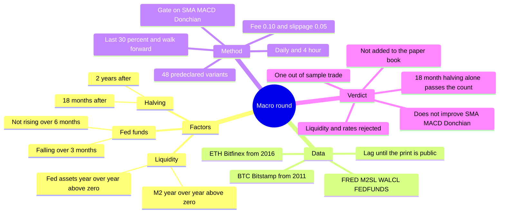

# บันทึกการทดลอง

รอบนี้ลงวันที่ 2026-11-06 ข้อมูลราคาที่ใช้จบวันที่ 2026-11-05 เพราะแท่งของวันที่ 6 พฤศจิกายนยังไม่จบวัน

ห้องนี้ตอบคำถามเดียว: กติกาที่คนมักบอกว่าใช้ได้กับคริปโต ถ้าเอาไปเดินบนราคาจริงในอดีต แล้วหักค่าธรรมเนียมกับ slippage แล้ว ได้เงินมากกว่าการซื้อครั้งเดียวแล้วถือไว้หรือไม่

คำตอบสั้น ๆ ของรอบแรกอยู่ด้านล่าง ส่วนคำอธิบายคำศัพท์และการรันโปรแกรมอยู่ใน [README.md](README.md)

นี่ไม่ใช่คำแนะนำให้ซื้อหรือขายของจริง ไม่มีการเชื่อมต่อบัญชีเทรด

## คำตอบรอบนี้แบบไม่หมกเม็ด

เงินเริ่มสมมติก้อนละ 10,000 ดอลลาร์ ซื้อได้อย่างเดียว ขายแล้วถือเงินสดได้ ไม่มีการขายชอร์ต

**กติกาเดียวที่กำไรรวมสูงกว่าซื้อแล้วถือ ทั้งช่วง 30% ท้าย และแบบ walk-forward บนทั้ง BTC และ ETH** คือ "ถือเมื่อราคาปิดอยู่เหนือเส้นค่าเฉลี่ย 200 วัน"

ตัวเลขเงินปลายทางของกติกานี้ ถ้าเริ่ม 10,000 ดอลลาร์

| ช่วง | BTC เส้น 200 วัน | BTC ซื้อแล้วถือ | ETH เส้น 200 วัน | ETH ซื้อแล้วถือ |
|---|---:|---:|---:|---:|
| ทั้งช่วง ด้วยค่ามาตรฐาน | ประมาณ 140 ล้าน | ประมาณ 64.0 ล้าน | ประมาณ 5.57 ล้าน | ประมาณ 2.02 ล้าน |
| 30% ท้าย เริ่มเงินใหม่ | ประมาณ 31,300 | ประมาณ 18,400 | ประมาณ 17,100 | ประมาณ 13,500 |
| Walk-forward เริ่มเงินใหม่หลัง 2 ปีแรก | สูงกว่าซื้อแล้วถือ | ตัวเทียบของช่วงเดียวกัน | สูงกว่าซื้อแล้วถือ | ตัวเทียบของช่วงเดียวกัน |

ช่วง 30% ท้ายของ BTC คือ 2022-04-13 ถึง 2026-11-05 ซื้อแล้วถือได้ +84.3% เส้น 200 วันได้ +213.4% ของ ETH คือ 2023-08-27 ถึง 2026-11-05 ซื้อแล้วถือได้ +34.7% เส้น 200 วันได้ +70.7%

แม้เส้นนี้จะชนะเรื่องเงินปลายทาง การขาดทุนจากจุดสูงสุดก็ยังโหด: ประมาณ −71% บน BTC ทั้งช่วง และประมาณ −81% บน ETH ทั้งช่วง ซื้อแล้วถือเจ็บกว่านั้น (ประมาณ −85% และ −94%) แต่ "เจ็บน้อยลง" ไม่ได้แปลว่า "ไม่เจ็บ" เงินที่เคยขึ้นไปแล้วยังหายไปได้ราวเจ็ดในสิบส่วน

กลยุทธ์ที่คนเล่าว่าซื้อตอนถูกและขายตอนแพง ไม่รอด

- RSI 14 ซื้อต่ำกว่า 30 ขายเหนือ 70: BTC ทั้งช่วงเงินกลายเป็นประมาณ 49,000 ดอลลาร์ ขณะที่ซื้อแล้วถือกลายเป็นประมาณ 64 ล้าน ETH กลายเป็นประมาณ 15,000 ดอลลาร์ ขณะที่ซื้อแล้วถือกลายเป็นประมาณ 2 ล้าน ช่วงท้ายทั้งสองเหรียญติดลบ
- โบลลินเจอร์ ซื้อขอบล่าง ขายเส้นกลาง: ขาดทุนทั้งช่วงทั้งสองเหรียญ BTC เหลือประมาณ 7,700 ดอลลาร์ ETH เหลือประมาณ 3,700 ดอลลาร์

กลยุทธ์ตามเทรนด์ตัวอื่นดูสวยเมื่อกวาดตาดูทั้งประวัติ แต่พอไม่ให้มันใช้ช่วงท้ายในการอวด หลายตัวไม่ชนะซื้อแล้วถือเรื่องกำไรรวม โดยเฉพาะดอนเชียนที่ทั้งช่วงของ BTC เงินโตมากที่สุดในห้องนี้ แต่ช่วง 30% ท้ายและ walk-forward ของ BTC กำไรรวมไม่ชนะซื้อแล้วถือ

MACD ชนะ walk-forward ทั้งสองเหรียญ แต่แพ้ช่วง 30% ท้ายด้วยค่าตามตำรา และถ้ายกค่าธรรมเนียมเป็น 0.50% ต่อครั้ง กำไรทั้งช่วงของ MACD ตกไปต่ำกว่าซื้อแล้วถือทั้ง BTC และ ETH เพราะมันซื้อขายบ่อย (BTC 183 ครั้ง, ETH 141 ครั้ง) เส้น 200 วันยังชนะช่วง 30% ท้ายแม้ค่าธรรมเนียมจะเป็น 0.50% (BTC +174% เทียบกับซื้อแล้วถือ +84%, ETH +57% เทียบกับ +34%) ตัวเลขค่าธรรมเนียม 0.50% ของช่วงท้ายนี้คำนวณจากเครื่องเดียวกันนอกตารางหลัก ตารางหลักด้านล่างเทียบค่าธรรมเนียมบนทั้งช่วง

DCA ทยอยซื้อ 52 สัปดาห์แล้วถือ ไม่ใช่สูตรวิเศษ มันชนะก้อนใหญ่เฉพาะตอนที่ปีแรกของช่วงนั้นเป็นปีราคาลง เช่น BTC ช่วงปลายปี 2011 และช่วงที่เริ่มเมษายน 2022 บน ETH ช่วงท้ายมันแพ้ และถ้า walk-forward สั่งให้เริ่มทยอยซื้อใหม่ทุกปี มันแพ้ซื้อแล้วถือชัดทั้งสองเหรียญ

## กติกาที่ใช้ร่วมกันทุกการทดลอง

- สัญญาณของวันหนึ่งใช้ได้แค่ราคาถึงปิดของวันนั้น ส่งคำสั่งที่ราคาเปิดวันถัดไป จึงไม่มี look-ahead
- ค่าธรรมเนียม 0.10% ต่อการซื้อและต่อการขาย slippage 0.05% ที่ทำให้ราคาที่ได้แย่ลง เว้นแต่แถวที่เขียนว่าลองค่าธรรมเนียมอื่น
- เงินสดได้ดอกเบี้ย 0%
- พารามิเตอร์มาตรฐานเอามาจากตำรา ไม่ได้จ้องหาค่าที่สวยที่สุดบนข้อมูลนี้ก่อน
- แถว "เลือกพารามิเตอร์จากข้อมูลชุดเดียวกัน" คือตัวอย่างของ overfitting ตัวเลขแถวนั้นถูกเลือกเพราะมันดูดีบนช่วงเดียวกัน ห้ามถือเป็นผลที่คาดหวังได้
- แถว walk-forward เลือกค่าจาก 2 ปีก่อนหน้า แล้วใช้ค่านั้นเทรดปีถัดไปเท่านั้น รายชื่อค่าที่ถูกเลือกแต่ละปีอยู่ใน `results/folds.csv` ค่ากระโดดไปมาหลายแบบ แปลว่า "ค่าที่ดีที่สุด" ไม่ได้เสถียร
- แต่ละแถวเริ่มด้วยเงินสด 10,000 ดอลลาร์ใหม่ ไม่ได้สะสมจากแถวก่อน
- กราฟเส้นเงินอยู่ที่ `results/charts/` ชื่อไฟล์เป็นภาษาอังกฤษตามรหัสกลยุทธ์

อัตราชนะใช้ระวัง เส้น 200 วันบน BTC ชนะแค่ประมาณ 27% ของรอบเทรด แต่ได้เงินเยอะ เพราะรอบที่ถูกทางได้กำไรก้อนใหญ่ RSI ชนะราว 68% ของรอบ แต่ได้เงินน้อยมาก DCA ขึ้นอัตราชนะ 100% เพราะตีราคาทุกไม้ด้วยราคาปิดวันสุดท้ายซึ่งสูงกว่าราคาซื้อในอดีตมาก ไม่ได้แปลว่าทุกไม้ชนะการซื้อครั้งเดียว

## ข้อมูล

แบ็กเทสต์ใช้แท่งเทียนจริงเท่านั้น

- BTC จาก Bitstamp รายวัน 2011-08-18 ถึง 2026-11-05 จำนวน 5,559 วัน ไม่มีวันที่ขาด ราคาปิดวันสุดท้ายประมาณ 75,971 ดอลลาร์
- ETH จาก Bitfinex รายวัน 2016-03-09 ถึง 2026-11-05 จำนวน 3,887 วัน ขาด 2016-08-03 ถึง 2016-08-09 เพราะกระดานหยุดเทรดหลังถูกแฮก ไม่ได้เติมราคา ราคาปิดวันสุดท้ายประมาณ 2,238 ดอลลาร์

ราคาอ้างอิงก่อนหน้านั้นมีเก็บไว้แต่ไม่ใส่ในแบ็กเทสต์: BTC ตั้งแต่ 2010-07-18 และ ETH ตั้งแต่ 2015-08-08 จาก Coin Metrics เป็นราคาเดียวต่อวัน ไม่มีสูงสุดต่ำสุดจริง ก่อนกลางปี 2010 ไม่มีชุดรายวันที่น่าเชื่อถือพอ

เอาไปเทียบ Yahoo แล้วราคาปิดห่างกันแค่ประมาณ 0.1% (ค่ามัธยฐาน) และผลตอบแทนรายวันสัมพันธ์กันราว 0.99 ETH เทียบกับ Coinbase แล้วก็อยู่ในระดับเดียวกัน รายละเอียดอยู่ใน [data/QUALITY.md](data/QUALITY.md)

ไม่ได้ใช้ Kraken เป็นแหล่งหลัก เพราะ API สาธารณะส่งย้อนหลังได้แค่ประมาณสองปี ไม่ได้ใช้ Binance เพราะเครือข่ายนี้ถูกปฏิเสธ และไม่ได้ใช้แหล่งที่ต้องมี API key

## การทดลองที่ 1 — เส้นค่าเฉลี่ย 50 วันตัด 200 วัน

- รหัส: `sma_cross`
- วันที่ทดสอบ: 2026-11-06
- สมมติฐาน: เมื่อเส้นสั้นตัดขึ้นเหนือเส้นยาว ให้ถือ และเมื่อตัดลงให้ถือเงินสด คนเรียกจังหวะตัดขึ้นว่า Golden Cross และเล่าว่าเป็นสัญญาณตลาดกระทิงระยะยาว
- ที่มา: คำจำกัดความ Golden Cross ของ Investopedia ที่ https://www.investopedia.com/terms/g/goldencross.asp ข่าวและบทวิเคราะห์บิตคอยน์มักยกคู่ 50 กับ 200 วันนี้ซ้ำ ๆ
- พารามิเตอร์มาตรฐาน: เส้นเร็ว 50 วัน เส้นช้า 200 วัน ถือเมื่อเส้นเร็วสูงกว่าเส้นช้า
- กราฟ: `results/charts/btc_sma_cross_full.png`, `results/charts/btc_sma_cross_oos.png`, `results/charts/eth_sma_cross_full.png`, `results/charts/eth_sma_cross_oos.png` และไฟล์ `*_walkforward.png` คู่กัน

ผลเทียบซื้อแล้วถือ เรื่องกำไรรวม

- BTC ทั้งช่วง: ชนะ เงินจบประมาณ 86.8 ล้าน เทียบกับ 64.0 ล้าน ขาดทุนสูงสุดประมาณ −78% เทียบกับ −85% Sharpe สูงกว่านิดหนึ่ง
- BTC 30% ท้าย: ไม่ชนะเรื่องกำไร (+79% เทียบกับ +84%) Sharpe สูงกว่านิดหนึ่ง และขาดทุนจากจุดสูงสุดเบากว่า (−40% เทียบกับ −62%)
- BTC walk-forward: ไม่ชนะทั้งกำไรและ Sharpe
- ETH ทั้งช่วง: ไม่ชนะเรื่องกำไร (ประมาณ 1.58 ล้าน เทียบกับ 2.02 ล้าน) แต่ Sharpe สูงกว่านิดและ drawdown เบากว่า
- ETH 30% ท้าย: ขาดทุนประมาณ −11% ขณะที่ซื้อแล้วถือได้ +35%
- ETH walk-forward: ชนะทั้งกำไรและ Sharpe

ข้อสรุป: กติกา Golden Cross ไม่ได้แย่แบบ RSI แต่มันไม่ได้ชนะซื้อแล้วถืออย่างสม่ำเสมอ พอออกจากช่วงที่บิตคอยน์วิ่งยาว ๆ กำไรรวมมักไม่ชนะ ตัวเลขในตัวอย่างที่จูนแล้วดูดีขึ้น เช่น ETH เลือกคู่ 20/150 แล้วทั้งช่วงต้นและช่วงท้ายดูดีกว่าค่า 50/200 แต่ค่าที่ walk-forward เลือกบน BTC กระโดดถึง 7 แบบใน 14 ปี อย่าจำคู่เลขจากช่วงที่มันเพิ่งโชคดี

ความคิดถัดไปของกติกานี้: ยังไม่ควรจูนเลขต่อ ให้ไปดูเส้น 200 วันแบบเส้นเดียวในการทดลองที่ 2 ก่อน เพราะอันนั้นเสถียรกว่า

## การทดลองที่ 2 — ถือเมื่อราคาปิดอยู่เหนือเส้น 200 วัน

- รหัส: `sma_filter`
- วันที่ทดสอบ: 2026-11-06
- สมมติฐาน: ถ้าราคาปิดวันนี้ยังอยู่เหนือค่าเฉลี่ย 200 วัน ให้ถือทั้งก้อน พรุ่งนี้เปิดตลาดค่อยปรับ ถ้าหลุดเส้นให้ไปถือเงินสด คนเล่าว่าวิธีนี้หนีตลาดหมีได้และยังได้ของขาขึ้น
- ที่มา: แนวคิดต้นทางคือ Meb Faber, "A Quantitative Approach to Tactical Asset Allocation" (2007, ปรับปรุง 2013) ซึ่งใช้เส้นค่าเฉลี่ยประมาณ 10 เดือนเพื่อออกจากสินทรัพย์เสี่ยงในตลาดแบบดั้งเดิม ไม่ได้ทดสอบบิตคอยน์ ชุมชนคริปโตเอามาเล่าเป็นเส้น 200 วันบนกราฟรายวัน ซึ่งเป็นคนละการทดลองกับเปเปอร์นั้น
- พารามิเตอร์มาตรฐาน: หน้าต่าง 200 วัน
- กราฟที่ควรดูก่อนเพื่อน: `results/charts/btc_sma_filter_oos.png` และ `results/charts/eth_sma_filter_oos.png` ช่วงที่เส้นกลยุทธ์นอนราบคือช่วงที่หลบไปถือเงินสด

ผลเทียบซื้อแล้วถือ เรื่องกำไรรวม ด้วยค่า 200 วันตามที่คนเล่า ไม่ได้จูน

- BTC ทั้งช่วง: ชนะ เงินจบประมาณ 140 ล้าน เทียบกับ 64 ล้าน ถือเหรียญอยู่ราว 61% ของวัน เทรด 49 ครั้ง อัตราชนะแค่ประมาณ 27% ขาดทุนสูงสุดประมาณ −71% เทียบกับ −85% Sharpe 1.33 เทียบกับ 1.12
- BTC 30% ท้าย: ชนะ +213% เทียบกับ +84% ขาดทุนสูงสุดประมาณ −32% เทียบกับ −62%
- BTC walk-forward: ชนะทั้งกำไรและ Sharpe
- ETH ทั้งช่วง: ชนะ เงินจบประมาณ 5.57 ล้าน เทียบกับ 2.02 ล้าน ถืออยู่ราว 53% ของวัน เทรด 31 ครั้ง อัตราชนะประมาณ 29% ขาดทุนสูงสุดประมาณ −81% เทียบกับ −94%
- ETH 30% ท้าย: ชนะ +71% เทียบกับ +35% ขาดทุนสูงสุดประมาณ −39% เทียบกับ −68%
- ETH walk-forward: ชนะทั้งกำไรและ Sharpe

ลองขยับค่าธรรมเนียมทั้งช่วงเป็น 0.50% เส้นนี้ยังได้เงินมากกว่าซื้อแล้วถือทั้งสองเหรียญ ช่วง 30% ท้ายที่ค่าธรรมเนียม 0.50% ก็ยังชนะ (BTC +174% เทียบ +84%, ETH +57% เทียบ +34%)

การจูนหน้าต่างบน 70% แรกของ BTC เลือก 100 วัน เพราะ Sharpe ในช่วงนั้นสูงกว่า แต่พอเอา 100 วันไปใช้ช่วงท้าย ได้ +159% ซึ่งยังชนะซื้อแล้วถือ แต่แพ้ค่ามาตรฐาน 200 วันที่ได้ +213% นี่คือตัวอย่างว่า "ค่าที่ดูดีที่สุดในอดีต" ไม่ได้แปลว่าดีที่สุดช่วงถัดไป บน ETH ค่า 200 วันชนะการจูนอยู่แล้ว จึงไม่ได้เปลี่ยน

ข้อสรุป: ในชุดข้อมูลนี้และกติกาชุดนี้ เส้น 200 วันเป็นตัวที่ซื่อสัตย์ที่สุด มันชนะซื้อแล้วถือเรื่องกำไรรวมในทุกช่องทางตรวจที่ตั้งใจกันหลอกตัวเอง ทั้งสองเหรียญ และยังพอง่ายกับค่าธรรมเนียมน้อยกว่า MACD มันไม่ได้ลบความเสี่ยง ก้อนเงินยังวูบได้เกินครึ่งจากจุดสูงสุด และอัตราชนะต่ำเพราะมีสัญญาณหลอกตอนราคาแกว่งคร่อมเส้น

ความคิดถัดไป: ตรวจสัญญาณนี้แค่สัปดาห์ละครั้ง ดูว่าลดการซื้อขายรอบเส้นแล้ว ชัยชนะช่วงท้ายกับ walk-forward ยังอยู่ไหม รายละเอียดอยู่ใน `NEXT_STEPS`

## การทดลองที่ 3 — RSI 14 ซื้อเมื่อต่ำกว่า 30 ขายเมื่อสูงกว่า 70

- รหัส: `rsi`
- วันที่ทดสอบ: 2026-11-06
- สมมติฐาน: RSI ต่ำกว่า 30 แปลว่าถูกเกินไป ให้ซื้อ RSI สูงกว่า 70 แปลว่าแพงเกินไป ให้ขาย แล้วราคาน่าจะเด้งกลับ
- ที่มา: J. Welles Wilder Jr., New Concepts in Technical Trading Systems (1978) กำหนด RSI คาบ 14 และระดับ 30/70 Investopedia สรุปไว้ที่ https://www.investopedia.com/terms/r/rsi.asp บทเรียนของกระดานเทรดคริปโตมักยกกติกานี้ไปใช้กับเหรียญโดยตรง
- พารามิเตอร์มาตรฐาน: คาบ 14, ซื้อเมื่อต่ำกว่า 30, ขายเมื่อสูงกว่า 70 ถือสถานะค้างไว้ระหว่างนั้น
- กราฟ: `results/charts/btc_rsi_full.png` และ `results/charts/eth_rsi_full.png` เส้นกลยุทธ์จะอยู่ต่ำกว่าเส้นซื้อแล้วถือมากบนมาตราส่วนล็อก

ผลเทียบซื้อแล้วถือ เรื่องกำไรรวม

- BTC ทั้งช่วง: แพ้ย่อยยับ เงินจบประมาณ 49,000 ดอลลาร์ ไม่ใช่หลักล้าน ช่วงท้ายติดลบประมาณ −12% ขณะที่ซื้อแล้วถือได้ +84%
- ETH ทั้งช่วง: เงินจบประมาณ 15,000 ดอลลาร์ เทียบกับประมาณ 2 ล้าน ช่วงท้ายติดลบประมาณ −28%
- Walk-forward ทั้งสองเหรียญก็แพ้ การจูนคาบและระดับ 30/70 บนช่วงต้นของทั้งสองเหรียญก็เลือกกลับมาที่ค่ามาตรฐานอยู่ดี แล้วช่วงท้ายก็ยังแพ้

อัตราชนะดูสูง (BTC ประมาณ 68%, ETH ประมาณ 71%) เพราะรอบเด้งสั้น ๆ มักเขียว แต่รอบที่ราคาลงต่อโดยที่ RSI ยังไม่ถึง 70 จะถือของตอนตลาดตก และพอขายก็พลาดขาขึ้นยาว ๆ ที่เป็นเนื้อของบิตคอยน์

ข้อสรุป: คำกล่าว "RSI ต่ำกว่า 30 คือของถูก" ใช้ไม่ได้กับ BTC และ ETH ในประวัตินี้ อย่างน้อยในกติกาซื้อต่ำกว่า 30 ขายเหนือ 70 แบบยาวทั้งก้อน มันไม่ใช่แค่แพ้นิดหน่อย มันพลาดการโตเกือบทั้งหมด

ความคิดถัดไป: ไม่ควรเอาเวลาไปจูนเลข RSI ในรอบหน้า ถ้าวันหนึ่งจะลองอีกครั้ง ให้ลองได้แค่ตอนที่ราคาอยู่เหนือเส้น 200 วันพร้อมกัน และต้องดูช่วงท้ายกับ walk-forward ไม่ใช่ดูทั้งช่วงอย่างเดียว

## การทดลองที่ 4 — MACD 12/26/9

- รหัส: `macd`
- วันที่ทดสอบ: 2026-11-06
- สมมติฐาน: เมื่อเส้น MACD อยู่เหนือเส้นสัญญาณ ให้ถือ เมื่อหลุดให้ถือเงินสด เป็นเครื่องมือตามเทรนด์ที่พบได้แทบทุกหน้าจอกราฟ
- ที่มา: Gerald Appel เป็นผู้เสนอ MACD ค่า 12, 26 และ 9 เป็นค่าปริยายที่ Investopedia อธิบายไว้ที่ https://www.investopedia.com/terms/m/macd.asp และเป็นค่าเริ่มต้นบนเครื่องมือกราฟยอดนิยม
- พารามิเตอร์มาตรฐาน: 12, 26, 9 เริ่มเทรดได้หลังจากเส้นช้ายและเส้นสัญญาณมีข้อมูลพอก่อน เพราะค่า EMA ช่วงแรกยังเป็นแค่เมล็ด ไม่น่าเชื่อ
- กราฟ: `results/charts/btc_macd_full.png`, `results/charts/eth_macd_oos.png` และไฟล์ walk-forward

ผลเทียบซื้อแล้วถือ เรื่องกำไรรวม ด้วยค่ามาตรฐาน

- BTC ทั้งช่วง: ชนะ เงินจบประมาณ 104 ล้าน เทียบกับ 64 ล้าน แต่เทรด 183 ครั้ง
- BTC 30% ท้าย: ไม่ชนะ +67% เทียบกับ +84%
- BTC walk-forward: ชนะทั้งกำไรและ Sharpe และการขาดทุนสูงสุดเบากว่าซื้อแล้วถือชัด (ประมาณ −54% เทียบกับ −85% ในหน้าต่าง walk-forward)
- ETH ทั้งช่วง: ชนะ เงินจบประมาณ 2.44 ล้าน เทียบกับ 2.02 ล้าน เทรด 141 ครั้ง
- ETH 30% ท้าย: ขาดทุนเล็กน้อยประมาณ −3% เทียบกับซื้อแล้วถือ +35%
- ETH walk-forward: ชนะชัด

พอขึ้นค่าธรรมเนียมเป็น 0.50% ต่อครั้ง กำไรทั้งช่วงของ MACD ตกต่ำกว่าซื้อแล้วถือทั้ง BTC (เหลือโตน้อยกว่าตัวเทียบมาก) และ ETH ช่วง 30% ท้ายของ BTC ที่ค่าธรรมเนียม 0.50% เหลือประมาณ +0.5% เทียบกับซื้อแล้วถือที่ยังได้ราว +84%

การจูนบนช่วงต้นของ BTC เลือก slow = 21 แทน 26 แล้วช่วงท้ายแย่กว่าค่ามาตรฐาน (ประมาณ +59% เทียบกับ +67% และทั้งคู่แพ้ซื้อแล้วถือ) เป็น overfitting ขนาดเล็ก แต่ทิศทางชัดว่าการจูนไม่ได้ช่วยช่วงที่ยังไม่เห็น

ข้อสรุป: MACD มีเคสให้พูดถึงในการทดสอบแบบเลื่อนหน้าต่าง และมันช่วยลดการเจ็บตัวในบางหน้าต่าง แต่ชัยชนะไม่ปรากฏในช่วงปีล่าสุด และมันซื้อขายบ่อยจนค่าธรรมเนียมกินขอบไปได้ อย่าสรุปว่า MACD "ใช้ได้" จากกราฟทั้งช่วงอย่างเดียว

ความคิดถัดไป: ถ้าจะแตะ MACD อีกครั้ง ให้ใส่ตัวกรอง "ซื้อได้เฉพาะเมื่อราคาอยู่เหนือเส้น 200 วัน" เพื่อตัดจำนวนเทรด แล้วย้อนดูว่า walk-forward ยังชนะอยู่ไหมเมื่อค่าธรรมเนียมเป็น 0.50% ยังไม่ใช่งานรอบถัดไป รอบถัดไปให้โฟกัสเส้น 200 วันก่อน

## การทดลองที่ 5 — โบลลินเจอร์แบนด์ ซื้อขอบล่าง ขายเส้นกลาง

- รหัส: `bollinger`
- วันที่ทดสอบ: 2026-11-06
- สมมติฐาน: ราคาที่หลุดขอบล่างของแถบ "ถูกผิดปกติ" น่าจะกลับเข้าหาค่าเฉลี่ย จึงซื้อ แล้วขายเมื่อกลับขึ้นไปเหนือเส้นกลาง
- ที่มา: แถบ 20 วัน กว้าง 2 เท่าของส่วนเบี่ยงเบนมาตรฐาน มาจาก John Bollinger อธิบายสูตรได้ที่ https://www.investopedia.com/terms/b/bollingerbands.asp Bollinger ไม่ได้การันตีว่าซื้อที่ขอบล่างแล้วจะกำไร กติกาที่ทดสอบนี้เป็นกติกาที่นักเทรดรายย่อยเล่าต่อกัน
- พารามิเตอร์มาตรฐาน: 20 วัน, กว้าง 2 เท่า, ใช้ส่วนเบี่ยงเบนแบบหารด้วยจำนวนวัน
- กราฟ: `results/charts/btc_bollinger_full.png` และ `results/charts/eth_bollinger_full.png`

ผลเทียบซื้อแล้วถือ เรื่องกำไรรวม

- BTC ทั้งช่วง: ขาดทุนประมาณ −23% เงินเหลือราว 7,700 ดอลลาร์ จาก 10,000 ในขณะที่ซื้อแล้วถือกลายเป็นหลักสิบล้าน ถือเหรียญแค่ราว 23% ของวัน เพราะส่วนใหญ่รอจังหวะเด้ง
- BTC 30% ท้าย: แทบไม่ไปไหน ประมาณ +2% เทียบกับ +84%
- ETH ทั้งช่วง: ขาดทุนประมาณ −63% ช่วงท้ายขาดทุนประมาณ −37%
- Walk-forward ทั้งสองเหรียญก็แพ้ ETH walk-forward เหลือเงินราวหนึ่งในห้าของตอนเริ่มหน้าต่าง

การจูนทำให้เห็น overfitting ชัดบน ETH: ค่าที่ Sharpe ช่วงต้นดีที่สุดคือหน้าต่าง 40 วัน กว้าง 1.5 เท่า ช่วงต้นก็ยังขาดทุน และช่วงท้ายขาดทุนหนักกว่าค่ามาตรฐาน (−74% เทียบกับ −37% ของค่ามาตรฐาน ซึ่งก็แพ้อยู่แล้ว) บน BTC การจูนทำให้ช่วงต้นดูเหมือนได้ +253% ซึ่งฟังดูดี ถ้าไม่บอกว่าซื้อแล้วถือช่วงเดียวกันได้เป็นแสนเปอร์เซ็นต์ และช่วงท้ายค่าที่จูนแล้วก็ยังได้แค่ราว +30% เทียบกับซื้อแล้วถือ +84%

ข้อสรุป: การซื้อขอบล่างโบลลินเจอร์แล้วหวังให้กลับเส้นกลาง ใช้ไม่ได้กับประวัติ BTC และ ETH ชุดนี้ มันต่อสู้กับเทรนด์ระยะยาวแล้วแพ้ ตัวเลขที่ดูดีขึ้นหลังจูนก็ยังแพ้ซื้อแล้วถือ และบางค่าแย่ลงอีกตอนออกจากตัวอย่าง

ความคิดถัดไป: เลิกไล่กติกา mean-reversion นี้ในการทดลองรอบหน้า

## การทดลองที่ 6 — ทะลุกรอบดอนเชียน เข้า 20 วัน ออก 10 วัน

- รหัส: `donchian`
- วันที่ทดสอบ: 2026-11-06
- สมมติฐาน: ซื้อเมื่อราคาปิดทะลุจุดสูงสุดของ 20 วันก่อนหน้า (ไม่นับแท่งวันนี้) และขายเมื่อราคาปิดหลุดจุดต่ำสุดของ 10 วันก่อนหน้า เป็นการตามเทรนด์เมื่อราคาทำจุดสูงสุดใหม่
- ที่มา: ช่องราคาของ Richard Donchian กติกาเข้า 20 ออก 10 คือระบบที่ 1 ของกลุ่มเต่าที่ Richard Dennis สอนช่วงปี 1983 เล่าไว้ใน Curtis Faith, Way of the Turtle (2007) และในเอกสารกติกาเต่าที่เผยแพร่ต่อสาธารณะ บทความตามเทรนด์ในคริปโตมักยกช่องนี้มาใช้กับบิตคอยน์ คำอธิบายช่องราคา: https://www.investopedia.com/terms/d/donchianchannels.asp
- พารามิเตอร์มาตรฐาน: เข้า 20 วัน ออก 10 วัน ช่องคำนวณจากวันก่อนหน้าเท่านั้น กันไม่ให้ไส้เทียนวันนี้แอบเป็นทั้งสัญญาณและประตู
- กราฟ: `results/charts/btc_donchian_full.png` และ `results/charts/eth_donchian_oos.png`

ผลเทียบซื้อแล้วถือ เรื่องกำไรรวม ด้วยค่ามาตรฐาน

- BTC ทั้งช่วง: ชนะมากที่สุดในห้องนี้ เงินจบประมาณ 176 ล้าน เทียบกับ 64 ล้าน Sharpe 1.46 เทียบกับ 1.12 ขาดทุนสูงสุดประมาณ −70% เทียบกับ −85% เทรด 66 ครั้ง ถืออยู่ราว 48% ของวัน
- BTC 30% ท้าย: ไม่ชนะ +69% เทียบกับ +84% Sharpe แทบเสมอกัน
- BTC walk-forward: ไม่ชนะเรื่องกำไร รวมทั้งที่ Sharpe ของหน้าต่างนั้นสูงกว่าซื้อแล้วถือ การจูนช่วงต้นก็เลือกคู่ 20/10 กลับมาอยู่ดี แล้วช่วงท้ายก็ยังแพ้
- ETH ทั้งช่วง: ชนะ เงินจบประมาณ 3.73 ล้าน เทียบกับ 2.02 ล้าน ขาดทุนสูงสุดประมาณ −67% เทียบกับ −94%
- ETH 30% ท้าย: ขาดทุนประมาณ −23% เทียบกับซื้อแล้วถือ +35%
- ETH walk-forward: ชนะทั้งกำไรและ Sharpe

ค่าธรรมเนียม 0.50% ยังไม่ทำให้ชัยชนะทั้งช่วงของ BTC พัง (ยังโตกว่าซื้อแล้วถือ) แต่ช่วงท้ายก็ยิ่งแพ้เข้าไปอีก

ข้อสรุป: ดอนเชียนคือตัวอย่างที่อันตรายที่สุดของการดูกราฟทั้งก้อนแล้วหลงเชื่อ บน BTC ทั้งช่วงมันดูเหมือนแชมป์ เพราะไปเจอขาขึ้นใหญ่ ๆ หลังเบรกเอาต์ แต่ช่วงปีหลัง ๆ และ walk-forward ของ BTC ไม่ได้ให้กำไรรวมเกินซื้อแล้วถือ ของ ETH ช่วงท้ายก็ขาดทุน ชัยชนะ walk-forward ของ ETH อย่างเดียวยังไม่พอให้สรุปว่ากติกาเต่าใช้ได้กับคริปโตทั่วไป

ความคิดถัดไป: ถ้าจะกลับมาที่ดอนเชียน ลองอนุญาตให้ซื้อก็ต่อเมื่อราคาปิดอยู่เหนือเส้น 200 วันด้วย แล้วดูช่วงท้ายของทั้งสองเหรียญเป็นตัวตัดสิน ไม่ใช่ดูเงินทั้งช่วง

## การทดลองที่ 7 — ทยอยซื้อทุกสัปดาห์ครบ 1 ปี แล้วถือ

- รหัส: `dca_weekly`
- วันที่ทดสอบ: 2026-11-06
- สมมติฐาน: คนมักบอกว่าอย่าลงเงินก้อนเดียว ให้ทยอยซื้อทีละนิดจะได้ราคาเฉลี่ยดีกว่าและปลอดภัยกว่า ที่ทดสอบนี้คือมีเงินก้อนอยู่แล้ว 10,000 ดอลลาร์ แล้วแบ่งซื้อเท่า ๆ กัน 52 สัปดาห์ จากนั้นถือสิ่งที่ซื้อไว้จนจบช่วง ไม่ใช่การเอาเงินเดือนใหม่มาซื้อทุกเดือน ซึ่งเป็นคนละคำถาม
- ที่มาของคำเล่า: บทเรียน DCA ของกระดานเทรดและกลุ่มคริปโตภาษาไทยพูดแบบนี้บ่อยมาก ที่มาของคำเตือนฝั่งตรงข้าม: งานของ Vanguard ชื่อ "Dollar-cost averaging just means taking risk later" (Anatoly Shtekhman, Christos Tasopoulos, Brian Wimmer, 2012) พบว่าในตลาดหุ้นและพันธบัตรแบบดั้งเดิม การลงทุนก้อนเดียวชนะการทยอยซื้อประมาณสองในสามของช่วงเวลา เปเปอร์นั้นไม่ได้ศึกษาบิตคอยน์
- พารามิเตอร์มาตรฐาน: 52 ไม้ ห่างกัน 7 แท่ง ไม้แรกซื้อที่ราคาเปิดวันถัดจากวันแรกของช่วง ให้เสมอกับจังหวะที่กลยุทธ์สัญญาณได้รับอนุญาตให้ซื้อไม้แรก
- กราฟ: `results/charts/btc_dca_weekly_full.png` และ `results/charts/eth_dca_weekly_oos.png`

ผลเทียบซื้อแล้วถือ เรื่องกำไรรวม

- BTC ทั้งช่วง: ชนะ เงินจบประมาณ 156 ล้าน เทียบกับ 64 ล้าน สาเหตุที่ตรวจจากราคาจริงคือปีแรกเริ่มที่ราคาปิดประมาณ 10.9 ดอลลาร์ในวันที่ 2011-08-18 แล้วไต่ลงไปต่ำสุดราว 2.2 ดอลลาร์ก่อนจะกลับมาแถว 11 ดอลลาร์ในอีกหนึ่งปี การทยอยซื้อจึงเก็บของตอนถูกกว่าการซื้อครั้งเดียวที่จุดเริ่ม หลังจากนั้นก็ถือคล้ายซื้อแล้วถือ จึงเจ็บตัวจากจุดสูงสุดพอ ๆ กัน (ประมาณ −85%)
- BTC 30% ท้ายที่เริ่ม 2022-04-13: ชนะ +246% เทียบกับ +84% ปีแรกของหน้าต่างนี้ราคาปิดวันแรกราว 41,000 ดอลลาร์ แล้วลงไปราว 16,000 ดอลลาร์ การทยอยซื้อจึงได้ของถูกกว่าก้อนเดียวอีกครั้ง เป็นของช่วงนี้ ไม่ใช่กฎทั่วไป
- ETH ทั้งช่วง: ชนะบนกระดาษแบบเฉียดกันมาก เงินจบประมาณ 2.023 ล้าน เทียบกับ 2.018 ล้าน ถือว่าเสมอในทางปฏิบัติ ปีแรกของ ETH จากประมาณ 11 ดอลลาร์ลงไปราว 7 ดอลลาร์แล้วไปจบปีราว 18 ดอลลาร์ ผลเลยแทบไม่ต่างจากการซื้อครั้งเดียว
- ETH 30% ท้าย: แพ้ ประมาณ −9% เทียบกับ +35% ปีแรกของหน้าต่างนี้ราคาไม่ได้ลงลึกแล้วค่อยเด้งแบบปี 2022 ของ BTC จึงไม่มีของถูกให้ทยอยเก็บ
- Walk-forward ทั้งสองเหรียญ: แพ้ชัด เพราะโปรแกรมเริ่มตารางทยอยซื้อใหม่ทุกปีทดสอบ เงินเลยได้เข้าตลาดช้าซ้ำ ๆ BTC walk-forward โตแค่หลักพันเปอร์เซ็นต์ ขณะที่ซื้อแล้วถือช่วงเดียวกันโตหลักหมื่น การจูนมักเลือกจำนวนสัปดาห์ที่สั้นลง เช่น 12 หรือ 26 สัปดาห์ ซึ่งก็คือขยับเข้าใกล้การซื้อครั้งเดียว นั่นเองคือคำใบ้ว่าในตลาดที่ขึ้นระยะยาว การทยอยซื้อคือการเลื่อนความเสี่ยงออกไป ไม่ใช่ของที่เพิ่มผลตอบแทนให้เอง

สัดส่วนวันที่ถือของ DCA โชว์ใกล้ 100% เพราะหลังจากไม้แรกก็มีเหรียญอยู่ในพอร์ตแล้ว แม้เงินก้อนจะยังทยอยเข้าไม่ครบใน 52 สัปดาห์แรก อย่าอ่านว่าเงินทั้งหมดลงตั้งแต่วันแรก

ข้อสรุป: คำว่า "DCA ดีกว่าเสมอ" ไม่จริงในห้องนี้ มันช่วยเมื่อช่วงเริ่มเป็นขาลง และเกือบไม่ต่างหรือแย่กว่าเมื่อเริ่มแล้วยังขึ้นต่อ การเริ่ม DCA ใหม่ทุกปีทำลายผลตอบแทน

ความคิดถัดไป: ไม่ต้องจูนจำนวนสัปดาห์ต่อ ถ้าจะแยกคำถาม "เอาเงินเดือนใหม่มาซื้อทุกเดือน" ต้องเขียนเครื่องจำลองคนละแบบ ที่เติมเงินสดใหม่เข้าระบบ ไม่ใช่การแบ่งก้อนเดิม

## การทดลองที่ 10 — เส้น 200 วัน ตรวจทุก 7 แท่ง

- รหัส: `sma_filter_weekly`
- วันที่ทดสอบ: 2026-11-14
- สมมติฐาน: เส้น 200 วันแบบรายวันซื้อขายบางครั้งเพราะราคาเพิ่งคร่อมเส้น ถ้าให้เปลี่ยนสถานะได้แค่ทุก 7 แท่ง โดยใช้สัญญาณของแท่งนั้น และระหว่างทางคงสถานะเดิม จำนวนเทรดควรลดลง และชัยชนะเรื่องกำไรรวมในช่วง 30% ท้ายกับ walk-forward ควรยังอยู่ทั้ง BTC และ ETH
- ที่มา: สัญญาณรายวันคือกติกาเดียวกับการทดลองที่ 2 ซึ่งชุมชนคริปโตเล่าจาก Meb Faber, "A Quantitative Approach to Tactical Asset Allocation" (2007, ปรับปรุง 2013) Faber ตรวจเป็นรายเดือนบนเส้นประมาณ 10 เดือน ไม่ได้กำหนดทุก 7 แท่งรายวัน ช่วง 7 แท่งเป็นคำถามที่การทดลองที่ 2 ทิ้งไว้ ไม่ใช่ค่าที่ค้นจากข้อมูลชุดนี้
- พารามิเตอร์: หน้าต่าง 200 วันเท่าตัวรายวัน กริดมีแค่ `{"window": 200}` จึงไม่มีอะไรให้ walk-forward เลือก ทุกโฟลด์ใน `results/folds_1d.csv` ของรหัสนี้เป็นหน้าต่าง 200 วัน แถวที่เขียนว่าเลือกพารามิเตอร์จากข้อมูลชุดเดียวกันจึงตรงกับค่ามาตรฐาน ไม่ใช่การค้นพบค่าใหม่ ค่าธรรมเนียม 0.10% slippage 0.05% เงินสดได้ดอกเบี้ย 0% ซื้อได้อย่างเดียว
- วิธีตัดสินใจ: คำนวณสัญญาณรายวันเหมือนเดิม (ถือเมื่อราคาปิดอยู่เหนือเส้น) แต่คัดลอกสัญญาณนั้นได้เฉพาะแท่งที่ลำดับในชุดราคาหารด้วย 7 ลงตัว คือแท่งที่ 0, 7, 14, ... นับจากต้นประวัติ ไม่ได้เลื่อนตามวันในปฏิทิน แท่งอื่นคงเป้าหมายล่าสุดที่คัดลอกไว้ ก่อนถึงแท่งแรกที่มีเส้นค่าเฉลี่ยและเป็นรอบ 7 เป้าหมายยังว่าง เครื่องจึงถือเงินสด สัญญาณใช้ราคาปิดของแท่งนั้นเท่านั้น แล้วไปส่งคำสั่งที่ราคาเปิดแท่งถัดไปตามเครื่องเดิม ไม่มี look-ahead ของรายวัน `sma_filter` ยังอยู่ ไม่ได้ถูกแทนที่
- ข้อมูลของรอบนี้จบวันที่ 2026-11-13 เพราะแท่งวันที่ 14 พฤศจิกายนยังไม่ปิด BTC 5,567 วันตั้งแต่ 2011-08-18 ETH 3,895 วันตั้งแต่ 2016-03-09 ช่องว่างเดือนสิงหาคม 2016 ของ ETH ยังไม่ได้เติม "ทุก 7 แท่ง" นับเป็นจำนวนแถว ไม่ใช่ 7 วันปฏิทิน ตารางด้านล่างถูกเขียนใหม่จากราคาชุดนี้ ข้อความของการทดลองที่ 1 ถึง 9 ยังเป็นรอบวันที่ 2026-11-06 ที่ข้อมูลจบวันที่ 2026-11-05 อย่าเอาเปอร์เซ็นต์สองรอบมาปนกัน
- กราฟ: `results/charts/btc_sma_filter_weekly_full.png`, `results/charts/btc_sma_filter_weekly_oos.png`, `results/charts/eth_sma_filter_weekly_oos.png` และไฟล์ `*_walkforward.png` คู่กัน

ช่วง 30% ท้ายรอบนี้ของ BTC คือ 2022-04-18 ถึง 2026-11-13 ของ ETH คือ 2023-09-02 ถึง 2026-11-13 ซื้อแล้วถือมีไม้เดียวที่ยังไม่ขาย จึงนับ 1 เทรด และอัตราชนะ 100% เพราะตีราคาไม้ที่ยังถือด้วยราคาปิดวันสุดท้ายซึ่งสูงกว่าราคาซื้อ ไม่ได้แปลว่าเป็นกติกาที่ชนะทุกทาง

| เหรียญ | ช่วง | กติกา | ผลตอบแทนรวม | ขาดทุนสูงสุด | อัตราชนะ | จำนวนเทรด |
|---|---|---|---:|---:|---:|---:|
| BTC | ทั้งช่วง | ตรวจทุก 7 แท่ง | 1606839.3% | -74.5% | 40.0% | 20 |
| BTC | ทั้งช่วง | รายวัน | 1309744.3% | -70.8% | 26.5% | 49 |
| BTC | ทั้งช่วง | ซื้อแล้วถือ | 574782.8% | -84.9% | 100% | 1 |
| BTC | 30% ท้าย | ตรวจทุก 7 แท่ง | 184.5% | -34.3% | 50.0% | 8 |
| BTC | 30% ท้าย | รายวัน | 194.0% | -32.1% | 35.3% | 17 |
| BTC | 30% ท้าย | ซื้อแล้วถือ | 66.9% | -62.0% | 100% | 1 |
| BTC | walk-forward | ตรวจทุก 7 แท่ง | 80641.8% | -74.5% | 40.0% | 20 |
| BTC | walk-forward | รายวัน | 94185.7% | -82.0% | 22.4% | 76 |
| BTC | walk-forward | ซื้อแล้วถือ | 68221.7% | -84.9% | 100% | 1 |
| ETH | ทั้งช่วง | ตรวจทุก 7 แท่ง | 34926.2% | -83.8% | 43.8% | 16 |
| ETH | ทั้งช่วง | รายวัน | 52772.0% | -80.9% | 29.0% | 31 |
| ETH | ทั้งช่วง | ซื้อแล้วถือ | 17302.5% | -93.8% | 100% | 1 |
| ETH | 30% ท้าย | ตรวจทุก 7 แท่ง | 14.2% | -59.2% | 33.3% | 6 |
| ETH | 30% ท้าย | รายวัน | 62.0% | -42.1% | 27.3% | 11 |
| ETH | 30% ท้าย | ซื้อแล้วถือ | 17.7% | -67.6% | 100% | 1 |
| ETH | walk-forward | ตรวจทุก 7 แท่ง | 648.3% | -76.7% | 40.0% | 15 |
| ETH | walk-forward | รายวัน | 410.9% | -77.2% | 28.2% | 39 |
| ETH | walk-forward | ซื้อแล้วถือ | 221.8% | -89.6% | 100% | 1 |

เทียบซื้อแล้วถือบนกรอบรายวัน ตัวที่ตรวจทุก 7 แท่งชนะทั้งช่วงทั้งสองเหรียญ ชนะ walk-forward ทั้งสองเหรียญ และชนะช่วง 30% ท้ายของ BTC (+184.5% เทียบ +66.9%) แต่แพ้ช่วง 30% ท้ายของ ETH (+14.2% เทียบ +17.7%)

เทียบตัวรายวันบนกรอบเดียวกัน ตัวรายสัปดาห์เทรดน้อยลงทุกช่อง (BTC 49 เหลือ 20 ทั้งช่วง, 17 เหลือ 8 ในช่วงท้าย, 76 เหลือ 20 ใน walk-forward; ETH 31 เหลือ 16, 11 เหลือ 6, 39 เหลือ 15) กำไรรวมชนะตัวรายวันแค่ BTC ทั้งช่วงกับ ETH walk-forward นอกนั้นแพ้ โดยเฉพาะช่วง 30% ท้ายของ ETH ที่ตัวรายวันยังได้ +62.0% การขาดทุนสูงสุดทั้งช่วงแย่ลงเล็กน้อยทั้งสองเหรียญ (BTC −74.5% เทียบ −70.8%, ETH −83.8% เทียบ −80.9%) และช่วงท้ายของ ETH เจ็บกว่าชัด (−59.2% เทียบ −42.1%) อัตราชนะสูงขึ้น แต่เงินช่วงท้ายของ ETH ไม่ได้สูงตาม

ตารางอัตโนมัติมีแถวกรอบ 4 ชั่วโมงของรหัสเดียวกันด้วย เพราะเครื่องรันทุกกติกาทั้งสองกรอบ แถวนั้นตรวจทุก 7 แท่งสี่ชั่วโมง ซึ่งยาวประมาณ 28 ชั่วโมง ไม่ใช่สัปดาห์ละครั้ง ตัวเลขเหล่านั้นไม่ใช่คำตอบของสมมติฐานนี้ และไม่ได้ถูกใช้ตัดสินว่าจะเก็บกติกานี้หรือไม่

ข้อสรุป: ไม่เก็บ `sma_filter_weekly` เป็นตัวเต็ง เงื่อนไขที่ตั้งไว้คือต้องชนะซื้อแล้วถือเรื่องกำไรรวมทั้งช่วง 30% ท้ายและ walk-forward ของทั้งสองเหรียญ พร้อมเทรดน้อยลง จำนวนเทรดลดลงจริง แต่ชัยชนะช่วงท้ายของ ETH หายไปแม้เพียงเหรียญเดียวก็พอให้กฎนี้ไม่ผ่าน ผลของตัวรายวันที่ชนะทุกช่องจึงไวต่อความถี่ในการเช็ค ยังไม่ควรเอาตัวรายสัปดาห์ไปทับกติกาอื่น และรอบนี้ยังไม่ใส่สมุดกระดาษหรือแดชบอร์ด

ความคิดถัดไป: ไปดูว่าข้อสรุปของตัวรายวันไวต่อสมมติว่าเงินสดได้ดอกเบี้ยศูนย์หรือไม่ โดยใส่ดอกเบี้ยสมมติทบต้นปีละ 4% เฉพาะวันที่ไม่ได้ถือเหรียญ ยังไม่จูนหน้าต่าง และยังไม่กลับไปไล่ RSI หรือโบลลินเจอร์

## การทดลองที่ 9 — เทียบกรอบรายวันกับกรอบ 4 ชั่วโมง

- วันที่ทดสอบ: 2026-11-06
- สมมติฐาน: กติกาชุดเดียวกันถ้าย้ายจากแท่งรายวันไปแท่ง 4 ชั่วโมง อาจจับจังหวะได้ถี่ขึ้นและชนะซื้อแล้วถือได้มากกว่า
- สิ่งที่ไม่ได้ทำ: ไม่ทดสอบกรอบ 1 ชั่วโมง แท่งสั้นทำให้เกิดสัญญาณหลอกถี่มาก และทุกครั้งที่ซื้อหรือขายเสียค่าธรรมเนียม 0.10% กับ slippage 0.05% เมื่อเทรดหลายสิบครั้งต่อสัปดาห์ ค่าใช้จ่ายนี้กินกำไรก้อนเล็ก ๆ จนตัวเลขที่ดูกำไรก่อนหักค่าธรรมเนียมกลายเป็นขาดทุนได้ง่าย
- ข้อมูล: BTC 4 ชั่วโมงจาก Bitstamp 33,355 แท่ง เริ่ม 2011-08-18 12:00 UTC, ETH จาก Bitfinex 23,306 แท่ง เริ่ม 2016-03-09 16:00 UTC ตัดแท่งที่ยังไม่ปิด
- พารามิเตอร์ยังนับเป็นจำนวนแท่ง ไม่ได้ขยายเป็นจำนวนวัน ดังนั้นเส้น 200 บนกราฟ 4 ชั่วโมงคือประมาณ 33 วัน ไม่ใช่เส้น 200 วันตัวเดิม เส้น 50/200 บนกราฟ 4 ชั่วโมงก็สั้นลงแบบเดียวกัน DCA ยังซื้อสัปดาห์ละครั้ง (ทุก 42 แท่ง) Sharpe ของกรอบ 4 ชั่วโมงถูกทำให้เทียบกันได้โดยใช้ 6 แท่งต่อวัน ไม่ได้เอาส่วนเบี่ยงเบนรายแท่งไปคูณรากของ 365 ตรง ๆ

ผลนอกตัวอย่าง 30% ท้าย เทียบซื้อแล้วถือของกรอบเดียวกัน

- รายวัน BTC: เส้น 200 วัน +213% ชนะซื้อแล้วถือ +84% และเป็นตัวที่ Sharpe ดีที่สุดในกลุ่มเทรนด์รายวัน
- 4 ชั่วโมง BTC: เส้น 200 แท่ง +134% และเส้น 50/200 แท่ง +115% ชนะซื้อแล้วถือ +84% แต่เส้น 200 แท่งเทรด 142 ครั้ง เทียบกับ 17 ครั้งของเส้นรายวัน MACD 4 ชั่วโมงขาดทุน −42% จาก 375 เทรด ดอนเชียนและโบลลินเจอร์ก็ไม่ชนะ
- รายวัน ETH: มีแค่เส้น 200 วันที่ชนะ (+71% เทียบ +35%)
- 4 ชั่วโมง ETH: เส้น 50/200 แท่ง +171% และเส้น 200 แท่ง +159% ชนะซื้อแล้วถือ +35% Sharpe สูงกว่าเส้นรายวัน แต่เทรดถี่กว่ามาก (85 ครั้งสำหรับเส้น 200 แท่ง เทียบกับ 11 ครั้งรายวัน)

สมุดกระดาษรันตามนาฬิกา 4 ชั่วโมง กลยุทธ์ที่ติดป้ายรายวันเปลี่ยนสถานะได้เฉพาะหลังแท่งวันปิด แล้วไปส่งคำสั่งที่ราคาเปิดของแท่ง 4 ชั่วโมงถัดไป ระหว่าง 04:00, 08:00, 12:00, 16:00 และ 20:00 สถานะรายวันไม่ขยับ ตรวจจากเวลาเข้าเทรดของเส้น 200 วันแล้วมีแค่ช่วงหลังเที่ยงคืนกับ 04:00 UTC ซึ่งคือจังหวะหลังแท่งวันปิด ไม่มีเข้าเทรดตอนกลางวัน

ในช่วงสมุดกระดาษถึงแท่ง 2026-11-06 12:00 UTC เงินเริ่ม 10,000

- BTC รายวัน: เส้น 200 วันประมาณ −6%, MACD ประมาณ −7%, ดอนเชียนประมาณ −3% ขณะที่ซื้อแล้วถือประมาณ −19%
- BTC 4 ชั่วโมง: เส้น 200 แท่งประมาณ −13%, MACD ประมาณ −43%, ดอนเชียนประมาณ −40%
- ETH รายวัน: ทั้งสามตัวขาดทุนราว −19% ถึง −24% ซื้อแล้วถือประมาณ −33%
- ETH 4 ชั่วโมง: เส้น 200 แท่งได้ประมาณ +60% ที่เหลือยังขาดทุน

ข้อสรุป: กรอบ 4 ชั่วโมงไม่ได้ทำให้ทุกกติกาดีขึ้น MACD และดอนเชียนบน BTC แย่ลงชัดเพราะเทรดถี่แล้วค่าธรรมเนียมกิน เส้นค่าเฉลี่ยบน ETH 4 ชั่วโมงดูดีทั้งนอกตัวอย่างและในสมุดกระดาษ แต่ตัวเลข 200 บนกราฟนั้นไม่ใช่เส้น 200 วัน อย่าเอาไปปนกับตัวชนะรอบแรก งานอัตโนมัติยังรันทุก 4 ชั่วโมงอยู่แล้ว

ความคิดถัดไป: ยังไม่เพิ่มกรอบ 1 ชั่วโมง ถ้าจะแตะกรอบ 4 ชั่วโมงต่อ ให้ลองเส้นค่าเฉลี่ยที่เทียบเท่า 200 วันจริง ๆ คือ 1,200 แท่งสี่ชั่วโมง แล้วดูว่าชัยชนะนอกตัวอย่างของ ETH ยังอยู่ไหม

## การทดลองที่ 8 — กวาดพารามิเตอร์ สมุดกระดาษ และแดชบอร์ด

- วันที่ทดสอบ: 2026-11-06
- สมมติฐาน: ถ้าให้โปรแกรมลองค่าในกริดเล็ก ๆ แล้วเลือกค่าที่ Sharpe ในตัวอย่างสูงสุด ค่านั้นควรเอาไปใช้ช่วงหลังได้ และสมุดกระดาษที่เริ่มปี 2025 ควรเห็นภาพเดียวกับช่วงนอกตัวอย่าง
- ที่มาของเครื่องมือ: VectorBT ใช้ตรวจเงินปลายทางของการกวาด (ออเดอร์วันถัดไปเหมือนเครื่องหลัก), pandas-ta ใช้ตรวจเส้นค่าเฉลี่ย, QuantStats เขียนรายงาน HTML เทียบซื้อแล้วถือ, CCXT ดึงแท่งล่าสุดแบบสาธารณะไม่มีกุญแจ, SQLite เก็บผล, Lightweight Charts วาดแดชบอร์ด ไม่ได้ใช้ Freqtrade และไม่มีการส่งคำสั่ง
- พารามิเตอร์: กริดเดิมของแต่ละกลยุทธ์ใน `crypto_lab/strategies.py` ค่ามาตรฐานไม่ถูกเปลี่ยน สามตัวในสมุดกระดาษคือเส้น 200 วัน, MACD 12/26/9, และดอนเชียน 20/10 เงินเริ่ม 10,000 ดอลลาร์ต่อตัวต่อเหรียญ เริ่มวันที่ 2025-01-01 UTC

ผลกวาดที่ควรจำ รายละเอียดอยู่ใน `results/sweep.md`

- VectorBT กับเครื่องหลักให้เงินปลายทางตรงกันภายใน 0.02% ในแถวค่ามาตรฐาน จึงใช้เครื่องหลักเป็นตัวเลขที่รายงาน และเก็บเงินปลายทางของ VectorBT ไว้ในฐานข้อมูลเป็นตัวตรวจ
- BTC เส้น 100 วันที่ดูดีในตัวอย่าง ให้ผลนอกตัวอย่าง +159% ซึ่งยังชนะซื้อแล้วถือ แต่แพ้ค่ามาตรฐาน 200 วันที่ได้ +213% การจูนทำให้แย่ลง
- ETH โบลลินเจอร์ค่าที่ Sharpe ในตัวอย่างสูงสุด ขาดทุนนอกตัวอย่าง −74% หนักกว่าค่ามาตรฐานที่ขาดทุน −37%
- มีข้อยกเว้น: ETH เส้น 20/150 ที่ชนะในตัวอย่าง ยังได้ +64% นอกตัวอย่าง ขณะที่ค่า 50/200 ได้ −11% แปลว่าการจูนไม่ได้พังทุกครั้ง แต่ก็เดาไม่ได้ว่าครั้งไหนจะรอด ห้องนี้จึงไม่เปลี่ยนค่ามาตรฐานตามกริด
- RSI ทุกค่าในกริดยังแพ้นอกตัวอย่างทั้งสองเหรียญ

สมุดกระดาษถึงแท่งปิดวันที่ 2026-11-05 เริ่มจาก 10,000 ดอลลาร์เมื่อปลายปี 2024 ช่วงนี้ราคาลง ทั้งซื้อแล้วถือและสามกลยุทธ์ยังขาดทุน ไม่มีตัวไหนทำกำไร

| | BTC | ETH |
|---|---:|---:|
| ซื้อแล้วถือ | −18.7% (เหลือประมาณ 8,126) | −33.2% (เหลือประมาณ 6,681) |
| เส้น 200 วัน | −10.1% (เหลือประมาณ 8,993) | −3.9% (เหลือประมาณ 9,613) |
| MACD | −14.3% (เหลือประมาณ 8,573) | −29.5% (เหลือประมาณ 7,048) |
| ดอนเชียน | −4.4% (เหลือประมาณ 9,562) | −30.5% (เหลือประมาณ 6,947) |

ในช่วงสมุดกระดาษนี้ ดอนเชียนขาดทุนน้อยสุดบน BTC และเส้น 200 วันขาดทุนน้อยสุดบน ETH ทุกตัวขาดทุนน้อยกว่าซื้อแล้วถือ แต่ตัวเลขนี้เป็นแค่ช่วงขาลงช่วงหนึ่ง อย่าเอามาล้มข้อสรุปรอบแรกว่าเส้น 200 วันเป็นตัวที่ชนะการทดสอบนอกตัวอย่างและ walk-forward สม่ำเสมอกว่า

แดชบอร์ดอยู่ที่ `docs/index.html` รายงาน QuantStats อยู่ที่ `docs/tearsheets/` ฐานข้อมูลอยู่ที่ `data/lab.sqlite` งาน GitHub Actions ชื่อ paper dashboard รันทุก 4 ชั่วโมงเพื่อต่อแท่งที่ปิดใหม่เข้าสมุดนี้ รันซ้ำบนข้อมูลเดิมได้แถวเดิม

ข้อสรุป: เครื่องมือรอบนี้ทำให้ตรวจ overfitting และติดตามสมุดกระดาษได้โดยไม่ต้องเปิดคอมพิวเตอร์ทิ้งไว้ มันไม่ได้ทำให้กลยุทธ์ตัวไหนกลายเป็นของที่การันตีกำไร ช่วงสมุดกระดาษปัจจุบันทุกตัวยังติดลบ

ความคิดถัดไป: ยังไม่เปลี่ยนค่าในสมุดกระดาษ จนกว่าการทดลองเส้น 200 วันแบบเช็คสัปดาห์ละครั้งจะจบ รายละเอียดอยู่ใน `NEXT_STEPS`

## การทดลองที่ 11 — ตัวกรองแมโครสามปัจจัย วางทับกติกาเดิม

- วันที่ทดสอบ: 2026-11-19
- สมมติฐาน: เฟสหลัง halving, สภาพคล่อง (M2 และงบดุลเฟด), และทิศทางดอกเบี้ยเฟด น่าจะบอกได้ว่าเมื่อไรควรปล่อยให้กติกาเดิมถือเหรียญ ถ้าตัวกรองปิด ให้ถือเงินสด
- ที่มาของคำเล่า: ชุมชนคริปโตเล่าว่า 12–18 เดือนหลัง halving เป็นขาขึ้น, เงินในระบบโตแล้วคริปโตขึ้น, และดอกเบี้ยเฟดที่กำลังลงเป็นลมหนุน รอบนี้ไม่ได้จูนตัวเลขให้เข้ากับราคาชุดนี้
- กติกา 6 ข้อ ประกาศก่อนรัน แล้วไม่แก้หลังเห็นผล
  1. ถือได้เฉพาะ 18 เดือนหลัง halving นับวันถัดจากวันเกิดเหตุเป็นวันที่ 1 ถึงวันที่ 548
  2. ถือได้เฉพาะ 2 ปีหลัง halving ถึงวันที่ 730
  3. ถือได้เมื่อ M2 โตจากปีก่อน
  4. ถือได้เมื่องบดุลเฟดโตจากปีก่อน
  5. ถือได้เมื่อดอกเบี้ยเฟดต่ำกว่าระดับเมื่อ 3 เดือนก่อน
  6. ถือได้เมื่อดอกเบี้ยเฟดไม่สูงกว่าระดับเมื่อ 6 เดือนก่อน
- แต่ละข้อไปวางบน 8 ช่อง รวม 48 แบบ ไม่มีกริดให้เดิน: ตัวกรองอย่างเดียว (ถือเมื่อตัวกรองเปิด) ทั้งรายวันและ 4 ชั่วโมง, เส้น 200 วัน, เส้น 200 แท่งบนกราฟ 4 ชั่วโมง, MACD 12/26/9 ทั้งสองกรอบ, ดอนเชียน 20/10 ทั้งสองกรอบ ตัวกรองไม่ได้สั่งซื้อเอง มันแค่ห้ามกติกาเดิมถือตอนที่ตัวกรองปิด กติกาเดิมที่ไม่ได้ใส่ตัวกรองยังอยู่ครบ ไม่ได้ถูกลบ
- ค่าธรรมเนียม 0.10% และ slippage 0.05% ต่อครั้ง เงินสดดอกเบี้ย 0% ซื้อได้อย่างเดียว สัญญาณของแท่งนั้นใช้ข้อมูลที่รู้แล้วถึงปิดแท่งนั้น แล้วไปส่งที่ราคาเปิดแท่งถัดไป ช่วง 30% ท้ายคือ 30% สุดท้ายของจำนวนแท่ง เริ่มเงินก้อนใหม่ walk-forward ข้าม 2 ปีแรกแล้วทดสอบปีถัดไปต่อกัน ตามเครื่องเดิม แต่รอบนี้ไม่ให้เลือกพารามิเตอร์ใหม่ เพราะทุกค่าถูกประกาศไว้แล้ว
- เกณฑ์เก็บ: กำไรรวมต้องสูงกว่าซื้อแล้วถือทั้งช่วง 30% ท้ายและ walk-forward ของทั้ง BTC และ ETH ถ้าจะบอกว่าตัวกรองทำให้กติกาเดิมดีขึ้น ต้องสูงกว่ากติกาเดิมที่ไม่ได้ใส่ตัวกรองบนสองช่องนั้นของทั้งสองเหรียญด้วย
- ไม่ได้แก้สมุดกระดาษ แดชบอร์ด หรือตารางเวลาของงาน paper dashboard

### ข้อมูลและการกัน look-ahead

ราคาที่ใช้คือแท่งเทียนจริงของห้องนี้ ต่อให้ถึงแท่งที่ปิดแล้วของวันที่ 19 พฤศจิกายน 2026

- BTC จาก Bitstamp รายวัน 2011-08-18 ถึง 2026-11-18 จำนวน 5,572 วัน และแท่ง 4 ชั่วโมงถึง 2026-11-19 12:00 UTC จำนวน 33,433 แท่ง ที่มา https://www.bitstamp.net/api/v2/ohlc/btcusd/
- ETH จาก Bitfinex รายวัน 2016-03-09 ถึง 2026-11-18 จำนวน 3,900 วัน และแท่ง 4 ชั่วโมงถึง 2026-11-19 12:00 UTC จำนวน 23,384 แท่ง ที่มา https://api-pub.bitfinex.com/v2/candles/trade:1D:tETHUSD/hist ช่องว่าง 2016-08-03 ถึง 2016-08-09 ยังไม่ได้เติม
- แถว ETH รายวัน 5 วันท้ายแคชที่มาจาก Coinbase ไม่ได้ใช้ ดึง Bitfinex มาปิดช่วง 2026-11-14 ถึง 2026-11-18 แทน เพื่อไม่เย็บคนละกระดาน
- ราคาเดี่ยวของ Coin Metrics ก่อนมีแท่งเทียน (BTC ตั้งแต่ 2010-07-18, ETH ตั้งแต่ 2015-08-08) ยังไม่เข้าแบ็กเทสต์ เพราะไม่มีราคาเปิด เครื่องจึงส่งคำสั่งที่แท่งถัดไปไม่ได้ แหล่งนี้อยู่ใน [data/QUALITY.md](data/QUALITY.md)

แมโครดึงจาก CSV สาธารณะของ FRED ไม่ใช้ API key สำเนาอยู่ใน `data/cache/fred/`

- M2SL 1959-01-01 ถึง 2026-09-01 จำนวน 813 เดือน ค่าเดือนแรก 286.6 พันล้านดอลลาร์ หน้าชุดข้อมูล https://fred.stlouisfed.org/series/M2SL ไฟล์ https://fred.stlouisfed.org/graph/fredgraph.csv?id=M2SL
- WALCL 2002-12-18 ถึง 2026-11-11 จำนวน 1,248 สัปดาห์ จุดแรก 719,542 ล้านดอลลาร์ ซึ่งคือสินทรัพย์รวมของเฟดหลังหักรายการที่เกิดจากการรวมงบ หน้าชุดข้อมูล https://fred.stlouisfed.org/series/WALCL ไฟล์ https://fred.stlouisfed.org/graph/fredgraph.csv?id=WALCL
- FEDFUNDS 1954-07-01 ถึง 2026-10-01 จำนวน 868 เดือน จุดแรก 0.80% หน้าชุดข้อมูล https://fred.stlouisfed.org/series/FEDFUNDS ไฟล์ https://fred.stlouisfed.org/graph/fredgraph.csv?id=FEDFUNDS

ตัวเลขของเดือนหรือสัปดาห์ใช้ได้ก็ต่อเมื่อวันของแท่งนั้นถึงวันเผยแพร่แล้ว ก่อนหน้านั้นตัวกรองปิด

- M2 รายเดือนในรายงาน H.6 ออกวันอังคารที่สี่ของเดือนถัดไป ซึ่งไม่เลยวันที่ 28 จึงให้ใช้ได้วันที่ 1 ของอีกเดือนถัดไป เช่น ข้อมูลมกราคมใช้ได้ 1 มีนาคม หน้าเผยแพร่ https://www.federalreserve.gov/releases/h6/current/default.htm
- WALCL เป็นยอดวันพุธ รายงาน H.4.1 ออกวันพฤหัส 16:30 น. ตามเวลาตะวันออก และเลื่อนเป็นวันศุกร์เมื่อวันพฤหัสเป็นวันหยุด จึงให้ใช้ได้วันเสาร์ คือวันสังเกตบวก 3 วัน หน้าเผยแพร่ https://www.federalreserve.gov/releases/h41/current/default.htm
- FEDFUNDS เป็นค่าเฉลี่ยรายเดือน ให้ใช้ได้วันที่ 7 ของเดือนถัดไป เพื่อให้พ้นวันทำการแรกและวันหยุดต้นเดือน หน้าเผยแพร่ https://www.federalreserve.gov/releases/h15/
- วัน halving คือบล็อก 210000, 420000, 630000 และ 840000 วันที่ 2012-11-28, 2016-07-09, 2020-05-11, 2024-04-20 เฟสใหม่เริ่มวันปฏิทินถัดไป แท่ง 4 ชั่วโมงในวันเกิดเหตุยังใช้เฟสเก่า ลิงก์บล็อก https://mempool.space/block/210000 https://mempool.space/block/420000 https://mempool.space/block/630000 https://mempool.space/block/840000
- ใช้รุ่นล่าสุดของ FRED ไม่ได้ดึงทุก vintage จาก ALFRED การแก้ไขย้อนหลังของ M2 และดอกเบี้ยจึงยังเล็ดลอดได้ ถ้าเครื่องหมายการเปลี่ยนแปลงอยู่ใกล้ศูนย์ ช่วงที่ตัวเลขห่างจากศูนย์ชัด ๆ เครื่องหมายไม่ค่อยพลิกจากการแก้ไข

ถึงวันที่ 19 พฤศจิกายน 2026 ข้อมูลที่ตัวกรองมีสิทธิใช้ครบแล้ว: M2 เดือนกันยายนใช้ได้ 1 พฤศจิกายน, เดือนตุลาคมจะใช้ได้ 1 ธันวาคม WALCL งวด 11 พฤศจิกายนใช้ได้ 14 พฤศจิกายน งวด 18 พฤศจิกายนยังไม่ออกในตอนที่รัน (รายงานวันพฤหัสออกตอนบ่ายตามเวลาตะวันออก) และต่อให้มีแล้วก็ยังไม่ถึงวันเสาร์ FEDFUNDS เดือนตุลาคมใช้ได้ 7 พฤศจิกายน เดือนพฤศจิกายนจะใช้ได้ 7 ธันวาคม

### ผล

ผ่านเกณฑ์เก็บ 2 แบบจาก 48 คือถือเฉพาะ 18 เดือนหลัง halving โดยไม่มีเส้นค่าเฉลี่ย ไม่มี MACD และไม่มีดอนเชียน ทั้งรายวันและ 4 ชั่วโมง อีก 46 แบบไม่ผ่าน รวมทุกแบบที่เอาตัวกรองไปทับกติกาเดิม และทุกรูปของสภาพคล่องกับดอกเบี้ย

บนราคาชุดเดียวกันนี้ เส้น 200 วันรายวันแบบไม่มีตัวกรองยังชนะซื้อแล้วถือทั้งสองช่องทั้งสองเหรียญ ตัวเลข walk-forward ของรอบนี้ล็อกหน้าต่างที่ 200 วัน ไม่ได้ให้โปรแกรมเลือกหน้าต่างใหม่ จึงอย่าเอาไปปนกับแถว walk-forward เก่าที่เลือกค่าได้

ช่วง 30% ท้ายของ BTC รายวันคือ 2022-04-22 ถึง 2026-11-18 ของ ETH คือ 2023-09-06 ถึง 2026-11-18

| เหรียญ | กรอบ | กติกา | OOS | OOS ซื้อแล้วถือ | Walk-forward | Walk-forward ซื้อแล้วถือ | ขาดทุนสูงสุด OOS | ขาดทุนสูงสุด walk-forward | ไม้ OOS | ไม้ walk-forward | ตัดสิน |
|---|---|---|---:|---:|---:|---:|---:|---:|---:|---:|---|
| BTC | 1d | 18 เดือนหลัง halving อย่างเดียว | 66.3% | 58.4% | 169149.5% | 62964.7% | -28.2% | -67.9% | 1 | 4 | ผ่านตัวเลข |
| ETH | 1d | 18 เดือนหลัง halving อย่างเดียว | 22.8% | 8.6% | 2944.6% | 196.3% | -63.2% | -63.2% | 1 | 2 | ผ่านตัวเลข |
| BTC | 4h | 18 เดือนหลัง halving อย่างเดียว | 66.9% | 59.4% | 180951.9% | 63532.1% | -30.6% | -68.7% | 1 | 4 | ผ่านตัวเลข |
| ETH | 4h | 18 เดือนหลัง halving อย่างเดียว | 23.6% | 8.7% | 2930.1% | 226.2% | -65.2% | -65.2% | 1 | 2 | ผ่านตัวเลข |
| BTC | 1d | เส้น 200 วัน ไม่มีตัวกรอง | 194.0% | 58.4% | 72562.6% | 62964.7% | -32.1% | -70.3% | — | — | ตัวเทียบ ยังชนะ |
| ETH | 1d | เส้น 200 วัน ไม่มีตัวกรอง | 62.0% | 8.6% | 1073.8% | 196.3% | -42.1% | -72.8% | — | — | ตัวเทียบ ยังชนะ |
| BTC | 1d | เส้น 200 วัน และ 18 เดือนหลัง halving | 1.8% | 58.4% | 36235.2% | 62964.7% | -32.1% | -65.2% | 12 | 23 | ไม่ผ่าน |
| ETH | 1d | เส้น 200 วัน และ 18 เดือนหลัง halving | 28.5% | 8.6% | 2534.6% | 196.3% | -32.6% | -57.8% | 6 | 9 | ไม่ผ่าน เพราะ BTC ไม่ผ่าน |
| BTC | 1d | M2 โตจากปีก่อน อย่างเดียว | -35.7% | 58.4% | 25511.2% | 62964.7% | -61.0% | -84.9% | 2 | 2 | ไม่ผ่าน |
| ETH | 1d | M2 โตจากปีก่อน อย่างเดียว | -40.4% | 8.6% | 63.0% | 196.3% | -67.6% | -89.6% | 1 | 2 | ไม่ผ่าน |
| BTC | 1d | งบดุลเฟดโตจากปีก่อน อย่างเดียว | -66.3% | 58.4% | 1943.7% | 62964.7% | -69.2% | -84.9% | 2 | 9 | ไม่ผ่าน |
| ETH | 1d | งบดุลเฟดโตจากปีก่อน อย่างเดียว | -18.6% | 8.6% | 592.8% | 196.3% | -36.2% | -81.8% | 1 | 2 | ไม่ผ่าน |
| BTC | 1d | ดอกเบี้ยเฟดลดใน 3 เดือน อย่างเดียว | 27.3% | 58.4% | 355.7% | 62964.7% | -52.9% | -72.0% | 3 | 14 | ไม่ผ่าน |
| ETH | 1d | ดอกเบี้ยเฟดลดใน 3 เดือน อย่างเดียว | -43.9% | 8.6% | 132.5% | 196.3% | -81.5% | -88.3% | 3 | 8 | ไม่ผ่าน |
| BTC | 1d | ดอกเบี้ยเฟดไม่ขึ้นใน 6 เดือน อย่างเดียว | 24.1% | 58.4% | 1050.0% | 62964.7% | -53.1% | -77.6% | 1 | 7 | ไม่ผ่าน |
| ETH | 1d | ดอกเบี้ยเฟดไม่ขึ้นใน 6 เดือน อย่างเดียว | -33.4% | 8.6% | 151.0% | 196.3% | -67.6% | -71.0% | 1 | 4 | ไม่ผ่าน |

ตารางตัดสินทั้ง 48 แบบและตารางรายเหรียญทั้ง 96 แถวอยู่ท้ายหัวข้อนี้ ตัวเลขดิบอยู่ที่ `results/macro_factors.csv`

ชัยชนะนอกตัวอย่างของกติกา 18 เดือนคือไม้เดียวทั้งสองเหรียญ เข้าหลัง halving วันที่ 20 เมษายน 2024 แล้วออกเมื่อครบ 548 วันราวเดือนตุลาคม 2025 ช่วงนั้นหลบตลาดหมีปี 2022 ได้เพราะเฟส 18 เดือนของ halving ปี 2020 จบไปก่อนช่วง 30% ท้ายจะเริ่ม Walk-forward ของ BTC มี 4 ไม้ ของ ETH มี 2 ไม้ เพราะหน้าต่างของ halving ปี 2016 จบก่อนวันที่ walk-forward ของ ETH เริ่มนับ (2018-03-16) ทั้งประวัติมี halving ให้ดูประมาณ 3 ถึง 4 รอบ ตัวเลข walk-forward ที่เป็นหมื่นเปอร์เซ็นต์จึงมาจากไม้ไม่กี่ไม้ในยุคแรก

การเอา 18 เดือนนี้ไปทับเส้น 200 วันทำให้ BTC นอกตัวอย่างเหลือ +1.8% จาก +194.0% ของเส้นเปล่า และ walk-forward ของ BTC แพ้ทั้งเส้นเปล่าและซื้อแล้วถือ เส้นเปล่ายังนำอยู่ชัด

M2 เปิดตัวกรองอยู่ราว 92% ของวัน BTC จึงแทบเป็นการถือตลอด ยกเว้นช่วงที่ M2 หด ซึ่งไปกองอยู่ในช่วง 30% ท้าย พอใช้เป็นกติกาเดียว BTC นอกตัวอย่างติดลบ −35.7% งบดุลเฟดที่ต้องโตจากปีก่อนทำให้ BTC นอกตัวอย่าง −66.3% เพราะไปยืนเงินสดตอนราคาขึ้น ดอกเบี้ยที่นับเฉพาะตอนที่กำลังลด ไม่นับตอนที่ดอกเบี้ยแบนอยู่ที่ศูนย์ จึงพลาดขาขึ้นยาว walk-forward ของ BTC เหลือ +355.7% เทียบซื้อแล้วถือ +62,964.7% กติกา "ไม่ขึ้นใน 6 เดือน" ซึ่งนับช่วงแบนด้วย ยังแพ้ซื้อแล้วถือทั้ง walk-forward และนอกตัวอย่างของ BTC

มีกรณีเดียวที่ตัวกรองชนะกติกาเดิมทั้งสองเหรียญทั้งสองช่องแต่ยังไม่ผ่านเกณฑ์เก็บ คือ MACD 12/26/9 บนแท่ง 4 ชั่วโมง ที่ถูกกรองด้วย 18 เดือนหลัง halving มันดีกว่า MACD เปล่าซึ่งแย่อยู่แล้ว แต่ BTC นอกตัวอย่างยังติดลบ −6.0% ขณะที่ซื้อแล้วถือได้ +59.4%

ข้อสรุป: สภาพคล่องและดอกเบี้ยเฟดในกติกาชุดนี้ไม่ช่วย ทั้งที่ใช้เป็นตัวกรองอย่างเดียวและใช้ทับเส้น 200 วัน, MACD, และดอนเชียน การถือเฉพาะ 18 เดือนหลัง halving ชนะซื้อแล้วถือบนตัวเลขของรอบนี้ทั้งสองกรอบเวลา แต่เป็นไม้ไม่กี่ไม้ และไม่ได้ทำให้กติกาเดิมดีขึ้น จึงไม่รับเข้าสมุดกระดาษ เส้น 200 วันรายวันยังเป็นตัวที่ตอบคำถามของห้องนี้ได้ดีกว่า

ความคิดถัดไป: อย่านำตัวกรองแมโครเข้าสมุดกระดาษหรือแดชบอร์ด งานถัดไปยังเป็นดอกเบี้ยเงินสดสมมติ 4% บนเส้น 200 วันรายวัน

### ตารางตัดสินทั้ง 48 แบบ

| ปัจจัย | ตัวกรอง | กติกาเดิม | กรอบ | ผ่านเกณฑ์เก็บ (ชนะซื้อถือทั้ง OOS และ walk-forward ทั้งสองเหรียญ) | ผ่านเกณฑ์เก็บและดีกว่ากติกาเดิม |
|---|---|---|---|---|---|
| halving | 18 เดือนหลัง halving | ดอนเชียน 20/10 รายวัน | 1d | ไม่ | ไม่ |
| halving | 18 เดือนหลัง halving | MACD 12/26/9 รายวัน | 1d | ไม่ | ไม่ |
| halving | 18 เดือนหลัง halving | ตัวกรองอย่างเดียว | 1d | ใช่ | ใช่ |
| halving | 18 เดือนหลัง halving | เส้น 200 วัน | 1d | ไม่ | ไม่ |
| halving | 18 เดือนหลัง halving | ดอนเชียน 20/10 แท่ง 4 ชั่วโมง | 4h | ไม่ | ไม่ |
| halving | 18 เดือนหลัง halving | MACD 12/26/9 แท่ง 4 ชั่วโมง | 4h | ไม่ | ไม่ |
| halving | 18 เดือนหลัง halving | ตัวกรองอย่างเดียว | 4h | ใช่ | ใช่ |
| halving | 18 เดือนหลัง halving | เส้น 200 แท่ง 4 ชั่วโมง | 4h | ไม่ | ไม่ |
| halving | 2 ปีหลัง halving | ดอนเชียน 20/10 รายวัน | 1d | ไม่ | ไม่ |
| halving | 2 ปีหลัง halving | MACD 12/26/9 รายวัน | 1d | ไม่ | ไม่ |
| halving | 2 ปีหลัง halving | ตัวกรองอย่างเดียว | 1d | ไม่ | ไม่ |
| halving | 2 ปีหลัง halving | เส้น 200 วัน | 1d | ไม่ | ไม่ |
| halving | 2 ปีหลัง halving | ดอนเชียน 20/10 แท่ง 4 ชั่วโมง | 4h | ไม่ | ไม่ |
| halving | 2 ปีหลัง halving | MACD 12/26/9 แท่ง 4 ชั่วโมง | 4h | ไม่ | ไม่ |
| halving | 2 ปีหลัง halving | ตัวกรองอย่างเดียว | 4h | ไม่ | ไม่ |
| halving | 2 ปีหลัง halving | เส้น 200 แท่ง 4 ชั่วโมง | 4h | ไม่ | ไม่ |
| liquidity | M2 โตจากปีก่อน | ดอนเชียน 20/10 รายวัน | 1d | ไม่ | ไม่ |
| liquidity | M2 โตจากปีก่อน | MACD 12/26/9 รายวัน | 1d | ไม่ | ไม่ |
| liquidity | M2 โตจากปีก่อน | ตัวกรองอย่างเดียว | 1d | ไม่ | ไม่ |
| liquidity | M2 โตจากปีก่อน | เส้น 200 วัน | 1d | ไม่ | ไม่ |
| liquidity | M2 โตจากปีก่อน | ดอนเชียน 20/10 แท่ง 4 ชั่วโมง | 4h | ไม่ | ไม่ |
| liquidity | M2 โตจากปีก่อน | MACD 12/26/9 แท่ง 4 ชั่วโมง | 4h | ไม่ | ไม่ |
| liquidity | M2 โตจากปีก่อน | ตัวกรองอย่างเดียว | 4h | ไม่ | ไม่ |
| liquidity | M2 โตจากปีก่อน | เส้น 200 แท่ง 4 ชั่วโมง | 4h | ไม่ | ไม่ |
| liquidity | งบดุลเฟดโตจากปีก่อน | ดอนเชียน 20/10 รายวัน | 1d | ไม่ | ไม่ |
| liquidity | งบดุลเฟดโตจากปีก่อน | MACD 12/26/9 รายวัน | 1d | ไม่ | ไม่ |
| liquidity | งบดุลเฟดโตจากปีก่อน | ตัวกรองอย่างเดียว | 1d | ไม่ | ไม่ |
| liquidity | งบดุลเฟดโตจากปีก่อน | เส้น 200 วัน | 1d | ไม่ | ไม่ |
| liquidity | งบดุลเฟดโตจากปีก่อน | ดอนเชียน 20/10 แท่ง 4 ชั่วโมง | 4h | ไม่ | ไม่ |
| liquidity | งบดุลเฟดโตจากปีก่อน | MACD 12/26/9 แท่ง 4 ชั่วโมง | 4h | ไม่ | ไม่ |
| liquidity | งบดุลเฟดโตจากปีก่อน | ตัวกรองอย่างเดียว | 4h | ไม่ | ไม่ |
| liquidity | งบดุลเฟดโตจากปีก่อน | เส้น 200 แท่ง 4 ชั่วโมง | 4h | ไม่ | ไม่ |
| rates | ดอกเบี้ยเฟดลดลงใน 3 เดือน | ดอนเชียน 20/10 รายวัน | 1d | ไม่ | ไม่ |
| rates | ดอกเบี้ยเฟดลดลงใน 3 เดือน | MACD 12/26/9 รายวัน | 1d | ไม่ | ไม่ |
| rates | ดอกเบี้ยเฟดลดลงใน 3 เดือน | ตัวกรองอย่างเดียว | 1d | ไม่ | ไม่ |
| rates | ดอกเบี้ยเฟดลดลงใน 3 เดือน | เส้น 200 วัน | 1d | ไม่ | ไม่ |
| rates | ดอกเบี้ยเฟดลดลงใน 3 เดือน | ดอนเชียน 20/10 แท่ง 4 ชั่วโมง | 4h | ไม่ | ไม่ |
| rates | ดอกเบี้ยเฟดลดลงใน 3 เดือน | MACD 12/26/9 แท่ง 4 ชั่วโมง | 4h | ไม่ | ไม่ |
| rates | ดอกเบี้ยเฟดลดลงใน 3 เดือน | ตัวกรองอย่างเดียว | 4h | ไม่ | ไม่ |
| rates | ดอกเบี้ยเฟดลดลงใน 3 เดือน | เส้น 200 แท่ง 4 ชั่วโมง | 4h | ไม่ | ไม่ |
| rates | ดอกเบี้ยเฟดไม่ขึ้นใน 6 เดือน | ดอนเชียน 20/10 รายวัน | 1d | ไม่ | ไม่ |
| rates | ดอกเบี้ยเฟดไม่ขึ้นใน 6 เดือน | MACD 12/26/9 รายวัน | 1d | ไม่ | ไม่ |
| rates | ดอกเบี้ยเฟดไม่ขึ้นใน 6 เดือน | ตัวกรองอย่างเดียว | 1d | ไม่ | ไม่ |
| rates | ดอกเบี้ยเฟดไม่ขึ้นใน 6 เดือน | เส้น 200 วัน | 1d | ไม่ | ไม่ |
| rates | ดอกเบี้ยเฟดไม่ขึ้นใน 6 เดือน | ดอนเชียน 20/10 แท่ง 4 ชั่วโมง | 4h | ไม่ | ไม่ |
| rates | ดอกเบี้ยเฟดไม่ขึ้นใน 6 เดือน | MACD 12/26/9 แท่ง 4 ชั่วโมง | 4h | ไม่ | ไม่ |
| rates | ดอกเบี้ยเฟดไม่ขึ้นใน 6 เดือน | ตัวกรองอย่างเดียว | 4h | ไม่ | ไม่ |
| rates | ดอกเบี้ยเฟดไม่ขึ้นใน 6 เดือน | เส้น 200 แท่ง 4 ชั่วโมง | 4h | ไม่ | ไม่ |

### ตารางรายเหรียญ

| เหรียญ | กรอบ | กติกาเดิม | ตัวกรอง | OOS กรอง | OOS กติกาเดิม | OOS ซื้อถือ | WF กรอง | WF กติกาเดิม | WF ซื้อถือ | MDD OOS | MDD WF | ชนะซื้อถือทั้งสองช่อง | ชนะกติกาเดิมทั้งสองช่อง |
|---|---|---|---|---:|---:|---:|---:|---:|---:|---:|---:|---|---|
| BTC | 1d | ดอนเชียน 20/10 รายวัน | 18 เดือนหลัง halving | 7.0% | 69.3% | 58.4% | 30003.4% | 118137.3% | 62964.7% | -24.8% | -49.4% | ไม่ | ไม่ |
| ETH | 1d | ดอนเชียน 20/10 รายวัน | 18 เดือนหลัง halving | -2.0% | -22.6% | 8.6% | 1234.2% | 768.6% | 196.3% | -28.7% | -33.6% | ไม่ | ใช่ |
| BTC | 1d | MACD 12/26/9 รายวัน | 18 เดือนหลัง halving | 18.9% | 66.6% | 58.4% | 47709.9% | 228946.1% | 62964.7% | -32.5% | -46.3% | ไม่ | ไม่ |
| ETH | 1d | MACD 12/26/9 รายวัน | 18 เดือนหลัง halving | -23.0% | -2.6% | 8.6% | 163.6% | 639.4% | 196.3% | -58.3% | -58.3% | ไม่ | ไม่ |
| BTC | 1d | ตัวกรองอย่างเดียว | 18 เดือนหลัง halving | 66.3% | 58.4% | 58.4% | 169149.5% | 62964.7% | 62964.7% | -28.2% | -67.9% | ใช่ | ใช่ |
| ETH | 1d | ตัวกรองอย่างเดียว | 18 เดือนหลัง halving | 22.8% | 8.6% | 8.6% | 2944.6% | 196.3% | 196.3% | -63.2% | -63.2% | ใช่ | ใช่ |
| BTC | 1d | เส้น 200 วัน | 18 เดือนหลัง halving | 1.8% | 194.0% | 58.4% | 36235.2% | 72562.6% | 62964.7% | -32.1% | -65.2% | ไม่ | ไม่ |
| ETH | 1d | เส้น 200 วัน | 18 เดือนหลัง halving | 28.5% | 62.0% | 8.6% | 2534.6% | 1073.8% | 196.3% | -32.6% | -57.8% | ใช่ | ไม่ |
| BTC | 4h | ดอนเชียน 20/10 แท่ง 4 ชั่วโมง | 18 เดือนหลัง halving | 5.1% | 8.7% | 59.4% | 18453.2% | 49399.7% | 63532.1% | -30.6% | -48.4% | ไม่ | ไม่ |
| ETH | 4h | ดอนเชียน 20/10 แท่ง 4 ชั่วโมง | 18 เดือนหลัง halving | -15.1% | -1.6% | 8.7% | 182.4% | 164.2% | 226.2% | -54.4% | -64.9% | ไม่ | ไม่ |
| BTC | 4h | MACD 12/26/9 แท่ง 4 ชั่วโมง | 18 เดือนหลัง halving | -6.0% | -46.2% | 59.4% | 4968.9% | 3017.5% | 63532.1% | -33.5% | -50.0% | ไม่ | ใช่ |
| ETH | 4h | MACD 12/26/9 แท่ง 4 ชั่วโมง | 18 เดือนหลัง halving | 69.1% | 1.8% | 8.7% | 700.9% | -23.5% | 226.2% | -42.0% | -52.8% | ใช่ | ใช่ |
| BTC | 4h | ตัวกรองอย่างเดียว | 18 เดือนหลัง halving | 66.9% | 59.4% | 59.4% | 180951.9% | 63532.1% | 63532.1% | -30.6% | -68.7% | ใช่ | ใช่ |
| ETH | 4h | ตัวกรองอย่างเดียว | 18 เดือนหลัง halving | 23.6% | 8.7% | 8.7% | 2930.1% | 226.2% | 226.2% | -65.2% | -65.2% | ใช่ | ใช่ |
| BTC | 4h | เส้น 200 แท่ง 4 ชั่วโมง | 18 เดือนหลัง halving | 28.3% | 134.3% | 59.4% | 17186.9% | 69248.9% | 63532.1% | -29.3% | -66.6% | ไม่ | ไม่ |
| ETH | 4h | เส้น 200 แท่ง 4 ชั่วโมง | 18 เดือนหลัง halving | 74.3% | 159.2% | 8.7% | 2875.2% | 6163.3% | 226.2% | -32.9% | -37.3% | ใช่ | ไม่ |
| BTC | 1d | ดอนเชียน 20/10 รายวัน | 2 ปีหลัง halving | -2.1% | 69.3% | 58.4% | 15490.9% | 118137.3% | 62964.7% | -34.4% | -51.2% | ไม่ | ไม่ |
| ETH | 1d | ดอนเชียน 20/10 รายวัน | 2 ปีหลัง halving | -25.8% | -22.6% | 8.6% | 827.8% | 768.6% | 196.3% | -49.1% | -49.1% | ไม่ | ไม่ |
| BTC | 1d | MACD 12/26/9 รายวัน | 2 ปีหลัง halving | -0.7% | 66.6% | 58.4% | 22476.3% | 228946.1% | 62964.7% | -36.7% | -46.3% | ไม่ | ไม่ |
| ETH | 1d | MACD 12/26/9 รายวัน | 2 ปีหลัง halving | -34.1% | -2.6% | 8.6% | 117.5% | 639.4% | 196.3% | -58.3% | -63.0% | ไม่ | ไม่ |
| BTC | 1d | ตัวกรองอย่างเดียว | 2 ปีหลัง halving | -14.8% | 58.4% | 58.4% | 13846.3% | 62964.7% | 62964.7% | -49.7% | -72.5% | ไม่ | ไม่ |
| ETH | 1d | ตัวกรองอย่างเดียว | 2 ปีหลัง halving | -26.3% | 8.6% | 8.6% | 447.3% | 196.3% | 196.3% | -63.2% | -80.9% | ไม่ | ไม่ |
| BTC | 1d | เส้น 200 วัน | 2 ปีหลัง halving | -3.9% | 194.0% | 58.4% | 8097.2% | 72562.6% | 62964.7% | -32.1% | -71.2% | ไม่ | ไม่ |
| ETH | 1d | เส้น 200 วัน | 2 ปีหลัง halving | -1.2% | 62.0% | 8.6% | 971.4% | 1073.8% | 196.3% | -38.4% | -57.8% | ไม่ | ไม่ |
| BTC | 4h | ดอนเชียน 20/10 แท่ง 4 ชั่วโมง | 2 ปีหลัง halving | -23.1% | 8.7% | 59.4% | 7303.4% | 49399.7% | 63532.1% | -41.6% | -52.5% | ไม่ | ไม่ |
| ETH | 4h | ดอนเชียน 20/10 แท่ง 4 ชั่วโมง | 2 ปีหลัง halving | -30.5% | -1.6% | 8.7% | 57.1% | 164.2% | 226.2% | -54.4% | -75.8% | ไม่ | ไม่ |
| BTC | 4h | MACD 12/26/9 แท่ง 4 ชั่วโมง | 2 ปีหลัง halving | -43.8% | -46.2% | 59.4% | 1214.2% | 3017.5% | 63532.1% | -47.4% | -80.5% | ไม่ | ไม่ |
| ETH | 4h | MACD 12/26/9 แท่ง 4 ชั่วโมง | 2 ปีหลัง halving | 7.6% | 1.8% | 8.7% | 119.7% | -23.5% | 226.2% | -43.3% | -80.6% | ไม่ | ใช่ |
| BTC | 4h | ตัวกรองอย่างเดียว | 2 ปีหลัง halving | -17.3% | 59.4% | 59.4% | 14448.5% | 63532.1% | 63532.1% | -50.0% | -75.2% | ไม่ | ไม่ |
| ETH | 4h | ตัวกรองอย่างเดียว | 2 ปีหลัง halving | -27.3% | 8.7% | 8.7% | 536.2% | 226.2% | 226.2% | -65.2% | -81.8% | ไม่ | ไม่ |
| BTC | 4h | เส้น 200 แท่ง 4 ชั่วโมง | 2 ปีหลัง halving | 8.8% | 134.3% | 59.4% | 8521.6% | 69248.9% | 63532.1% | -35.6% | -70.1% | ไม่ | ไม่ |
| ETH | 4h | เส้น 200 แท่ง 4 ชั่วโมง | 2 ปีหลัง halving | 26.5% | 159.2% | 8.7% | 1735.3% | 6163.3% | 226.2% | -44.1% | -49.0% | ใช่ | ไม่ |
| BTC | 1d | ดอนเชียน 20/10 รายวัน | M2 โตจากปีก่อน | 7.7% | 69.3% | 58.4% | 75122.4% | 118137.3% | 62964.7% | -34.4% | -58.7% | ไม่ | ไม่ |
| ETH | 1d | ดอนเชียน 20/10 รายวัน | M2 โตจากปีก่อน | -32.2% | -22.6% | 8.6% | 804.4% | 768.6% | 196.3% | -50.7% | -57.5% | ไม่ | ไม่ |
| BTC | 1d | MACD 12/26/9 รายวัน | M2 โตจากปีก่อน | 9.7% | 66.6% | 58.4% | 150699.9% | 228946.1% | 62964.7% | -36.7% | -54.2% | ไม่ | ไม่ |
| ETH | 1d | MACD 12/26/9 รายวัน | M2 โตจากปีก่อน | -27.2% | -2.6% | 8.6% | 465.6% | 639.4% | 196.3% | -58.3% | -68.6% | ไม่ | ไม่ |
| BTC | 1d | ตัวกรองอย่างเดียว | M2 โตจากปีก่อน | -35.7% | 58.4% | 58.4% | 25511.2% | 62964.7% | 62964.7% | -61.0% | -84.9% | ไม่ | ไม่ |
| ETH | 1d | ตัวกรองอย่างเดียว | M2 โตจากปีก่อน | -40.4% | 8.6% | 8.6% | 63.0% | 196.3% | 196.3% | -67.6% | -89.6% | ไม่ | ไม่ |
| BTC | 1d | เส้น 200 วัน | M2 โตจากปีก่อน | 30.6% | 194.0% | 58.4% | 32180.3% | 72562.6% | 62964.7% | -32.1% | -70.3% | ไม่ | ไม่ |
| ETH | 1d | เส้น 200 วัน | M2 โตจากปีก่อน | -1.6% | 62.0% | 8.6% | 595.8% | 1073.8% | 196.3% | -42.1% | -72.8% | ไม่ | ไม่ |
| BTC | 4h | ดอนเชียน 20/10 แท่ง 4 ชั่วโมง | M2 โตจากปีก่อน | -37.1% | 8.7% | 59.4% | 28573.5% | 49399.7% | 63532.1% | -46.7% | -57.5% | ไม่ | ไม่ |
| ETH | 4h | ดอนเชียน 20/10 แท่ง 4 ชั่วโมง | M2 โตจากปีก่อน | -27.2% | -1.6% | 8.7% | 140.3% | 164.2% | 226.2% | -54.4% | -74.5% | ไม่ | ไม่ |
| BTC | 4h | MACD 12/26/9 แท่ง 4 ชั่วโมง | M2 โตจากปีก่อน | -55.7% | -46.2% | 59.4% | 2470.1% | 3017.5% | 63532.1% | -56.2% | -84.5% | ไม่ | ไม่ |
| ETH | 4h | MACD 12/26/9 แท่ง 4 ชั่วโมง | M2 โตจากปีก่อน | -19.9% | 1.8% | 8.7% | -33.8% | -23.5% | 226.2% | -60.4% | -81.5% | ไม่ | ไม่ |
| BTC | 4h | ตัวกรองอย่างเดียว | M2 โตจากปีก่อน | -38.9% | 59.4% | 59.4% | 24286.2% | 63532.1% | 63532.1% | -61.3% | -85.2% | ไม่ | ไม่ |
| ETH | 4h | ตัวกรองอย่างเดียว | M2 โตจากปีก่อน | -40.9% | 8.7% | 8.7% | 71.1% | 226.2% | 226.2% | -68.1% | -89.9% | ไม่ | ไม่ |
| BTC | 4h | เส้น 200 แท่ง 4 ชั่วโมง | M2 โตจากปีก่อน | 21.2% | 134.3% | 59.4% | 35752.6% | 69248.9% | 63532.1% | -37.7% | -75.3% | ไม่ | ไม่ |
| ETH | 4h | เส้น 200 แท่ง 4 ชั่วโมง | M2 โตจากปีก่อน | 86.3% | 159.2% | 8.7% | 5932.9% | 6163.3% | 226.2% | -44.1% | -51.8% | ใช่ | ไม่ |
| BTC | 1d | ดอนเชียน 20/10 รายวัน | งบดุลเฟดโตจากปีก่อน | -16.7% | 69.3% | 58.4% | 6491.8% | 118137.3% | 62964.7% | -32.3% | -58.7% | ไม่ | ไม่ |
| ETH | 1d | ดอนเชียน 20/10 รายวัน | งบดุลเฟดโตจากปีก่อน | -4.4% | -22.6% | 8.6% | 1575.6% | 768.6% | 196.3% | -11.8% | -41.5% | ไม่ | ใช่ |
| BTC | 1d | MACD 12/26/9 รายวัน | งบดุลเฟดโตจากปีก่อน | -24.0% | 66.6% | 58.4% | 10191.0% | 228946.1% | 62964.7% | -34.4% | -57.6% | ไม่ | ไม่ |
| ETH | 1d | MACD 12/26/9 รายวัน | งบดุลเฟดโตจากปีก่อน | 2.1% | -2.6% | 8.6% | 460.1% | 639.4% | 196.3% | -15.4% | -53.1% | ไม่ | ไม่ |
| BTC | 1d | ตัวกรองอย่างเดียว | งบดุลเฟดโตจากปีก่อน | -66.3% | 58.4% | 58.4% | 1943.7% | 62964.7% | 62964.7% | -69.2% | -84.9% | ไม่ | ไม่ |
| ETH | 1d | ตัวกรองอย่างเดียว | งบดุลเฟดโตจากปีก่อน | -18.6% | 8.6% | 8.6% | 592.8% | 196.3% | 196.3% | -36.2% | -81.8% | ไม่ | ไม่ |
| BTC | 1d | เส้น 200 วัน | งบดุลเฟดโตจากปีก่อน | 2.7% | 194.0% | 58.4% | 2729.6% | 72562.6% | 62964.7% | -17.7% | -70.3% | ไม่ | ไม่ |
| ETH | 1d | เส้น 200 วัน | งบดุลเฟดโตจากปีก่อน | -5.9% | 62.0% | 8.6% | 575.8% | 1073.8% | 196.3% | -23.5% | -66.5% | ไม่ | ไม่ |
| BTC | 4h | ดอนเชียน 20/10 แท่ง 4 ชั่วโมง | งบดุลเฟดโตจากปีก่อน | -36.6% | 8.7% | 59.4% | 2290.4% | 49399.7% | 63532.1% | -36.6% | -57.2% | ไม่ | ไม่ |
| ETH | 4h | ดอนเชียน 20/10 แท่ง 4 ชั่วโมง | งบดุลเฟดโตจากปีก่อน | 4.7% | -1.6% | 8.7% | 171.6% | 164.2% | 226.2% | -19.3% | -62.6% | ไม่ | ใช่ |
| BTC | 4h | MACD 12/26/9 แท่ง 4 ชั่วโมง | งบดุลเฟดโตจากปีก่อน | -49.4% | -46.2% | 59.4% | 320.0% | 3017.5% | 63532.1% | -50.1% | -82.3% | ไม่ | ไม่ |
| ETH | 4h | MACD 12/26/9 แท่ง 4 ชั่วโมง | งบดุลเฟดโตจากปีก่อน | -21.3% | 1.8% | 8.7% | 53.2% | -23.5% | 226.2% | -38.7% | -81.5% | ไม่ | ไม่ |
| BTC | 4h | ตัวกรองอย่างเดียว | งบดุลเฟดโตจากปีก่อน | -66.6% | 59.4% | 59.4% | 1857.2% | 63532.1% | 63532.1% | -69.9% | -85.2% | ไม่ | ไม่ |
| ETH | 4h | ตัวกรองอย่างเดียว | งบดุลเฟดโตจากปีก่อน | -20.1% | 8.7% | 8.7% | 562.3% | 226.2% | 226.2% | -36.7% | -82.8% | ไม่ | ไม่ |
| BTC | 4h | เส้น 200 แท่ง 4 ชั่วโมง | งบดุลเฟดโตจากปีก่อน | -15.0% | 134.3% | 59.4% | 4882.8% | 69248.9% | 63532.1% | -30.5% | -75.3% | ไม่ | ไม่ |
| ETH | 4h | เส้น 200 แท่ง 4 ชั่วโมง | งบดุลเฟดโตจากปีก่อน | 44.1% | 159.2% | 8.7% | 3318.0% | 6163.3% | 226.2% | -7.8% | -44.9% | ใช่ | ไม่ |
| BTC | 1d | ดอนเชียน 20/10 รายวัน | ดอกเบี้ยเฟดลดลงใน 3 เดือน | 55.5% | 69.3% | 58.4% | 629.5% | 118137.3% | 62964.7% | -26.3% | -44.9% | ไม่ | ไม่ |
| ETH | 1d | ดอนเชียน 20/10 รายวัน | ดอกเบี้ยเฟดลดลงใน 3 เดือน | -28.1% | -22.6% | 8.6% | 280.5% | 768.6% | 196.3% | -47.5% | -54.1% | ไม่ | ไม่ |
| BTC | 1d | MACD 12/26/9 รายวัน | ดอกเบี้ยเฟดลดลงใน 3 เดือน | -7.2% | 66.6% | 58.4% | 300.9% | 228946.1% | 62964.7% | -41.2% | -57.6% | ไม่ | ไม่ |
| ETH | 1d | MACD 12/26/9 รายวัน | ดอกเบี้ยเฟดลดลงใน 3 เดือน | -49.8% | -2.6% | 8.6% | 73.1% | 639.4% | 196.3% | -68.5% | -79.8% | ไม่ | ไม่ |
| BTC | 1d | ตัวกรองอย่างเดียว | ดอกเบี้ยเฟดลดลงใน 3 เดือน | 27.3% | 58.4% | 58.4% | 355.7% | 62964.7% | 62964.7% | -52.9% | -72.0% | ไม่ | ไม่ |
| ETH | 1d | ตัวกรองอย่างเดียว | ดอกเบี้ยเฟดลดลงใน 3 เดือน | -43.9% | 8.6% | 8.6% | 132.5% | 196.3% | 196.3% | -81.5% | -88.3% | ไม่ | ไม่ |
| BTC | 1d | เส้น 200 วัน | ดอกเบี้ยเฟดลดลงใน 3 เดือน | 5.3% | 194.0% | 58.4% | 148.6% | 72562.6% | 62964.7% | -42.4% | -66.7% | ไม่ | ไม่ |
| ETH | 1d | เส้น 200 วัน | ดอกเบี้ยเฟดลดลงใน 3 เดือน | -32.7% | 62.0% | 8.6% | 88.6% | 1073.8% | 196.3% | -52.3% | -78.8% | ไม่ | ไม่ |
| BTC | 4h | ดอนเชียน 20/10 แท่ง 4 ชั่วโมง | ดอกเบี้ยเฟดลดลงใน 3 เดือน | -18.7% | 8.7% | 59.4% | 509.1% | 49399.7% | 63532.1% | -46.8% | -58.0% | ไม่ | ไม่ |
| ETH | 4h | ดอนเชียน 20/10 แท่ง 4 ชั่วโมง | ดอกเบี้ยเฟดลดลงใน 3 เดือน | -44.7% | -1.6% | 8.7% | 123.2% | 164.2% | 226.2% | -69.2% | -79.6% | ไม่ | ไม่ |
| BTC | 4h | MACD 12/26/9 แท่ง 4 ชั่วโมง | ดอกเบี้ยเฟดลดลงใน 3 เดือน | -7.4% | -46.2% | 59.4% | 51.4% | 3017.5% | 63532.1% | -47.5% | -66.2% | ไม่ | ไม่ |
| ETH | 4h | MACD 12/26/9 แท่ง 4 ชั่วโมง | ดอกเบี้ยเฟดลดลงใน 3 เดือน | -35.8% | 1.8% | 8.7% | -21.1% | -23.5% | 226.2% | -64.3% | -79.2% | ไม่ | ไม่ |
| BTC | 4h | ตัวกรองอย่างเดียว | ดอกเบี้ยเฟดลดลงใน 3 เดือน | 26.3% | 59.4% | 59.4% | 335.7% | 63532.1% | 63532.1% | -55.1% | -72.7% | ไม่ | ไม่ |
| ETH | 4h | ตัวกรองอย่างเดียว | ดอกเบี้ยเฟดลดลงใน 3 เดือน | -43.7% | 8.7% | 8.7% | 160.8% | 226.2% | 226.2% | -82.5% | -89.1% | ไม่ | ไม่ |
| BTC | 4h | เส้น 200 แท่ง 4 ชั่วโมง | ดอกเบี้ยเฟดลดลงใน 3 เดือน | 21.1% | 134.3% | 59.4% | 361.1% | 69248.9% | 63532.1% | -41.8% | -51.1% | ไม่ | ไม่ |
| ETH | 4h | เส้น 200 แท่ง 4 ชั่วโมง | ดอกเบี้ยเฟดลดลงใน 3 เดือน | -3.4% | 159.2% | 8.7% | 534.7% | 6163.3% | 226.2% | -57.4% | -65.5% | ไม่ | ไม่ |
| BTC | 1d | ดอนเชียน 20/10 รายวัน | ดอกเบี้ยเฟดไม่ขึ้นใน 6 เดือน | 2.7% | 69.3% | 58.4% | 918.9% | 118137.3% | 62964.7% | -34.4% | -54.5% | ไม่ | ไม่ |
| ETH | 1d | ดอนเชียน 20/10 รายวัน | ดอกเบี้ยเฟดไม่ขึ้นใน 6 เดือน | -55.1% | -22.6% | 8.6% | 106.3% | 768.6% | 196.3% | -57.2% | -58.9% | ไม่ | ไม่ |
| BTC | 1d | MACD 12/26/9 รายวัน | ดอกเบี้ยเฟดไม่ขึ้นใน 6 เดือน | 10.4% | 66.6% | 58.4% | 1753.1% | 228946.1% | 62964.7% | -36.7% | -53.3% | ไม่ | ไม่ |
| ETH | 1d | MACD 12/26/9 รายวัน | ดอกเบี้ยเฟดไม่ขึ้นใน 6 เดือน | -35.5% | -2.6% | 8.6% | 68.5% | 639.4% | 196.3% | -59.7% | -64.4% | ไม่ | ไม่ |
| BTC | 1d | ตัวกรองอย่างเดียว | ดอกเบี้ยเฟดไม่ขึ้นใน 6 เดือน | 24.1% | 58.4% | 58.4% | 1050.0% | 62964.7% | 62964.7% | -53.1% | -77.6% | ไม่ | ไม่ |
| ETH | 1d | ตัวกรองอย่างเดียว | ดอกเบี้ยเฟดไม่ขึ้นใน 6 เดือน | -33.4% | 8.6% | 8.6% | 151.0% | 196.3% | 196.3% | -67.6% | -71.0% | ไม่ | ไม่ |
| BTC | 1d | เส้น 200 วัน | ดอกเบี้ยเฟดไม่ขึ้นใน 6 เดือน | 11.8% | 194.0% | 58.4% | 296.7% | 72562.6% | 62964.7% | -32.1% | -76.2% | ไม่ | ไม่ |
| ETH | 1d | เส้น 200 วัน | ดอกเบี้ยเฟดไม่ขึ้นใน 6 เดือน | -8.1% | 62.0% | 8.6% | 35.2% | 1073.8% | 196.3% | -38.4% | -66.5% | ไม่ | ไม่ |
| BTC | 4h | ดอนเชียน 20/10 แท่ง 4 ชั่วโมง | ดอกเบี้ยเฟดไม่ขึ้นใน 6 เดือน | -23.9% | 8.7% | 59.4% | 792.0% | 49399.7% | 63532.1% | -43.7% | -53.8% | ไม่ | ไม่ |
| ETH | 4h | ดอนเชียน 20/10 แท่ง 4 ชั่วโมง | ดอกเบี้ยเฟดไม่ขึ้นใน 6 เดือน | -29.6% | -1.6% | 8.7% | 55.1% | 164.2% | 226.2% | -57.1% | -62.6% | ไม่ | ไม่ |
| BTC | 4h | MACD 12/26/9 แท่ง 4 ชั่วโมง | ดอกเบี้ยเฟดไม่ขึ้นใน 6 เดือน | -31.2% | -46.2% | 59.4% | 84.3% | 3017.5% | 63532.1% | -52.5% | -71.8% | ไม่ | ไม่ |
| ETH | 4h | MACD 12/26/9 แท่ง 4 ชั่วโมง | ดอกเบี้ยเฟดไม่ขึ้นใน 6 เดือน | -2.3% | 1.8% | 8.7% | 2.4% | -23.5% | 226.2% | -55.6% | -64.2% | ไม่ | ไม่ |
| BTC | 4h | ตัวกรองอย่างเดียว | ดอกเบี้ยเฟดไม่ขึ้นใน 6 เดือน | 27.3% | 59.4% | 59.4% | 1099.9% | 63532.1% | 63532.1% | -53.6% | -79.6% | ไม่ | ไม่ |
| ETH | 4h | ตัวกรองอย่างเดียว | ดอกเบี้ยเฟดไม่ขึ้นใน 6 เดือน | -30.9% | 8.7% | 8.7% | 146.3% | 226.2% | 226.2% | -68.1% | -75.1% | ไม่ | ไม่ |
| BTC | 4h | เส้น 200 แท่ง 4 ชั่วโมง | ดอกเบี้ยเฟดไม่ขึ้นใน 6 เดือน | 21.1% | 134.3% | 59.4% | 1048.9% | 69248.9% | 63532.1% | -37.7% | -67.0% | ไม่ | ไม่ |
| ETH | 4h | เส้น 200 แท่ง 4 ชั่วโมง | ดอกเบี้ยเฟดไม่ขึ้นใน 6 เดือน | 40.9% | 159.2% | 8.7% | 588.2% | 6163.3% | 226.2% | -44.1% | -52.0% | ใช่ | ไม่ |

### แผนที่สรุป

ไฟล์เดียวกันนี้อยู่ที่ [docs/research/macro-factors.md](docs/research/macro-factors.md) ตัวเลขดิบอยู่ที่ `results/macro_factors.csv`

## สิ่งที่รอบนี้ยังไม่ตอบ

- ยังไม่ได้ให้ดอกเบี้ยกับเงินสด หลังปี 2022 เงินสดในโลกจริงไม่ได้รับศูนย์เปอร์เซ็นต์ กลยุทธ์ที่ออกไปถือเงินสดครึ่งเวลาอาจดูดีขึ้นหรือแย่ลงเมื่อใส่ดอกเบี้ย
- ยังไม่ได้ทดสอบการเช็คสัญญาณเป็นรายสัปดาห์ เส้น 200 วันเทรด 49 ครั้งบน BTC ซึ่งบางส่วนน่าจะเป็นสัญญาณหลอกตอนราคาคร่อมเส้น
- ยังไม่ได้ทดสอบการถือไม่เต็มก้อน เช่น เสี่ยงแค่บางส่วนของพอร์ตต่อหนึ่งสัญญาณ
- ราคาปี 2010 ถึงกลางปี 2011 ของ BTC และปลายปี 2015 ถึงต้นปี 2016 ของ ETH ยังไม่ได้เข้าแบ็กเทสต์ เพราะไม่ใช่แท่งเทียน
- มีเส้นทางประวัติศาสตร์เส้นเดียว ไม่มีโลกคู่ขนานให้สุ่มซ้ำ ชนะในอดีตยังไม่ใช่หลักฐานว่าจะชนะต่อจากวันนี้

## ตารางผลทั้งหมด

คำว่า "ใช่" ในคอลัมน์กำไร หมายถึงมากกว่าซื้อแล้วถือแม้เพียงนิดเดียว แถว DCA ของ ETH ทั้งช่วงจึงขึ้นว่าใช่ ทั้งที่เงินต่างกันไม่ถึงครึ่งเปอร์เซ็นต์ ให้ถือว่าเสมอ

แถวที่เขียนว่าเลือกพารามิเตอร์จากข้อมูลชุดเดียวกัน เป็นตัวเลขที่มองคำตอบของช่วงนั้นแล้ว ใช้อ่านเป็นบทเรียนเรื่อง overfitting เท่านั้น

<!-- RESULTS_START -->
| เหรียญ | กรอบ | กลยุทธ์ | การทดลอง | ผลตอบแทนรวม | ทบต้นต่อปี | ขาดทุนสูงสุด | Sharpe | อัตราชนะ | จำนวนเทรด | สัดส่วนวันที่ถือ | ซื้อแล้วถือ | Sharpe ซื้อแล้วถือ | กำไรสูงกว่าซื้อแล้วถือ? | Sharpe สูงกว่าซื้อแล้วถือ? |
|---|---|---|---|---:|---:|---:|---:|---:|---:|---:|---:|---:|---|---|
| BTC | 1d | เส้นค่าเฉลี่ย 50 วันตัด 200 วัน | ทั้งช่วง ด้วยค่ามาตรฐานจากตำรา | 779229.2% | 80.0% | -78.1% | 1.24 | 53.8% | 13 | 61.3% | 574782.8% | 1.11 | ใช่ | ใช่ |
| BTC | 1d | เส้นค่าเฉลี่ย 50 วันตัด 200 วัน | ในตัวอย่าง 70% แรก ด้วยค่ามาตรฐาน | 484608.1% | 121.6% | -78.1% | 1.46 | 50.0% | 8 | 64.3% | 334345.3% | 1.30 | ใช่ | ใช่ |
| BTC | 1d | เส้นค่าเฉลี่ย 50 วันตัด 200 วัน | นอกตัวอย่าง 30% ท้าย ด้วยค่ามาตรฐาน | 60.8% | 10.9% | -45.7% | 0.47 | 60.0% | 5 | 54.3% | 66.9% | 0.47 | ไม่ | ไม่ |
| BTC | 1d | เส้นค่าเฉลี่ย 50 วันตัด 200 วัน | ในตัวอย่าง ที่เลือกพารามิเตอร์จากข้อมูลชุดเดียวกัน (ตัวเลขนี้มองคำตอบแล้ว ห้ามถือเป็นผลจริง) | 676394.4% | 128.7% | -70.3% | 1.51 | 50.0% | 20 | 59.4% | 334345.3% | 1.30 | ใช่ | ใช่ |
| BTC | 1d | เส้นค่าเฉลี่ย 50 วันตัด 200 วัน | นอกตัวอย่าง ด้วยพารามิเตอร์ที่เลือกจาก 70% แรกเท่านั้น | 93.5% | 15.5% | -40.7% | 0.60 | 36.4% | 11 | 52.6% | 66.9% | 0.47 | ใช่ | ใช่ |
| BTC | 1d | เส้นค่าเฉลี่ย 50 วันตัด 200 วัน | walk-forward เลือกจาก 2 ปีที่ผ่านมา แล้วทดสอบปีถัดไป ต่อกันทั้งเส้น | 16094.3% | 46.8% | -78.0% | 0.94 | 38.1% | 21 | 58.3% | 68221.7% | 1.05 | ไม่ | ไม่ |
| BTC | 1d | ถือก็ต่อเมื่อราคาปิดอยู่เหนือเส้น 200 วัน | ทั้งช่วง ด้วยค่ามาตรฐานจากตำรา | 1309744.3% | 86.3% | -70.8% | 1.32 | 26.5% | 49 | 60.8% | 574782.8% | 1.11 | ใช่ | ใช่ |
| BTC | 1d | ถือก็ต่อเมื่อราคาปิดอยู่เหนือเส้น 200 วัน | ในตัวอย่าง 70% แรก ด้วยค่ามาตรฐาน | 445444.3% | 119.9% | -70.8% | 1.48 | 21.9% | 32 | 62.7% | 334345.3% | 1.30 | ใช่ | ใช่ |
| BTC | 1d | ถือก็ต่อเมื่อราคาปิดอยู่เหนือเส้น 200 วัน | นอกตัวอย่าง 30% ท้าย ด้วยค่ามาตรฐาน | 194.0% | 26.6% | -32.1% | 0.85 | 35.3% | 17 | 56.2% | 66.9% | 0.47 | ใช่ | ใช่ |
| BTC | 1d | ถือก็ต่อเมื่อราคาปิดอยู่เหนือเส้น 200 วัน | ในตัวอย่าง ที่เลือกพารามิเตอร์จากข้อมูลชุดเดียวกัน (ตัวเลขนี้มองคำตอบแล้ว ห้ามถือเป็นผลจริง) | 856518.8% | 133.8% | -70.3% | 1.56 | 27.1% | 59 | 59.5% | 334345.3% | 1.30 | ใช่ | ใช่ |
| BTC | 1d | ถือก็ต่อเมื่อราคาปิดอยู่เหนือเส้น 200 วัน | นอกตัวอย่าง ด้วยพารามิเตอร์ที่เลือกจาก 70% แรกเท่านั้น | 158.4% | 23.1% | -36.5% | 0.79 | 25.0% | 32 | 52.7% | 66.9% | 0.47 | ใช่ | ใช่ |
| BTC | 1d | ถือก็ต่อเมื่อราคาปิดอยู่เหนือเส้น 200 วัน | walk-forward เลือกจาก 2 ปีที่ผ่านมา แล้วทดสอบปีถัดไป ต่อกันทั้งเส้น | 94185.7% | 67.7% | -82.0% | 1.18 | 22.4% | 76 | 59.3% | 68221.7% | 1.05 | ใช่ | ใช่ |
| BTC | 1d | เส้น 200 วัน ตรวจทุก 7 แท่ง | ทั้งช่วง ด้วยค่ามาตรฐานจากตำรา | 1606839.3% | 88.8% | -74.5% | 1.33 | 40.0% | 20 | 60.7% | 574782.8% | 1.11 | ใช่ | ใช่ |
| BTC | 1d | เส้น 200 วัน ตรวจทุก 7 แท่ง | ในตัวอย่าง 70% แรก ด้วยค่ามาตรฐาน | 564657.1% | 124.8% | -74.5% | 1.49 | 33.3% | 12 | 63.1% | 334345.3% | 1.30 | ใช่ | ใช่ |
| BTC | 1d | เส้น 200 วัน ตรวจทุก 7 แท่ง | นอกตัวอย่าง 30% ท้าย ด้วยค่ามาตรฐาน | 184.5% | 25.7% | -34.3% | 0.82 | 50.0% | 8 | 55.3% | 66.9% | 0.47 | ใช่ | ใช่ |
| BTC | 1d | เส้น 200 วัน ตรวจทุก 7 แท่ง | ในตัวอย่าง ที่เลือกพารามิเตอร์จากข้อมูลชุดเดียวกัน (ตัวเลขนี้มองคำตอบแล้ว ห้ามถือเป็นผลจริง) | 564657.1% | 124.8% | -74.5% | 1.49 | 33.3% | 12 | 63.1% | 334345.3% | 1.30 | ใช่ | ใช่ |
| BTC | 1d | เส้น 200 วัน ตรวจทุก 7 แท่ง | นอกตัวอย่าง ด้วยพารามิเตอร์ที่เลือกจาก 70% แรกเท่านั้น | 184.5% | 25.7% | -34.3% | 0.82 | 50.0% | 8 | 55.3% | 66.9% | 0.47 | ใช่ | ใช่ |
| BTC | 1d | เส้น 200 วัน ตรวจทุก 7 แท่ง | walk-forward เลือกจาก 2 ปีที่ผ่านมา แล้วทดสอบปีถัดไป ต่อกันทั้งเส้น | 80641.8% | 65.8% | -74.5% | 1.16 | 40.0% | 20 | 59.0% | 68221.7% | 1.05 | ใช่ | ใช่ |
| BTC | 1d | RSI 14 ซื้อเมื่อถูกเกินไป ขายเมื่อแพงเกินไป | ทั้งช่วง ด้วยค่ามาตรฐานจากตำรา | 370.9% | 10.7% | -74.8% | 0.45 | 65.4% | 26 | 39.6% | 574782.8% | 1.11 | ไม่ | ไม่ |
| BTC | 1d | RSI 14 ซื้อเมื่อถูกเกินไป ขายเมื่อแพงเกินไป | ในตัวอย่าง 70% แรก ด้วยค่ามาตรฐาน | 457.6% | 17.5% | -74.8% | 0.57 | 68.4% | 19 | 36.5% | 334345.3% | 1.30 | ไม่ | ไม่ |
| BTC | 1d | RSI 14 ซื้อเมื่อถูกเกินไป ขายเมื่อแพงเกินไป | นอกตัวอย่าง 30% ท้าย ด้วยค่ามาตรฐาน | -15.5% | -3.6% | -50.4% | 0.08 | 57.1% | 7 | 47.0% | 66.9% | 0.47 | ไม่ | ไม่ |
| BTC | 1d | RSI 14 ซื้อเมื่อถูกเกินไป ขายเมื่อแพงเกินไป | ในตัวอย่าง ที่เลือกพารามิเตอร์จากข้อมูลชุดเดียวกัน (ตัวเลขนี้มองคำตอบแล้ว ห้ามถือเป็นผลจริง) | 457.6% | 17.5% | -74.8% | 0.57 | 68.4% | 19 | 36.5% | 334345.3% | 1.30 | ไม่ | ไม่ |
| BTC | 1d | RSI 14 ซื้อเมื่อถูกเกินไป ขายเมื่อแพงเกินไป | นอกตัวอย่าง ด้วยพารามิเตอร์ที่เลือกจาก 70% แรกเท่านั้น | -15.5% | -3.6% | -50.4% | 0.08 | 57.1% | 7 | 47.0% | 66.9% | 0.47 | ไม่ | ไม่ |
| BTC | 1d | RSI 14 ซื้อเมื่อถูกเกินไป ขายเมื่อแพงเกินไป | walk-forward เลือกจาก 2 ปีที่ผ่านมา แล้วทดสอบปีถัดไป ต่อกันทั้งเส้น | 109.9% | 5.8% | -75.5% | 0.33 | 68.8% | 32 | 21.8% | 68221.7% | 1.05 | ไม่ | ไม่ |
| BTC | 1d | MACD 12/26/9 ถือเมื่อเส้น MACD อยู่เหนือเส้นสัญญาณ | ทั้งช่วง ด้วยค่ามาตรฐานจากตำรา | 1036568.0% | 83.4% | -75.2% | 1.35 | 43.2% | 183 | 52.8% | 574782.8% | 1.11 | ใช่ | ใช่ |
| BTC | 1d | MACD 12/26/9 ถือเมื่อเส้น MACD อยู่เหนือเส้นสัญญาณ | ในตัวอย่าง 70% แรก ด้วยค่ามาตรฐาน | 622284.3% | 126.9% | -75.2% | 1.59 | 48.3% | 120 | 54.3% | 334345.3% | 1.30 | ใช่ | ใช่ |
| BTC | 1d | MACD 12/26/9 ถือเมื่อเส้น MACD อยู่เหนือเส้นสัญญาณ | นอกตัวอย่าง 30% ท้าย ด้วยค่ามาตรฐาน | 66.6% | 11.8% | -36.7% | 0.51 | 33.3% | 63 | 49.3% | 66.9% | 0.47 | ไม่ | ใช่ |
| BTC | 1d | MACD 12/26/9 ถือเมื่อเส้น MACD อยู่เหนือเส้นสัญญาณ | ในตัวอย่าง ที่เลือกพารามิเตอร์จากข้อมูลชุดเดียวกัน (ตัวเลขนี้มองคำตอบแล้ว ห้ามถือเป็นผลจริง) | 879583.4% | 134.4% | -73.1% | 1.66 | 48.8% | 129 | 54.7% | 334345.3% | 1.30 | ใช่ | ใช่ |
| BTC | 1d | MACD 12/26/9 ถือเมื่อเส้น MACD อยู่เหนือเส้นสัญญาณ | นอกตัวอย่าง ด้วยพารามิเตอร์ที่เลือกจาก 70% แรกเท่านั้น | 58.6% | 10.6% | -44.6% | 0.47 | 33.8% | 65 | 48.2% | 66.9% | 0.47 | ไม่ | ไม่ |
| BTC | 1d | MACD 12/26/9 ถือเมื่อเส้น MACD อยู่เหนือเส้นสัญญาณ | walk-forward เลือกจาก 2 ปีที่ผ่านมา แล้วทดสอบปีถัดไป ต่อกันทั้งเส้น | 171328.9% | 75.5% | -54.2% | 1.38 | 40.6% | 175 | 52.1% | 68221.7% | 1.05 | ใช่ | ใช่ |
| BTC | 1d | โบลลินเจอร์แบนด์ ซื้อที่ขอบล่าง ขายที่เส้นกลาง | ทั้งช่วง ด้วยค่ามาตรฐานจากตำรา | -26.3% | -2.0% | -83.5% | 0.20 | 64.6% | 79 | 23.2% | 574782.8% | 1.11 | ไม่ | ไม่ |
| BTC | 1d | โบลลินเจอร์แบนด์ ซื้อที่ขอบล่าง ขายที่เส้นกลาง | ในตัวอย่าง 70% แรก ด้วยค่ามาตรฐาน | -27.3% | -3.0% | -83.5% | 0.22 | 62.0% | 50 | 23.4% | 334345.3% | 1.30 | ไม่ | ไม่ |
| BTC | 1d | โบลลินเจอร์แบนด์ ซื้อที่ขอบล่าง ขายที่เส้นกลาง | นอกตัวอย่าง 30% ท้าย ด้วยค่ามาตรฐาน | -1.5% | -0.3% | -44.7% | 0.14 | 66.7% | 30 | 22.6% | 66.9% | 0.47 | ไม่ | ไม่ |
| BTC | 1d | โบลลินเจอร์แบนด์ ซื้อที่ขอบล่าง ขายที่เส้นกลาง | ในตัวอย่าง ที่เลือกพารามิเตอร์จากข้อมูลชุดเดียวกัน (ตัวเลขนี้มองคำตอบแล้ว ห้ามถือเป็นผลจริง) | 253.0% | 12.6% | -65.8% | 0.47 | 65.6% | 32 | 14.2% | 334345.3% | 1.30 | ไม่ | ไม่ |
| BTC | 1d | โบลลินเจอร์แบนด์ ซื้อที่ขอบล่าง ขายที่เส้นกลาง | นอกตัวอย่าง ด้วยพารามิเตอร์ที่เลือกจาก 70% แรกเท่านั้น | 29.9% | 5.9% | -32.4% | 0.35 | 77.8% | 18 | 14.0% | 66.9% | 0.47 | ไม่ | ไม่ |
| BTC | 1d | โบลลินเจอร์แบนด์ ซื้อที่ขอบล่าง ขายที่เส้นกลาง | walk-forward เลือกจาก 2 ปีที่ผ่านมา แล้วทดสอบปีถัดไป ต่อกันทั้งเส้น | 22.3% | 1.5% | -58.1% | 0.22 | 67.9% | 84 | 16.3% | 68221.7% | 1.05 | ไม่ | ไม่ |
| BTC | 1d | ทะลุกรอบดอนเชียน 20 วัน ออกเมื่อหลุดกรอบ 10 วัน | ทั้งช่วง ด้วยค่ามาตรฐานจากตำรา | 1763902.9% | 90.0% | -70.3% | 1.46 | 54.5% | 66 | 47.9% | 574782.8% | 1.11 | ใช่ | ใช่ |
| BTC | 1d | ทะลุกรอบดอนเชียน 20 วัน ออกเมื่อหลุดกรอบ 10 วัน | ในตัวอย่าง 70% แรก ด้วยค่ามาตรฐาน | 1041719.7% | 138.1% | -70.3% | 1.73 | 63.4% | 41 | 48.7% | 334345.3% | 1.30 | ใช่ | ใช่ |
| BTC | 1d | ทะลุกรอบดอนเชียน 20 วัน ออกเมื่อหลุดกรอบ 10 วัน | นอกตัวอย่าง 30% ท้าย ด้วยค่ามาตรฐาน | 69.3% | 12.2% | -34.4% | 0.53 | 40.0% | 25 | 45.8% | 66.9% | 0.47 | ใช่ | ใช่ |
| BTC | 1d | ทะลุกรอบดอนเชียน 20 วัน ออกเมื่อหลุดกรอบ 10 วัน | ในตัวอย่าง ที่เลือกพารามิเตอร์จากข้อมูลชุดเดียวกัน (ตัวเลขนี้มองคำตอบแล้ว ห้ามถือเป็นผลจริง) | 1041719.7% | 138.1% | -70.3% | 1.73 | 63.4% | 41 | 48.7% | 334345.3% | 1.30 | ใช่ | ใช่ |
| BTC | 1d | ทะลุกรอบดอนเชียน 20 วัน ออกเมื่อหลุดกรอบ 10 วัน | นอกตัวอย่าง ด้วยพารามิเตอร์ที่เลือกจาก 70% แรกเท่านั้น | 69.3% | 12.2% | -34.4% | 0.53 | 40.0% | 25 | 45.8% | 66.9% | 0.47 | ใช่ | ใช่ |
| BTC | 1d | ทะลุกรอบดอนเชียน 20 วัน ออกเมื่อหลุดกรอบ 10 วัน | walk-forward เลือกจาก 2 ปีที่ผ่านมา แล้วทดสอบปีถัดไป ต่อกันทั้งเส้น | 51286.3% | 60.2% | -55.6% | 1.30 | 56.7% | 60 | 32.9% | 68221.7% | 1.05 | ไม่ | ใช่ |
| BTC | 1d | ทยอยซื้อทุกสัปดาห์เป็นเวลา 1 ปี แล้วถือยาว | ทั้งช่วง ด้วยค่ามาตรฐานจากตำรา | 1396877.0% | 87.1% | -84.9% | 1.22 | 100.0% | 52 | 100.0% | 574782.8% | 1.11 | ใช่ | ใช่ |
| BTC | 1d | ทยอยซื้อทุกสัปดาห์เป็นเวลา 1 ปี แล้วถือยาว | ในตัวอย่าง 70% แรก ด้วยค่ามาตรฐาน | 812608.8% | 132.6% | -84.9% | 1.44 | 100.0% | 52 | 100.0% | 334345.3% | 1.30 | ใช่ | ใช่ |
| BTC | 1d | ทยอยซื้อทุกสัปดาห์เป็นเวลา 1 ปี แล้วถือยาว | นอกตัวอย่าง 30% ท้าย ด้วยค่ามาตรฐาน | 210.9% | 28.2% | -53.1% | 0.79 | 100.0% | 52 | 99.9% | 66.9% | 0.47 | ใช่ | ใช่ |
| BTC | 1d | ทยอยซื้อทุกสัปดาห์เป็นเวลา 1 ปี แล้วถือยาว | ในตัวอย่าง ที่เลือกพารามิเตอร์จากข้อมูลชุดเดียวกัน (ตัวเลขนี้มองคำตอบแล้ว ห้ามถือเป็นผลจริง) | 930069.8% | 135.6% | -84.9% | 1.44 | 100.0% | 26 | 100.0% | 334345.3% | 1.30 | ใช่ | ใช่ |
| BTC | 1d | ทยอยซื้อทุกสัปดาห์เป็นเวลา 1 ปี แล้วถือยาว | นอกตัวอย่าง ด้วยพารามิเตอร์ที่เลือกจาก 70% แรกเท่านั้น | 187.3% | 26.0% | -53.1% | 0.73 | 100.0% | 26 | 99.9% | 66.9% | 0.47 | ใช่ | ใช่ |
| BTC | 1d | ทยอยซื้อทุกสัปดาห์เป็นเวลา 1 ปี แล้วถือยาว | walk-forward เลือกจาก 2 ปีที่ผ่านมา แล้วทดสอบปีถัดไป ต่อกันทั้งเส้น | 4183.4% | 32.8% | -84.0% | 0.78 | 63.2% | 356 | 99.7% | 68221.7% | 1.05 | ไม่ | ไม่ |
| ETH | 1d | เส้นค่าเฉลี่ย 50 วันตัด 200 วัน | ทั้งช่วง ด้วยค่ามาตรฐานจากตำรา | 13552.5% | 58.5% | -86.9% | 1.00 | 54.5% | 11 | 52.5% | 17302.5% | 0.99 | ไม่ | ใช่ |
| ETH | 1d | เส้นค่าเฉลี่ย 50 วันตัด 200 วัน | ในตัวอย่าง 70% แรก ด้วยค่ามาตรฐาน | 17296.9% | 99.3% | -86.9% | 1.27 | 57.1% | 7 | 54.0% | 14598.8% | 1.17 | ใช่ | ใช่ |
| ETH | 1d | เส้นค่าเฉลี่ย 50 วันตัด 200 วัน | นอกตัวอย่าง 30% ท้าย ด้วยค่ามาตรฐาน | -21.4% | -7.3% | -62.5% | 0.05 | 50.0% | 4 | 49.0% | 17.7% | 0.40 | ไม่ | ไม่ |
| ETH | 1d | เส้นค่าเฉลี่ย 50 วันตัด 200 วัน | ในตัวอย่าง ที่เลือกพารามิเตอร์จากข้อมูลชุดเดียวกัน (ตัวเลขนี้มองคำตอบแล้ว ห้ามถือเป็นผลจริง) | 53116.8% | 131.4% | -65.9% | 1.46 | 55.6% | 9 | 52.9% | 14598.8% | 1.17 | ใช่ | ใช่ |
| ETH | 1d | เส้นค่าเฉลี่ย 50 วันตัด 200 วัน | นอกตัวอย่าง ด้วยพารามิเตอร์ที่เลือกจาก 70% แรกเท่านั้น | 41.7% | 11.5% | -47.0% | 0.46 | 50.0% | 4 | 49.5% | 17.7% | 0.40 | ใช่ | ใช่ |
| ETH | 1d | เส้นค่าเฉลี่ย 50 วันตัด 200 วัน | walk-forward เลือกจาก 2 ปีที่ผ่านมา แล้วทดสอบปีถัดไป ต่อกันทั้งเส้น | 548.2% | 24.1% | -74.6% | 0.67 | 50.0% | 12 | 50.4% | 221.8% | 0.58 | ใช่ | ใช่ |
| ETH | 1d | ถือก็ต่อเมื่อราคาปิดอยู่เหนือเส้น 200 วัน | ทั้งช่วง ด้วยค่ามาตรฐานจากตำรา | 52772.0% | 79.9% | -80.9% | 1.19 | 29.0% | 31 | 52.6% | 17302.5% | 0.99 | ใช่ | ใช่ |
| ETH | 1d | ถือก็ต่อเมื่อราคาปิดอยู่เหนือเส้น 200 วัน | ในตัวอย่าง 70% แรก ด้วยค่ามาตรฐาน | 32543.3% | 116.8% | -80.9% | 1.38 | 30.0% | 20 | 54.2% | 14598.8% | 1.17 | ใช่ | ใช่ |
| ETH | 1d | ถือก็ต่อเมื่อราคาปิดอยู่เหนือเส้น 200 วัน | นอกตัวอย่าง 30% ท้าย ด้วยค่ามาตรฐาน | 62.0% | 16.3% | -42.1% | 0.56 | 27.3% | 11 | 48.7% | 17.7% | 0.40 | ใช่ | ใช่ |
| ETH | 1d | ถือก็ต่อเมื่อราคาปิดอยู่เหนือเส้น 200 วัน | ในตัวอย่าง ที่เลือกพารามิเตอร์จากข้อมูลชุดเดียวกัน (ตัวเลขนี้มองคำตอบแล้ว ห้ามถือเป็นผลจริง) | 32543.3% | 116.8% | -80.9% | 1.38 | 30.0% | 20 | 54.2% | 14598.8% | 1.17 | ใช่ | ใช่ |
| ETH | 1d | ถือก็ต่อเมื่อราคาปิดอยู่เหนือเส้น 200 วัน | นอกตัวอย่าง ด้วยพารามิเตอร์ที่เลือกจาก 70% แรกเท่านั้น | 62.0% | 16.3% | -42.1% | 0.56 | 27.3% | 11 | 48.7% | 17.7% | 0.40 | ใช่ | ใช่ |
| ETH | 1d | ถือก็ต่อเมื่อราคาปิดอยู่เหนือเส้น 200 วัน | walk-forward เลือกจาก 2 ปีที่ผ่านมา แล้วทดสอบปีถัดไป ต่อกันทั้งเส้น | 410.9% | 20.7% | -77.2% | 0.62 | 28.2% | 39 | 51.5% | 221.8% | 0.58 | ใช่ | ใช่ |
| ETH | 1d | เส้น 200 วัน ตรวจทุก 7 แท่ง | ทั้งช่วง ด้วยค่ามาตรฐานจากตำรา | 34926.2% | 73.1% | -83.8% | 1.13 | 43.8% | 16 | 52.8% | 17302.5% | 0.99 | ใช่ | ใช่ |
| ETH | 1d | เส้น 200 วัน ตรวจทุก 7 แท่ง | ในตัวอย่าง 70% แรก ด้วยค่ามาตรฐาน | 30577.0% | 115.0% | -83.8% | 1.36 | 50.0% | 10 | 53.9% | 14598.8% | 1.17 | ใช่ | ใช่ |
| ETH | 1d | เส้น 200 วัน ตรวจทุก 7 แท่ง | นอกตัวอย่าง 30% ท้าย ด้วยค่ามาตรฐาน | 14.2% | 4.2% | -59.2% | 0.31 | 33.3% | 6 | 50.3% | 17.7% | 0.40 | ไม่ | ไม่ |
| ETH | 1d | เส้น 200 วัน ตรวจทุก 7 แท่ง | ในตัวอย่าง ที่เลือกพารามิเตอร์จากข้อมูลชุดเดียวกัน (ตัวเลขนี้มองคำตอบแล้ว ห้ามถือเป็นผลจริง) | 30577.0% | 115.0% | -83.8% | 1.36 | 50.0% | 10 | 53.9% | 14598.8% | 1.17 | ใช่ | ใช่ |
| ETH | 1d | เส้น 200 วัน ตรวจทุก 7 แท่ง | นอกตัวอย่าง ด้วยพารามิเตอร์ที่เลือกจาก 70% แรกเท่านั้น | 14.2% | 4.2% | -59.2% | 0.31 | 33.3% | 6 | 50.3% | 17.7% | 0.40 | ไม่ | ไม่ |
| ETH | 1d | เส้น 200 วัน ตรวจทุก 7 แท่ง | walk-forward เลือกจาก 2 ปีที่ผ่านมา แล้วทดสอบปีถัดไป ต่อกันทั้งเส้น | 648.3% | 26.2% | -76.7% | 0.70 | 40.0% | 15 | 51.7% | 221.8% | 0.58 | ใช่ | ใช่ |
| ETH | 1d | RSI 14 ซื้อเมื่อถูกเกินไป ขายเมื่อแพงเกินไป | ทั้งช่วง ด้วยค่ามาตรฐานจากตำรา | 44.2% | 3.5% | -77.5% | 0.31 | 66.7% | 15 | 34.0% | 17302.5% | 0.99 | ไม่ | ไม่ |
| ETH | 1d | RSI 14 ซื้อเมื่อถูกเกินไป ขายเมื่อแพงเกินไป | ในตัวอย่าง 70% แรก ด้วยค่ามาตรฐาน | 108.2% | 10.3% | -77.5% | 0.44 | 72.7% | 11 | 28.8% | 14598.8% | 1.17 | ไม่ | ไม่ |
| ETH | 1d | RSI 14 ซื้อเมื่อถูกเกินไป ขายเมื่อแพงเกินไป | นอกตัวอย่าง 30% ท้าย ด้วยค่ามาตรฐาน | -31.2% | -11.0% | -58.9% | -0.03 | 40.0% | 5 | 46.1% | 17.7% | 0.40 | ไม่ | ไม่ |
| ETH | 1d | RSI 14 ซื้อเมื่อถูกเกินไป ขายเมื่อแพงเกินไป | ในตัวอย่าง ที่เลือกพารามิเตอร์จากข้อมูลชุดเดียวกัน (ตัวเลขนี้มองคำตอบแล้ว ห้ามถือเป็นผลจริง) | 108.2% | 10.3% | -77.5% | 0.44 | 72.7% | 11 | 28.8% | 14598.8% | 1.17 | ไม่ | ไม่ |
| ETH | 1d | RSI 14 ซื้อเมื่อถูกเกินไป ขายเมื่อแพงเกินไป | นอกตัวอย่าง ด้วยพารามิเตอร์ที่เลือกจาก 70% แรกเท่านั้น | -31.2% | -11.0% | -58.9% | -0.03 | 40.0% | 5 | 46.1% | 17.7% | 0.40 | ไม่ | ไม่ |
| ETH | 1d | RSI 14 ซื้อเมื่อถูกเกินไป ขายเมื่อแพงเกินไป | walk-forward เลือกจาก 2 ปีที่ผ่านมา แล้วทดสอบปีถัดไป ต่อกันทั้งเส้น | -79.8% | -16.9% | -89.3% | -0.23 | 57.9% | 19 | 23.1% | 221.8% | 0.58 | ไม่ | ไม่ |
| ETH | 1d | MACD 12/26/9 ถือเมื่อเส้น MACD อยู่เหนือเส้นสัญญาณ | ทั้งช่วง ด้วยค่ามาตรฐานจากตำรา | 23095.6% | 66.5% | -68.6% | 1.10 | 39.7% | 141 | 51.6% | 17302.5% | 0.99 | ใช่ | ใช่ |
| ETH | 1d | MACD 12/26/9 ถือเมื่อเส้น MACD อยู่เหนือเส้นสัญญาณ | ในตัวอย่าง 70% แรก ด้วยค่ามาตรฐาน | 23617.6% | 107.7% | -68.6% | 1.37 | 42.9% | 98 | 52.4% | 14598.8% | 1.17 | ใช่ | ใช่ |
| ETH | 1d | MACD 12/26/9 ถือเมื่อเส้น MACD อยู่เหนือเส้นสัญญาณ | นอกตัวอย่าง 30% ท้าย ด้วยค่ามาตรฐาน | -2.8% | -0.9% | -59.7% | 0.20 | 31.8% | 44 | 49.4% | 17.7% | 0.40 | ไม่ | ไม่ |
| ETH | 1d | MACD 12/26/9 ถือเมื่อเส้น MACD อยู่เหนือเส้นสัญญาณ | ในตัวอย่าง ที่เลือกพารามิเตอร์จากข้อมูลชุดเดียวกัน (ตัวเลขนี้มองคำตอบแล้ว ห้ามถือเป็นผลจริง) | 23617.6% | 107.7% | -68.6% | 1.37 | 42.9% | 98 | 52.4% | 14598.8% | 1.17 | ใช่ | ใช่ |
| ETH | 1d | MACD 12/26/9 ถือเมื่อเส้น MACD อยู่เหนือเส้นสัญญาณ | นอกตัวอย่าง ด้วยพารามิเตอร์ที่เลือกจาก 70% แรกเท่านั้น | -2.8% | -0.9% | -59.7% | 0.20 | 31.8% | 44 | 49.4% | 17.7% | 0.40 | ไม่ | ไม่ |
| ETH | 1d | MACD 12/26/9 ถือเมื่อเส้น MACD อยู่เหนือเส้นสัญญาณ | walk-forward เลือกจาก 2 ปีที่ผ่านมา แล้วทดสอบปีถัดไป ต่อกันทั้งเส้น | 1988.7% | 42.0% | -68.6% | 0.90 | 39.1% | 128 | 51.0% | 221.8% | 0.58 | ใช่ | ใช่ |
| ETH | 1d | โบลลินเจอร์แบนด์ ซื้อที่ขอบล่าง ขายที่เส้นกลาง | ทั้งช่วง ด้วยค่ามาตรฐานจากตำรา | -66.0% | -9.6% | -80.8% | 0.03 | 62.3% | 61 | 26.4% | 17302.5% | 0.99 | ไม่ | ไม่ |
| ETH | 1d | โบลลินเจอร์แบนด์ ซื้อที่ขอบล่าง ขายที่เส้นกลาง | ในตัวอย่าง 70% แรก ด้วยค่ามาตรฐาน | -38.6% | -6.3% | -80.8% | 0.13 | 66.7% | 42 | 25.5% | 14598.8% | 1.17 | ไม่ | ไม่ |
| ETH | 1d | โบลลินเจอร์แบนด์ ซื้อที่ขอบล่าง ขายที่เส้นกลาง | นอกตัวอย่าง 30% ท้าย ด้วยค่ามาตรฐาน | -44.7% | -16.9% | -60.6% | -0.30 | 52.6% | 19 | 28.4% | 17.7% | 0.40 | ไม่ | ไม่ |
| ETH | 1d | โบลลินเจอร์แบนด์ ซื้อที่ขอบล่าง ขายที่เส้นกลาง | ในตัวอย่าง ที่เลือกพารามิเตอร์จากข้อมูลชุดเดียวกัน (ตัวเลขนี้มองคำตอบแล้ว ห้ามถือเป็นผลจริง) | -39.8% | -6.6% | -90.9% | 0.15 | 56.0% | 25 | 32.0% | 14598.8% | 1.17 | ไม่ | ไม่ |
| ETH | 1d | โบลลินเจอร์แบนด์ ซื้อที่ขอบล่าง ขายที่เส้นกลาง | นอกตัวอย่าง ด้วยพารามิเตอร์ที่เลือกจาก 70% แรกเท่านั้น | -77.1% | -36.9% | -78.2% | -0.84 | 41.7% | 12 | 37.4% | 17.7% | 0.40 | ไม่ | ไม่ |
| ETH | 1d | โบลลินเจอร์แบนด์ ซื้อที่ขอบล่าง ขายที่เส้นกลาง | walk-forward เลือกจาก 2 ปีที่ผ่านมา แล้วทดสอบปีถัดไป ต่อกันทั้งเส้น | -83.2% | -18.6% | -85.0% | -0.19 | 60.3% | 58 | 30.7% | 221.8% | 0.58 | ไม่ | ไม่ |
| ETH | 1d | ทะลุกรอบดอนเชียน 20 วัน ออกเมื่อหลุดกรอบ 10 วัน | ทั้งช่วง ด้วยค่ามาตรฐานจากตำรา | 37217.6% | 74.1% | -67.1% | 1.18 | 50.0% | 52 | 42.7% | 17302.5% | 0.99 | ใช่ | ใช่ |
| ETH | 1d | ทะลุกรอบดอนเชียน 20 วัน ออกเมื่อหลุดกรอบ 10 วัน | ในตัวอย่าง 70% แรก ด้วยค่ามาตรฐาน | 48121.4% | 128.4% | -67.1% | 1.50 | 54.5% | 33 | 43.7% | 14598.8% | 1.17 | ใช่ | ใช่ |
| ETH | 1d | ทะลุกรอบดอนเชียน 20 วัน ออกเมื่อหลุดกรอบ 10 วัน | นอกตัวอย่าง 30% ท้าย ด้วยค่ามาตรฐาน | -22.6% | -7.7% | -57.2% | -0.03 | 42.1% | 19 | 40.5% | 17.7% | 0.40 | ไม่ | ไม่ |
| ETH | 1d | ทะลุกรอบดอนเชียน 20 วัน ออกเมื่อหลุดกรอบ 10 วัน | ในตัวอย่าง ที่เลือกพารามิเตอร์จากข้อมูลชุดเดียวกัน (ตัวเลขนี้มองคำตอบแล้ว ห้ามถือเป็นผลจริง) | 48121.4% | 128.4% | -67.1% | 1.50 | 54.5% | 33 | 43.7% | 14598.8% | 1.17 | ใช่ | ใช่ |
| ETH | 1d | ทะลุกรอบดอนเชียน 20 วัน ออกเมื่อหลุดกรอบ 10 วัน | นอกตัวอย่าง ด้วยพารามิเตอร์ที่เลือกจาก 70% แรกเท่านั้น | -22.6% | -7.7% | -57.2% | -0.03 | 42.1% | 19 | 40.5% | 17.7% | 0.40 | ไม่ | ไม่ |
| ETH | 1d | ทะลุกรอบดอนเชียน 20 วัน ออกเมื่อหลุดกรอบ 10 วัน | walk-forward เลือกจาก 2 ปีที่ผ่านมา แล้วทดสอบปีถัดไป ต่อกันทั้งเส้น | 1195.1% | 34.4% | -54.6% | 0.85 | 51.1% | 47 | 36.4% | 221.8% | 0.58 | ใช่ | ใช่ |
| ETH | 1d | ทยอยซื้อทุกสัปดาห์เป็นเวลา 1 ปี แล้วถือยาว | ทั้งช่วง ด้วยค่ามาตรฐานจากตำรา | 17344.7% | 62.1% | -93.8% | 0.99 | 100.0% | 52 | 100.0% | 17302.5% | 0.99 | ใช่ | ใช่ |
| ETH | 1d | ทยอยซื้อทุกสัปดาห์เป็นเวลา 1 ปี แล้วถือยาว | ในตัวอย่าง 70% แรก ด้วยค่ามาตรฐาน | 14634.5% | 94.9% | -93.8% | 1.18 | 100.0% | 52 | 100.0% | 14598.8% | 1.17 | ใช่ | ใช่ |
| ETH | 1d | ทยอยซื้อทุกสัปดาห์เป็นเวลา 1 ปี แล้วถือยาว | นอกตัวอย่าง 30% ท้าย ด้วยค่ามาตรฐาน | -22.4% | -7.6% | -67.6% | 0.17 | 19.2% | 52 | 99.9% | 17.7% | 0.40 | ไม่ | ไม่ |
| ETH | 1d | ทยอยซื้อทุกสัปดาห์เป็นเวลา 1 ปี แล้วถือยาว | ในตัวอย่าง ที่เลือกพารามิเตอร์จากข้อมูลชุดเดียวกัน (ตัวเลขนี้มองคำตอบแล้ว ห้ามถือเป็นผลจริง) | 15638.6% | 96.7% | -93.8% | 1.18 | 100.0% | 12 | 100.0% | 14598.8% | 1.17 | ใช่ | ใช่ |
| ETH | 1d | ทยอยซื้อทุกสัปดาห์เป็นเวลา 1 ปี แล้วถือยาว | นอกตัวอย่าง ด้วยพารามิเตอร์ที่เลือกจาก 70% แรกเท่านั้น | 12.8% | 3.8% | -67.6% | 0.38 | 83.3% | 12 | 99.9% | 17.7% | 0.40 | ไม่ | ไม่ |
| ETH | 1d | ทยอยซื้อทุกสัปดาห์เป็นเวลา 1 ปี แล้วถือยาว | walk-forward เลือกจาก 2 ปีที่ผ่านมา แล้วทดสอบปีถัดไป ต่อกันทั้งเส้น | 130.4% | 10.1% | -71.4% | 0.46 | 37.8% | 296 | 99.7% | 221.8% | 0.58 | ไม่ | ไม่ |
| BTC | 4h | เส้นค่าเฉลี่ย 50 วันตัด 200 วัน | ทั้งช่วง ด้วยค่ามาตรฐานจากตำรา | 593458.7% | 76.9% | -83.6% | 1.20 | 44.1% | 93 | 55.1% | 624887.3% | 1.01 | ไม่ | ใช่ |
| BTC | 4h | เส้นค่าเฉลี่ย 50 วันตัด 200 วัน | ในตัวอย่าง 70% แรก ด้วยค่ามาตรฐาน | 276680.0% | 110.2% | -83.6% | 1.37 | 49.2% | 63 | 56.8% | 373784.5% | 1.16 | ไม่ | ใช่ |
| BTC | 4h | เส้นค่าเฉลี่ย 50 วันตัด 200 วัน | นอกตัวอย่าง 30% ท้าย ด้วยค่ามาตรฐาน | 114.5% | 18.2% | -37.4% | 0.68 | 33.3% | 30 | 51.0% | 67.3% | 0.47 | ใช่ | ใช่ |
| BTC | 4h | เส้นค่าเฉลี่ย 50 วันตัด 200 วัน | ในตัวอย่าง ที่เลือกพารามิเตอร์จากข้อมูลชุดเดียวกัน (ตัวเลขนี้มองคำตอบแล้ว ห้ามถือเป็นผลจริง) | 2019233.3% | 153.3% | -77.3% | 1.62 | 53.7% | 82 | 56.3% | 373784.5% | 1.16 | ใช่ | ใช่ |
| BTC | 4h | เส้นค่าเฉลี่ย 50 วันตัด 200 วัน | นอกตัวอย่าง ด้วยพารามิเตอร์ที่เลือกจาก 70% แรกเท่านั้น | 14.8% | 3.1% | -53.7% | 0.26 | 31.7% | 41 | 52.1% | 67.3% | 0.47 | ไม่ | ไม่ |
| BTC | 4h | เส้นค่าเฉลี่ย 50 วันตัด 200 วัน | walk-forward เลือกจาก 2 ปีที่ผ่านมา แล้วทดสอบปีถัดไป ต่อกันทั้งเส้น | 50943.8% | 60.1% | -65.2% | 1.17 | 39.7% | 121 | 53.4% | 68767.4% | 1.05 | ไม่ | ใช่ |
| BTC | 4h | ถือก็ต่อเมื่อราคาปิดอยู่เหนือเส้น 200 วัน | ทั้งช่วง ด้วยค่ามาตรฐานจากตำรา | 215464.8% | 65.5% | -88.0% | 0.93 | 14.1% | 481 | 55.3% | 624887.3% | 1.01 | ไม่ | ไม่ |
| BTC | 4h | ถือก็ต่อเมื่อราคาปิดอยู่เหนือเส้น 200 วัน | ในตัวอย่าง 70% แรก ด้วยค่ามาตรฐาน | 91885.3% | 89.6% | -88.0% | 1.04 | 14.7% | 339 | 57.2% | 373784.5% | 1.16 | ไม่ | ไม่ |
| BTC | 4h | ถือก็ต่อเมื่อราคาปิดอยู่เหนือเส้น 200 วัน | นอกตัวอย่าง 30% ท้าย ด้วยค่ามาตรฐาน | 134.3% | 20.5% | -37.7% | 0.74 | 12.7% | 142 | 50.8% | 67.3% | 0.47 | ใช่ | ใช่ |
| BTC | 4h | ถือก็ต่อเมื่อราคาปิดอยู่เหนือเส้น 200 วัน | ในตัวอย่าง ที่เลือกพารามิเตอร์จากข้อมูลชุดเดียวกัน (ตัวเลขนี้มองคำตอบแล้ว ห้ามถือเป็นผลจริง) | 452076.0% | 120.1% | -89.6% | 1.18 | 19.2% | 354 | 55.9% | 373784.5% | 1.16 | ใช่ | ใช่ |
| BTC | 4h | ถือก็ต่อเมื่อราคาปิดอยู่เหนือเส้น 200 วัน | นอกตัวอย่าง ด้วยพารามิเตอร์ที่เลือกจาก 70% แรกเท่านั้น | 66.6% | 11.8% | -41.8% | 0.51 | 15.9% | 176 | 50.5% | 67.3% | 0.47 | ไม่ | ใช่ |
| BTC | 4h | ถือก็ต่อเมื่อราคาปิดอยู่เหนือเส้น 200 วัน | walk-forward เลือกจาก 2 ปีที่ผ่านมา แล้วทดสอบปีถัดไป ต่อกันทั้งเส้น | 205270.5% | 77.9% | -62.0% | 1.42 | 16.9% | 443 | 54.6% | 68767.4% | 1.05 | ใช่ | ใช่ |
| BTC | 4h | เส้น 200 วัน ตรวจทุก 7 แท่ง | ทั้งช่วง ด้วยค่ามาตรฐานจากตำรา | 2504520.8% | 94.4% | -78.2% | 1.41 | 28.1% | 185 | 55.3% | 624887.3% | 1.01 | ใช่ | ใช่ |
| BTC | 4h | เส้น 200 วัน ตรวจทุก 7 แท่ง | ในตัวอย่าง 70% แรก ด้วยค่ามาตรฐาน | 798541.3% | 132.2% | -78.2% | 1.57 | 30.6% | 124 | 57.3% | 373784.5% | 1.16 | ใช่ | ใช่ |
| BTC | 4h | เส้น 200 วัน ตรวจทุก 7 แท่ง | นอกตัวอย่าง 30% ท้าย ด้วยค่ามาตรฐาน | 213.6% | 28.4% | -36.2% | 0.94 | 23.0% | 61 | 50.7% | 67.3% | 0.47 | ใช่ | ใช่ |
| BTC | 4h | เส้น 200 วัน ตรวจทุก 7 แท่ง | ในตัวอย่าง ที่เลือกพารามิเตอร์จากข้อมูลชุดเดียวกัน (ตัวเลขนี้มองคำตอบแล้ว ห้ามถือเป็นผลจริง) | 798541.3% | 132.2% | -78.2% | 1.57 | 30.6% | 124 | 57.3% | 373784.5% | 1.16 | ใช่ | ใช่ |
| BTC | 4h | เส้น 200 วัน ตรวจทุก 7 แท่ง | นอกตัวอย่าง ด้วยพารามิเตอร์ที่เลือกจาก 70% แรกเท่านั้น | 213.6% | 28.4% | -36.2% | 0.94 | 23.0% | 61 | 50.7% | 67.3% | 0.47 | ใช่ | ใช่ |
| BTC | 4h | เส้น 200 วัน ตรวจทุก 7 แท่ง | walk-forward เลือกจาก 2 ปีที่ผ่านมา แล้วทดสอบปีถัดไป ต่อกันทั้งเส้น | 311324.6% | 83.6% | -71.1% | 1.42 | 29.7% | 155 | 55.0% | 68767.4% | 1.05 | ใช่ | ใช่ |
| BTC | 4h | RSI 14 ซื้อเมื่อถูกเกินไป ขายเมื่อแพงเกินไป | ทั้งช่วง ด้วยค่ามาตรฐานจากตำรา | -53.5% | -4.9% | -94.2% | 0.24 | 65.4% | 133 | 46.5% | 624887.3% | 1.01 | ไม่ | ไม่ |
| BTC | 4h | RSI 14 ซื้อเมื่อถูกเกินไป ขายเมื่อแพงเกินไป | ในตัวอย่าง 70% แรก ด้วยค่ามาตรฐาน | -56.9% | -7.6% | -94.2% | 0.25 | 62.8% | 86 | 45.4% | 373784.5% | 1.16 | ไม่ | ไม่ |
| BTC | 4h | RSI 14 ซื้อเมื่อถูกเกินไป ขายเมื่อแพงเกินไป | นอกตัวอย่าง 30% ท้าย ด้วยค่ามาตรฐาน | 8.1% | 1.7% | -53.3% | 0.23 | 68.8% | 48 | 49.0% | 67.3% | 0.47 | ไม่ | ไม่ |
| BTC | 4h | RSI 14 ซื้อเมื่อถูกเกินไป ขายเมื่อแพงเกินไป | ในตัวอย่าง ที่เลือกพารามิเตอร์จากข้อมูลชุดเดียวกัน (ตัวเลขนี้มองคำตอบแล้ว ห้ามถือเป็นผลจริง) | -7.2% | -0.7% | -87.3% | 0.32 | 58.7% | 126 | 28.6% | 373784.5% | 1.16 | ไม่ | ไม่ |
| BTC | 4h | RSI 14 ซื้อเมื่อถูกเกินไป ขายเมื่อแพงเกินไป | นอกตัวอย่าง ด้วยพารามิเตอร์ที่เลือกจาก 70% แรกเท่านั้น | -10.6% | -2.4% | -45.7% | 0.07 | 64.6% | 65 | 30.7% | 67.3% | 0.47 | ไม่ | ไม่ |
| BTC | 4h | RSI 14 ซื้อเมื่อถูกเกินไป ขายเมื่อแพงเกินไป | walk-forward เลือกจาก 2 ปีที่ผ่านมา แล้วทดสอบปีถัดไป ต่อกันทั้งเส้น | -92.5% | -17.7% | -97.2% | -0.17 | 56.6% | 113 | 30.3% | 68767.4% | 1.05 | ไม่ | ไม่ |
| BTC | 4h | MACD 12/26/9 ถือเมื่อเส้น MACD อยู่เหนือเส้นสัญญาณ | ทั้งช่วง ด้วยค่ามาตรฐานจากตำรา | 6044.3% | 31.0% | -86.5% | 0.67 | 37.6% | 1237 | 50.9% | 624887.3% | 1.01 | ไม่ | ไม่ |
| BTC | 4h | MACD 12/26/9 ถือเมื่อเส้น MACD อยู่เหนือเส้นสัญญาณ | ในตัวอย่าง 70% แรก ด้วยค่ามาตรฐาน | 11028.1% | 55.5% | -86.5% | 0.84 | 40.5% | 860 | 51.3% | 373784.5% | 1.16 | ไม่ | ไม่ |
| BTC | 4h | MACD 12/26/9 ถือเมื่อเส้น MACD อยู่เหนือเส้นสัญญาณ | นอกตัวอย่าง 30% ท้าย ด้วยค่ามาตรฐาน | -44.6% | -12.1% | -53.3% | -0.21 | 31.0% | 377 | 50.0% | 67.3% | 0.47 | ไม่ | ไม่ |
| BTC | 4h | MACD 12/26/9 ถือเมื่อเส้น MACD อยู่เหนือเส้นสัญญาณ | ในตัวอย่าง ที่เลือกพารามิเตอร์จากข้อมูลชุดเดียวกัน (ตัวเลขนี้มองคำตอบแล้ว ห้ามถือเป็นผลจริง) | 25767.7% | 68.3% | -83.7% | 0.92 | 38.9% | 1042 | 50.9% | 373784.5% | 1.16 | ไม่ | ไม่ |
| BTC | 4h | MACD 12/26/9 ถือเมื่อเส้น MACD อยู่เหนือเส้นสัญญาณ | นอกตัวอย่าง ด้วยพารามิเตอร์ที่เลือกจาก 70% แรกเท่านั้น | -56.9% | -16.8% | -64.0% | -0.38 | 31.0% | 455 | 49.8% | 67.3% | 0.47 | ไม่ | ไม่ |
| BTC | 4h | MACD 12/26/9 ถือเมื่อเส้น MACD อยู่เหนือเส้นสัญญาณ | walk-forward เลือกจาก 2 ปีที่ผ่านมา แล้วทดสอบปีถัดไป ต่อกันทั้งเส้น | 3072.0% | 29.8% | -79.9% | 0.79 | 37.1% | 1149 | 50.4% | 68767.4% | 1.05 | ไม่ | ไม่ |
| BTC | 4h | โบลลินเจอร์แบนด์ ซื้อที่ขอบล่าง ขายที่เส้นกลาง | ทั้งช่วง ด้วยค่ามาตรฐานจากตำรา | -98.6% | -24.6% | -98.8% | -0.20 | 59.3% | 543 | 25.4% | 624887.3% | 1.01 | ไม่ | ไม่ |
| BTC | 4h | โบลลินเจอร์แบนด์ ซื้อที่ขอบล่าง ขายที่เส้นกลาง | ในตัวอย่าง 70% แรก ด้วยค่ามาตรฐาน | -95.9% | -25.9% | -96.6% | -0.12 | 57.7% | 364 | 24.6% | 373784.5% | 1.16 | ไม่ | ไม่ |
| BTC | 4h | โบลลินเจอร์แบนด์ ซื้อที่ขอบล่าง ขายที่เส้นกลาง | นอกตัวอย่าง 30% ท้าย ด้วยค่ามาตรฐาน | -66.6% | -21.3% | -72.0% | -0.70 | 62.6% | 179 | 27.1% | 67.3% | 0.47 | ไม่ | ไม่ |
| BTC | 4h | โบลลินเจอร์แบนด์ ซื้อที่ขอบล่าง ขายที่เส้นกลาง | ในตัวอย่าง ที่เลือกพารามิเตอร์จากข้อมูลชุดเดียวกัน (ตัวเลขนี้มองคำตอบแล้ว ห้ามถือเป็นผลจริง) | -56.2% | -7.4% | -86.0% | 0.18 | 55.2% | 154 | 20.6% | 373784.5% | 1.16 | ไม่ | ไม่ |
| BTC | 4h | โบลลินเจอร์แบนด์ ซื้อที่ขอบล่าง ขายที่เส้นกลาง | นอกตัวอย่าง ด้วยพารามิเตอร์ที่เลือกจาก 70% แรกเท่านั้น | -38.9% | -10.2% | -49.9% | -0.28 | 65.8% | 76 | 20.0% | 67.3% | 0.47 | ไม่ | ไม่ |
| BTC | 4h | โบลลินเจอร์แบนด์ ซื้อที่ขอบล่าง ขายที่เส้นกลาง | walk-forward เลือกจาก 2 ปีที่ผ่านมา แล้วทดสอบปีถัดไป ต่อกันทั้งเส้น | -86.8% | -14.2% | -91.9% | -0.13 | 57.0% | 314 | 21.7% | 68767.4% | 1.05 | ไม่ | ไม่ |
| BTC | 4h | ทะลุกรอบดอนเชียน 20 วัน ออกเมื่อหลุดกรอบ 10 วัน | ทั้งช่วง ด้วยค่ามาตรฐานจากตำรา | 155797.5% | 62.0% | -88.3% | 0.91 | 42.3% | 428 | 44.0% | 624887.3% | 1.01 | ไม่ | ไม่ |
| BTC | 4h | ทะลุกรอบดอนเชียน 20 วัน ออกเมื่อหลุดกรอบ 10 วัน | ในตัวอย่าง 70% แรก ด้วยค่ามาตรฐาน | 147254.8% | 98.2% | -88.3% | 1.08 | 46.2% | 286 | 46.1% | 373784.5% | 1.16 | ไม่ | ไม่ |
| BTC | 4h | ทะลุกรอบดอนเชียน 20 วัน ออกเมื่อหลุดกรอบ 10 วัน | นอกตัวอย่าง 30% ท้าย ด้วยค่ามาตรฐาน | 5.8% | 1.2% | -46.7% | 0.19 | 34.5% | 142 | 39.1% | 67.3% | 0.47 | ไม่ | ไม่ |
| BTC | 4h | ทะลุกรอบดอนเชียน 20 วัน ออกเมื่อหลุดกรอบ 10 วัน | ในตัวอย่าง ที่เลือกพารามิเตอร์จากข้อมูลชุดเดียวกัน (ตัวเลขนี้มองคำตอบแล้ว ห้ามถือเป็นผลจริง) | 336227.7% | 114.1% | -82.9% | 1.16 | 50.4% | 135 | 38.2% | 373784.5% | 1.16 | ไม่ | ใช่ |
| BTC | 4h | ทะลุกรอบดอนเชียน 20 วัน ออกเมื่อหลุดกรอบ 10 วัน | นอกตัวอย่าง ด้วยพารามิเตอร์ที่เลือกจาก 70% แรกเท่านั้น | 82.5% | 14.1% | -28.5% | 0.63 | 37.5% | 64 | 33.5% | 67.3% | 0.47 | ใช่ | ใช่ |
| BTC | 4h | ทะลุกรอบดอนเชียน 20 วัน ออกเมื่อหลุดกรอบ 10 วัน | walk-forward เลือกจาก 2 ปีที่ผ่านมา แล้วทดสอบปีถัดไป ต่อกันทั้งเส้น | 78385.3% | 65.4% | -43.5% | 1.46 | 43.6% | 234 | 31.4% | 68767.4% | 1.05 | ใช่ | ใช่ |
| BTC | 4h | ทยอยซื้อทุกสัปดาห์เป็นเวลา 1 ปี แล้วถือยาว | ทั้งช่วง ด้วยค่ามาตรฐานจากตำรา | 1373593.0% | 86.9% | -85.2% | 1.18 | 100.0% | 52 | 100.0% | 624887.3% | 1.01 | ใช่ | ใช่ |
| BTC | 4h | ทยอยซื้อทุกสัปดาห์เป็นเวลา 1 ปี แล้วถือยาว | ในตัวอย่าง 70% แรก ด้วยค่ามาตรฐาน | 821680.7% | 132.8% | -85.2% | 1.38 | 100.0% | 52 | 100.0% | 373784.5% | 1.16 | ใช่ | ใช่ |
| BTC | 4h | ทยอยซื้อทุกสัปดาห์เป็นเวลา 1 ปี แล้วถือยาว | นอกตัวอย่าง 30% ท้าย ด้วยค่ามาตรฐาน | 210.8% | 28.2% | -53.6% | 0.80 | 100.0% | 52 | 100.0% | 67.3% | 0.47 | ใช่ | ใช่ |
| BTC | 4h | ทยอยซื้อทุกสัปดาห์เป็นเวลา 1 ปี แล้วถือยาว | ในตัวอย่าง ที่เลือกพารามิเตอร์จากข้อมูลชุดเดียวกัน (ตัวเลขนี้มองคำตอบแล้ว ห้ามถือเป็นผลจริง) | 821680.7% | 132.8% | -85.2% | 1.38 | 100.0% | 52 | 100.0% | 373784.5% | 1.16 | ใช่ | ใช่ |
| BTC | 4h | ทยอยซื้อทุกสัปดาห์เป็นเวลา 1 ปี แล้วถือยาว | นอกตัวอย่าง ด้วยพารามิเตอร์ที่เลือกจาก 70% แรกเท่านั้น | 210.8% | 28.2% | -53.6% | 0.80 | 100.0% | 52 | 100.0% | 67.3% | 0.47 | ใช่ | ใช่ |
| BTC | 4h | ทยอยซื้อทุกสัปดาห์เป็นเวลา 1 ปี แล้วถือยาว | walk-forward เลือกจาก 2 ปีที่ผ่านมา แล้วทดสอบปีถัดไป ต่อกันทั้งเส้น | 3848.6% | 32.0% | -84.0% | 0.77 | 63.1% | 358 | 100.0% | 68767.4% | 1.05 | ไม่ | ไม่ |
| ETH | 4h | เส้นค่าเฉลี่ย 50 วันตัด 200 วัน | ทั้งช่วง ด้วยค่ามาตรฐานจากตำรา | 533982.6% | 123.4% | -61.5% | 1.55 | 52.7% | 55 | 51.1% | 17111.3% | 0.99 | ใช่ | ใช่ |
| ETH | 4h | เส้นค่าเฉลี่ย 50 วันตัด 200 วัน | ในตัวอย่าง 70% แรก ด้วยค่ามาตรฐาน | 197152.1% | 175.7% | -61.5% | 1.74 | 55.3% | 38 | 52.0% | 14498.0% | 1.17 | ใช่ | ใช่ |
| ETH | 4h | เส้นค่าเฉลี่ย 50 วันตัด 200 วัน | นอกตัวอย่าง 30% ท้าย ด้วยค่ามาตรฐาน | 170.8% | 36.6% | -46.7% | 0.97 | 47.1% | 17 | 49.1% | 17.7% | 0.40 | ใช่ | ใช่ |
| ETH | 4h | เส้นค่าเฉลี่ย 50 วันตัด 200 วัน | ในตัวอย่าง ที่เลือกพารามิเตอร์จากข้อมูลชุดเดียวกัน (ตัวเลขนี้มองคำตอบแล้ว ห้ามถือเป็นผลจริง) | 191884.9% | 174.7% | -59.0% | 1.76 | 41.8% | 55 | 52.2% | 14498.0% | 1.17 | ใช่ | ใช่ |
| ETH | 4h | เส้นค่าเฉลี่ย 50 วันตัด 200 วัน | นอกตัวอย่าง ด้วยพารามิเตอร์ที่เลือกจาก 70% แรกเท่านั้น | 183.4% | 38.6% | -48.0% | 1.01 | 32.1% | 28 | 47.9% | 17.7% | 0.40 | ใช่ | ใช่ |
| ETH | 4h | เส้นค่าเฉลี่ย 50 วันตัด 200 วัน | walk-forward เลือกจาก 2 ปีที่ผ่านมา แล้วทดสอบปีถัดไป ต่อกันทั้งเส้น | 3686.6% | 52.2% | -54.5% | 1.04 | 41.0% | 78 | 49.4% | 253.2% | 0.58 | ใช่ | ใช่ |
| ETH | 4h | ถือก็ต่อเมื่อราคาปิดอยู่เหนือเส้น 200 วัน | ทั้งช่วง ด้วยค่ามาตรฐานจากตำรา | 436335.4% | 119.2% | -63.6% | 1.57 | 17.3% | 266 | 51.4% | 17111.3% | 0.99 | ใช่ | ใช่ |
| ETH | 4h | ถือก็ต่อเมื่อราคาปิดอยู่เหนือเส้น 200 วัน | ในตัวอย่าง 70% แรก ด้วยค่ามาตรฐาน | 168275.8% | 169.9% | -63.6% | 1.77 | 18.2% | 181 | 52.5% | 14498.0% | 1.17 | ใช่ | ใช่ |
| ETH | 4h | ถือก็ต่อเมื่อราคาปิดอยู่เหนือเส้น 200 วัน | นอกตัวอย่าง 30% ท้าย ด้วยค่ามาตรฐาน | 159.2% | 34.7% | -44.1% | 0.94 | 15.3% | 85 | 48.6% | 17.7% | 0.40 | ใช่ | ใช่ |
| ETH | 4h | ถือก็ต่อเมื่อราคาปิดอยู่เหนือเส้น 200 วัน | ในตัวอย่าง ที่เลือกพารามิเตอร์จากข้อมูลชุดเดียวกัน (ตัวเลขนี้มองคำตอบแล้ว ห้ามถือเป็นผลจริง) | 189832.0% | 174.3% | -68.0% | 1.80 | 17.0% | 212 | 51.9% | 14498.0% | 1.17 | ใช่ | ใช่ |
| ETH | 4h | ถือก็ต่อเมื่อราคาปิดอยู่เหนือเส้น 200 วัน | นอกตัวอย่าง ด้วยพารามิเตอร์ที่เลือกจาก 70% แรกเท่านั้น | 107.3% | 25.6% | -46.4% | 0.77 | 18.0% | 111 | 48.0% | 17.7% | 0.40 | ใช่ | ใช่ |
| ETH | 4h | ถือก็ต่อเมื่อราคาปิดอยู่เหนือเส้น 200 วัน | walk-forward เลือกจาก 2 ปีที่ผ่านมา แล้วทดสอบปีถัดไป ต่อกันทั้งเส้น | 5364.3% | 58.8% | -51.8% | 1.14 | 17.2% | 233 | 49.3% | 253.2% | 0.58 | ใช่ | ใช่ |
| ETH | 4h | เส้น 200 วัน ตรวจทุก 7 แท่ง | ทั้งช่วง ด้วยค่ามาตรฐานจากตำรา | 390392.6% | 116.9% | -59.2% | 1.53 | 29.5% | 112 | 51.4% | 17111.3% | 0.99 | ใช่ | ใช่ |
| ETH | 4h | เส้น 200 วัน ตรวจทุก 7 แท่ง | ในตัวอย่าง 70% แรก ด้วยค่ามาตรฐาน | 139906.3% | 163.3% | -59.2% | 1.71 | 32.4% | 74 | 52.6% | 14498.0% | 1.17 | ใช่ | ใช่ |
| ETH | 4h | เส้น 200 วัน ตรวจทุก 7 แท่ง | นอกตัวอย่าง 30% ท้าย ด้วยค่ามาตรฐาน | 178.9% | 37.9% | -42.0% | 1.00 | 23.7% | 38 | 48.6% | 17.7% | 0.40 | ใช่ | ใช่ |
| ETH | 4h | เส้น 200 วัน ตรวจทุก 7 แท่ง | ในตัวอย่าง ที่เลือกพารามิเตอร์จากข้อมูลชุดเดียวกัน (ตัวเลขนี้มองคำตอบแล้ว ห้ามถือเป็นผลจริง) | 139906.3% | 163.3% | -59.2% | 1.71 | 32.4% | 74 | 52.6% | 14498.0% | 1.17 | ใช่ | ใช่ |
| ETH | 4h | เส้น 200 วัน ตรวจทุก 7 แท่ง | นอกตัวอย่าง ด้วยพารามิเตอร์ที่เลือกจาก 70% แรกเท่านั้น | 178.9% | 37.9% | -42.0% | 1.00 | 23.7% | 38 | 48.6% | 17.7% | 0.40 | ใช่ | ใช่ |
| ETH | 4h | เส้น 200 วัน ตรวจทุก 7 แท่ง | walk-forward เลือกจาก 2 ปีที่ผ่านมา แล้วทดสอบปีถัดไป ต่อกันทั้งเส้น | 5970.6% | 60.7% | -52.8% | 1.15 | 28.4% | 95 | 50.1% | 253.2% | 0.58 | ใช่ | ใช่ |
| ETH | 4h | RSI 14 ซื้อเมื่อถูกเกินไป ขายเมื่อแพงเกินไป | ทั้งช่วง ด้วยค่ามาตรฐานจากตำรา | -98.0% | -30.7% | -99.0% | -0.23 | 54.1% | 85 | 48.0% | 17111.3% | 0.99 | ไม่ | ไม่ |
| ETH | 4h | RSI 14 ซื้อเมื่อถูกเกินไป ขายเมื่อแพงเกินไป | ในตัวอย่าง 70% แรก ด้วยค่ามาตรฐาน | -93.9% | -31.1% | -98.4% | -0.16 | 52.5% | 59 | 48.7% | 14498.0% | 1.17 | ไม่ | ไม่ |
| ETH | 4h | RSI 14 ซื้อเมื่อถูกเกินไป ขายเมื่อแพงเกินไป | นอกตัวอย่าง 30% ท้าย ด้วยค่ามาตรฐาน | -67.5% | -29.7% | -73.4% | -0.52 | 57.7% | 26 | 46.4% | 17.7% | 0.40 | ไม่ | ไม่ |
| ETH | 4h | RSI 14 ซื้อเมื่อถูกเกินไป ขายเมื่อแพงเกินไป | ในตัวอย่าง ที่เลือกพารามิเตอร์จากข้อมูลชุดเดียวกัน (ตัวเลขนี้มองคำตอบแล้ว ห้ามถือเป็นผลจริง) | -66.9% | -13.7% | -94.5% | 0.16 | 60.7% | 214 | 47.5% | 14498.0% | 1.17 | ไม่ | ไม่ |
| ETH | 4h | RSI 14 ซื้อเมื่อถูกเกินไป ขายเมื่อแพงเกินไป | นอกตัวอย่าง ด้วยพารามิเตอร์ที่เลือกจาก 70% แรกเท่านั้น | -51.2% | -20.1% | -67.5% | -0.25 | 60.4% | 91 | 48.0% | 17.7% | 0.40 | ไม่ | ไม่ |
| ETH | 4h | RSI 14 ซื้อเมื่อถูกเกินไป ขายเมื่อแพงเกินไป | walk-forward เลือกจาก 2 ปีที่ผ่านมา แล้วทดสอบปีถัดไป ต่อกันทั้งเส้น | -85.3% | -19.9% | -89.0% | -0.18 | 58.9% | 168 | 33.7% | 253.2% | 0.58 | ไม่ | ไม่ |
| ETH | 4h | MACD 12/26/9 ถือเมื่อเส้น MACD อยู่เหนือเส้นสัญญาณ | ทั้งช่วง ด้วยค่ามาตรฐานจากตำรา | 2620.0% | 36.2% | -81.6% | 0.81 | 34.8% | 881 | 50.9% | 17111.3% | 0.99 | ไม่ | ไม่ |
| ETH | 4h | MACD 12/26/9 ถือเมื่อเส้น MACD อยู่เหนือเส้นสัญญาณ | ในตัวอย่าง 70% แรก ด้วยค่ามาตรฐาน | 2496.1% | 54.5% | -81.6% | 0.98 | 36.3% | 619 | 50.5% | 14498.0% | 1.17 | ไม่ | ไม่ |
| ETH | 4h | MACD 12/26/9 ถือเมื่อเส้น MACD อยู่เหนือเส้นสัญญาณ | นอกตัวอย่าง 30% ท้าย ด้วยค่ามาตรฐาน | 4.8% | 1.5% | -58.5% | 0.25 | 31.3% | 262 | 51.7% | 17.7% | 0.40 | ไม่ | ไม่ |
| ETH | 4h | MACD 12/26/9 ถือเมื่อเส้น MACD อยู่เหนือเส้นสัญญาณ | ในตัวอย่าง ที่เลือกพารามิเตอร์จากข้อมูลชุดเดียวกัน (ตัวเลขนี้มองคำตอบแล้ว ห้ามถือเป็นผลจริง) | 2588.7% | 55.3% | -81.1% | 0.99 | 36.1% | 648 | 50.4% | 14498.0% | 1.17 | ไม่ | ไม่ |
| ETH | 4h | MACD 12/26/9 ถือเมื่อเส้น MACD อยู่เหนือเส้นสัญญาณ | นอกตัวอย่าง ด้วยพารามิเตอร์ที่เลือกจาก 70% แรกเท่านั้น | 3.4% | 1.1% | -61.6% | 0.24 | 33.1% | 272 | 51.7% | 17.7% | 0.40 | ไม่ | ไม่ |
| ETH | 4h | MACD 12/26/9 ถือเมื่อเส้น MACD อยู่เหนือเส้นสัญญาณ | walk-forward เลือกจาก 2 ปีที่ผ่านมา แล้วทดสอบปีถัดไป ต่อกันทั้งเส้น | -29.4% | -3.9% | -81.0% | 0.20 | 33.2% | 769 | 51.2% | 253.2% | 0.58 | ไม่ | ไม่ |
| ETH | 4h | โบลลินเจอร์แบนด์ ซื้อที่ขอบล่าง ขายที่เส้นกลาง | ทั้งช่วง ด้วยค่ามาตรฐานจากตำรา | -98.5% | -32.5% | -98.9% | -0.43 | 62.3% | 398 | 26.4% | 17111.3% | 0.99 | ไม่ | ไม่ |
| ETH | 4h | โบลลินเจอร์แบนด์ ซื้อที่ขอบล่าง ขายที่เส้นกลาง | ในตัวอย่าง 70% แรก ด้วยค่ามาตรฐาน | -96.0% | -35.0% | -97.8% | -0.39 | 63.2% | 277 | 26.7% | 14498.0% | 1.17 | ไม่ | ไม่ |
| ETH | 4h | โบลลินเจอร์แบนด์ ซื้อที่ขอบล่าง ขายที่เส้นกลาง | นอกตัวอย่าง 30% ท้าย ด้วยค่ามาตรฐาน | -62.1% | -26.2% | -72.4% | -0.61 | 60.3% | 121 | 25.7% | 17.7% | 0.40 | ไม่ | ไม่ |
| ETH | 4h | โบลลินเจอร์แบนด์ ซื้อที่ขอบล่าง ขายที่เส้นกลาง | ในตัวอย่าง ที่เลือกพารามิเตอร์จากข้อมูลชุดเดียวกัน (ตัวเลขนี้มองคำตอบแล้ว ห้ามถือเป็นผลจริง) | -86.8% | -23.7% | -95.9% | -0.21 | 57.5% | 106 | 20.6% | 14498.0% | 1.17 | ไม่ | ไม่ |
| ETH | 4h | โบลลินเจอร์แบนด์ ซื้อที่ขอบล่าง ขายที่เส้นกลาง | นอกตัวอย่าง ด้วยพารามิเตอร์ที่เลือกจาก 70% แรกเท่านั้น | -44.2% | -16.7% | -56.0% | -0.33 | 52.1% | 48 | 22.3% | 17.7% | 0.40 | ไม่ | ไม่ |
| ETH | 4h | โบลลินเจอร์แบนด์ ซื้อที่ขอบล่าง ขายที่เส้นกลาง | walk-forward เลือกจาก 2 ปีที่ผ่านมา แล้วทดสอบปีถัดไป ต่อกันทั้งเส้น | -94.0% | -27.8% | -95.6% | -0.46 | 61.4% | 272 | 23.4% | 253.2% | 0.58 | ไม่ | ไม่ |
| ETH | 4h | ทะลุกรอบดอนเชียน 20 วัน ออกเมื่อหลุดกรอบ 10 วัน | ทั้งช่วง ด้วยค่ามาตรฐานจากตำรา | 5853.8% | 46.6% | -72.0% | 0.96 | 33.7% | 323 | 42.2% | 17111.3% | 0.99 | ไม่ | ไม่ |
| ETH | 4h | ทะลุกรอบดอนเชียน 20 วัน ออกเมื่อหลุดกรอบ 10 วัน | ในตัวอย่าง 70% แรก ด้วยค่ามาตรฐาน | 5951.0% | 73.0% | -63.0% | 1.19 | 36.3% | 223 | 42.5% | 14498.0% | 1.17 | ไม่ | ใช่ |
| ETH | 4h | ทะลุกรอบดอนเชียน 20 วัน ออกเมื่อหลุดกรอบ 10 วัน | นอกตัวอย่าง 30% ท้าย ด้วยค่ามาตรฐาน | -1.6% | -0.5% | -60.1% | 0.17 | 28.0% | 100 | 41.5% | 17.7% | 0.40 | ไม่ | ไม่ |
| ETH | 4h | ทะลุกรอบดอนเชียน 20 วัน ออกเมื่อหลุดกรอบ 10 วัน | ในตัวอย่าง ที่เลือกพารามิเตอร์จากข้อมูลชุดเดียวกัน (ตัวเลขนี้มองคำตอบแล้ว ห้ามถือเป็นผลจริง) | 9497.0% | 84.0% | -42.1% | 1.53 | 41.8% | 158 | 19.5% | 14498.0% | 1.17 | ไม่ | ใช่ |
| ETH | 4h | ทะลุกรอบดอนเชียน 20 วัน ออกเมื่อหลุดกรอบ 10 วัน | นอกตัวอย่าง ด้วยพารามิเตอร์ที่เลือกจาก 70% แรกเท่านั้น | 45.5% | 12.5% | -28.5% | 0.58 | 39.1% | 64 | 17.9% | 17.7% | 0.40 | ใช่ | ใช่ |
| ETH | 4h | ทะลุกรอบดอนเชียน 20 วัน ออกเมื่อหลุดกรอบ 10 วัน | walk-forward เลือกจาก 2 ปีที่ผ่านมา แล้วทดสอบปีถัดไป ต่อกันทั้งเส้น | 495.0% | 22.9% | -57.1% | 0.72 | 38.0% | 192 | 25.6% | 253.2% | 0.58 | ใช่ | ใช่ |
| ETH | 4h | ทยอยซื้อทุกสัปดาห์เป็นเวลา 1 ปี แล้วถือยาว | ทั้งช่วง ด้วยค่ามาตรฐานจากตำรา | 17585.9% | 62.3% | -94.0% | 0.99 | 100.0% | 52 | 100.0% | 17111.3% | 0.99 | ใช่ | ใช่ |
| ETH | 4h | ทยอยซื้อทุกสัปดาห์เป็นเวลา 1 ปี แล้วถือยาว | ในตัวอย่าง 70% แรก ด้วยค่ามาตรฐาน | 14900.5% | 95.4% | -94.0% | 1.18 | 100.0% | 52 | 100.0% | 14498.0% | 1.17 | ใช่ | ใช่ |
| ETH | 4h | ทยอยซื้อทุกสัปดาห์เป็นเวลา 1 ปี แล้วถือยาว | นอกตัวอย่าง 30% ท้าย ด้วยค่ามาตรฐาน | -22.6% | -7.7% | -68.1% | 0.16 | 19.2% | 52 | 100.0% | 17.7% | 0.40 | ไม่ | ไม่ |
| ETH | 4h | ทยอยซื้อทุกสัปดาห์เป็นเวลา 1 ปี แล้วถือยาว | ในตัวอย่าง ที่เลือกพารามิเตอร์จากข้อมูลชุดเดียวกัน (ตัวเลขนี้มองคำตอบแล้ว ห้ามถือเป็นผลจริง) | 16451.3% | 97.9% | -94.0% | 1.19 | 100.0% | 12 | 100.0% | 14498.0% | 1.17 | ใช่ | ใช่ |
| ETH | 4h | ทยอยซื้อทุกสัปดาห์เป็นเวลา 1 ปี แล้วถือยาว | นอกตัวอย่าง ด้วยพารามิเตอร์ที่เลือกจาก 70% แรกเท่านั้น | 12.7% | 3.8% | -68.1% | 0.37 | 83.3% | 12 | 100.0% | 17.7% | 0.40 | ไม่ | ไม่ |
| ETH | 4h | ทยอยซื้อทุกสัปดาห์เป็นเวลา 1 ปี แล้วถือยาว | walk-forward เลือกจาก 2 ปีที่ผ่านมา แล้วทดสอบปีถัดไป ต่อกันทั้งเส้น | 132.2% | 10.2% | -71.9% | 0.45 | 40.6% | 298 | 100.0% | 253.2% | 0.58 | ไม่ | ไม่ |
<!-- RESULTS_END -->

## ถ้าค่าธรรมเนียมเปลี่ยน

แถวนี้คือทั้งช่วง ไม่ใช่ช่วง 30% ท้าย ตัวเลขช่วงท้ายที่ค่าธรรมเนียม 0.50% ถูกเล่าไว้ในการทดลองเส้น 200 วันและ MACD ด้านบน

<!-- COSTS_START -->
| เหรียญ | กลยุทธ์ | ค่าธรรมเนียม | ผลตอบแทนรวม | Sharpe | ขาดทุนสูงสุด | ซื้อแล้วถือ |
|---|---|---|---:|---:|---:|---:|
| BTC | เส้นค่าเฉลี่ย 50 วันตัด 200 วัน | 0.10% (ค่าที่ใช้ในรายงาน) | 779229.2% | 1.24 | -78.1% | 574782.8% |
| BTC | เส้นค่าเฉลี่ย 50 วันตัด 200 วัน | 0% | 798968.0% | 1.25 | -78.1% | 575358.3% |
| BTC | เส้นค่าเฉลี่ย 50 วันตัด 200 วัน | 0.50% | 704854.0% | 1.23 | -78.5% | 572481.0% |
| BTC | ถือก็ต่อเมื่อราคาปิดอยู่เหนือเส้น 200 วัน | 0.10% (ค่าที่ใช้ในรายงาน) | 1309744.3% | 1.32 | -70.8% | 574782.8% |
| BTC | ถือก็ต่อเมื่อราคาปิดอยู่เหนือเส้น 200 วัน | 0% | 1444680.4% | 1.33 | -70.8% | 575358.3% |
| BTC | ถือก็ต่อเมื่อราคาปิดอยู่เหนือเส้น 200 วัน | 0.50% | 883923.4% | 1.28 | -72.6% | 572481.0% |
| BTC | เส้น 200 วัน ตรวจทุก 7 แท่ง | 0.10% (ค่าที่ใช้ในรายงาน) | 1606839.3% | 1.33 | -74.5% | 574782.8% |
| BTC | เส้น 200 วัน ตรวจทุก 7 แท่ง | 0% | 1672453.2% | 1.33 | -74.3% | 575358.3% |
| BTC | เส้น 200 วัน ตรวจทุก 7 แท่ง | 0.50% | 1368583.9% | 1.31 | -75.3% | 572481.0% |
| BTC | RSI 14 ซื้อเมื่อถูกเกินไป ขายเมื่อแพงเกินไป | 0.10% (ค่าที่ใช้ในรายงาน) | 370.9% | 0.45 | -74.8% | 574782.8% |
| BTC | RSI 14 ซื้อเมื่อถูกเกินไป ขายเมื่อแพงเกินไป | 0% | 395.6% | 0.46 | -74.8% | 575358.3% |
| BTC | RSI 14 ซื้อเมื่อถูกเกินไป ขายเมื่อแพงเกินไป | 0.50% | 283.8% | 0.43 | -74.8% | 572481.0% |
| BTC | MACD 12/26/9 ถือเมื่อเส้น MACD อยู่เหนือเส้นสัญญาณ | 0.10% (ค่าที่ใช้ในรายงาน) | 1036568.0% | 1.35 | -75.2% | 574782.8% |
| BTC | MACD 12/26/9 ถือเมื่อเส้น MACD อยู่เหนือเส้นสัญญาณ | 0% | 1495002.6% | 1.40 | -75.1% | 575358.3% |
| BTC | MACD 12/26/9 ถือเมื่อเส้น MACD อยู่เหนือเส้นสัญญาณ | 0.50% | 238636.3% | 1.18 | -75.7% | 572481.0% |
| BTC | โบลลินเจอร์แบนด์ ซื้อที่ขอบล่าง ขายที่เส้นกลาง | 0.10% (ค่าที่ใช้ในรายงาน) | -26.3% | 0.20 | -83.5% | 574782.8% |
| BTC | โบลลินเจอร์แบนด์ ซื้อที่ขอบล่าง ขายที่เส้นกลาง | 0% | -13.7% | 0.22 | -82.5% | 575358.3% |
| BTC | โบลลินเจอร์แบนด์ ซื้อที่ขอบล่าง ขายที่เส้นกลาง | 0.50% | -60.7% | 0.12 | -88.2% | 572481.0% |
| BTC | ทะลุกรอบดอนเชียน 20 วัน ออกเมื่อหลุดกรอบ 10 วัน | 0.10% (ค่าที่ใช้ในรายงาน) | 1763902.9% | 1.46 | -70.3% | 574782.8% |
| BTC | ทะลุกรอบดอนเชียน 20 วัน ออกเมื่อหลุดกรอบ 10 วัน | 0% | 2012951.4% | 1.48 | -70.3% | 575358.3% |
| BTC | ทะลุกรอบดอนเชียน 20 วัน ออกเมื่อหลุดกรอบ 10 วัน | 0.50% | 1038627.2% | 1.40 | -70.3% | 572481.0% |
| BTC | ทยอยซื้อทุกสัปดาห์เป็นเวลา 1 ปี แล้วถือยาว | 0.10% (ค่าที่ใช้ในรายงาน) | 1396877.0% | 1.22 | -84.9% | 574782.8% |
| BTC | ทยอยซื้อทุกสัปดาห์เป็นเวลา 1 ปี แล้วถือยาว | 0% | 1398275.4% | 1.22 | -84.9% | 575358.3% |
| BTC | ทยอยซื้อทุกสัปดาห์เป็นเวลา 1 ปี แล้วถือยาว | 0.50% | 1391283.5% | 1.22 | -84.9% | 572481.0% |
| ETH | เส้นค่าเฉลี่ย 50 วันตัด 200 วัน | 0.10% (ค่าที่ใช้ในรายงาน) | 13552.5% | 1.00 | -86.9% | 17302.5% |
| ETH | เส้นค่าเฉลี่ย 50 วันตัด 200 วัน | 0% | 13842.4% | 1.01 | -86.8% | 17319.9% |
| ETH | เส้นค่าเฉลี่ย 50 วันตัด 200 วัน | 0.50% | 12449.4% | 0.99 | -87.1% | 17232.8% |
| ETH | ถือก็ต่อเมื่อราคาปิดอยู่เหนือเส้น 200 วัน | 0.10% (ค่าที่ใช้ในรายงาน) | 52772.0% | 1.19 | -80.9% | 17302.5% |
| ETH | ถือก็ต่อเมื่อราคาปิดอยู่เหนือเส้น 200 วัน | 0% | 56155.5% | 1.20 | -80.5% | 17319.9% |
| ETH | ถือก็ต่อเมื่อราคาปิดอยู่เหนือเส้น 200 วัน | 0.50% | 41128.4% | 1.16 | -82.4% | 17232.8% |
| ETH | เส้น 200 วัน ตรวจทุก 7 แท่ง | 0.10% (ค่าที่ใช้ในรายงาน) | 34926.2% | 1.13 | -83.8% | 17302.5% |
| ETH | เส้น 200 วัน ตรวจทุก 7 แท่ง | 0% | 36065.8% | 1.13 | -83.6% | 17319.9% |
| ETH | เส้น 200 วัน ตรวจทุก 7 แท่ง | 0.50% | 30706.1% | 1.11 | -84.5% | 17232.8% |
| ETH | RSI 14 ซื้อเมื่อถูกเกินไป ขายเมื่อแพงเกินไป | 0.10% (ค่าที่ใช้ในรายงาน) | 44.2% | 0.31 | -77.5% | 17302.5% |
| ETH | RSI 14 ซื้อเมื่อถูกเกินไป ขายเมื่อแพงเกินไป | 0% | 48.4% | 0.32 | -77.5% | 17319.9% |
| ETH | RSI 14 ซื้อเมื่อถูกเกินไป ขายเมื่อแพงเกินไป | 0.50% | 28.3% | 0.29 | -77.7% | 17232.8% |
| ETH | MACD 12/26/9 ถือเมื่อเส้น MACD อยู่เหนือเส้นสัญญาณ | 0.10% (ค่าที่ใช้ในรายงาน) | 23095.6% | 1.10 | -68.6% | 17302.5% |
| ETH | MACD 12/26/9 ถือเมื่อเส้น MACD อยู่เหนือเส้นสัญญาณ | 0% | 30656.6% | 1.15 | -68.1% | 17319.9% |
| ETH | MACD 12/26/9 ถือเมื่อเส้น MACD อยู่เหนือเส้นสัญญาณ | 0.50% | 7382.5% | 0.94 | -70.6% | 17232.8% |
| ETH | โบลลินเจอร์แบนด์ ซื้อที่ขอบล่าง ขายที่เส้นกลาง | 0.10% (ค่าที่ใช้ในรายงาน) | -66.0% | 0.03 | -80.8% | 17302.5% |
| ETH | โบลลินเจอร์แบนด์ ซื้อที่ขอบล่าง ขายที่เส้นกลาง | 0% | -61.7% | 0.05 | -80.5% | 17319.9% |
| ETH | โบลลินเจอร์แบนด์ ซื้อที่ขอบล่าง ขายที่เส้นกลาง | 0.50% | -79.1% | -0.07 | -82.3% | 17232.8% |
| ETH | ทะลุกรอบดอนเชียน 20 วัน ออกเมื่อหลุดกรอบ 10 วัน | 0.10% (ค่าที่ใช้ในรายงาน) | 37217.6% | 1.18 | -67.1% | 17302.5% |
| ETH | ทะลุกรอบดอนเชียน 20 วัน ออกเมื่อหลุดกรอบ 10 วัน | 0% | 41309.8% | 1.20 | -66.5% | 17319.9% |
| ETH | ทะลุกรอบดอนเชียน 20 วัน ออกเมื่อหลุดกรอบ 10 วัน | 0.50% | 24486.9% | 1.12 | -69.7% | 17232.8% |
| ETH | ทยอยซื้อทุกสัปดาห์เป็นเวลา 1 ปี แล้วถือยาว | 0.10% (ค่าที่ใช้ในรายงาน) | 17344.7% | 0.99 | -93.8% | 17302.5% |
| ETH | ทยอยซื้อทุกสัปดาห์เป็นเวลา 1 ปี แล้วถือยาว | 0% | 17362.1% | 0.99 | -93.8% | 17319.9% |
| ETH | ทยอยซื้อทุกสัปดาห์เป็นเวลา 1 ปี แล้วถือยาว | 0.50% | 17274.8% | 0.99 | -93.8% | 17232.8% |
| BTC | เส้นค่าเฉลี่ย 50 วันตัด 200 วัน | 0.10% (ค่าที่ใช้ในรายงาน) | 593458.7% | 1.20 | -83.6% | 624887.3% |
| BTC | เส้นค่าเฉลี่ย 50 วันตัด 200 วัน | 0% | 714861.8% | 1.22 | -83.4% | 625512.9% |
| BTC | เส้นค่าเฉลี่ย 50 วันตัด 200 วัน | 0.50% | 281333.6% | 1.13 | -84.1% | 622384.8% |
| BTC | ถือก็ต่อเมื่อราคาปิดอยู่เหนือเส้น 200 วัน | 0.10% (ค่าที่ใช้ในรายงาน) | 215464.8% | 0.93 | -88.0% | 624887.3% |
| BTC | ถือก็ต่อเมื่อราคาปิดอยู่เหนือเส้น 200 วัน | 0% | 564288.6% | 1.00 | -87.0% | 625512.9% |
| BTC | ถือก็ต่อเมื่อราคาปิดอยู่เหนือเส้น 200 วัน | 0.50% | 4443.4% | 0.65 | -91.1% | 622384.8% |
| BTC | เส้น 200 วัน ตรวจทุก 7 แท่ง | 0.10% (ค่าที่ใช้ในรายงาน) | 2504520.8% | 1.41 | -78.2% | 624887.3% |
| BTC | เส้น 200 วัน ตรวจทุก 7 แท่ง | 0% | 3626597.6% | 1.45 | -78.0% | 625512.9% |
| BTC | เส้น 200 วัน ตรวจทุก 7 แท่ง | 0.50% | 567511.5% | 1.25 | -79.3% | 622384.8% |
| BTC | RSI 14 ซื้อเมื่อถูกเกินไป ขายเมื่อแพงเกินไป | 0.10% (ค่าที่ใช้ในรายงาน) | -53.5% | 0.24 | -94.2% | 624887.3% |
| BTC | RSI 14 ซื้อเมื่อถูกเกินไป ขายเมื่อแพงเกินไป | 0% | -39.3% | 0.27 | -93.6% | 625512.9% |
| BTC | RSI 14 ซื้อเมื่อถูกเกินไป ขายเมื่อแพงเกินไป | 0.50% | -83.9% | 0.13 | -96.1% | 622384.8% |
| BTC | MACD 12/26/9 ถือเมื่อเส้น MACD อยู่เหนือเส้นสัญญาณ | 0.10% (ค่าที่ใช้ในรายงาน) | 6044.3% | 0.67 | -86.5% | 624887.3% |
| BTC | MACD 12/26/9 ถือเมื่อเส้น MACD อยู่เหนือเส้นสัญญาณ | 0% | 72921.7% | 0.85 | -85.9% | 625512.9% |
| BTC | MACD 12/26/9 ถือเมื่อเส้น MACD อยู่เหนือเส้นสัญญาณ | 0.50% | -99.7% | -0.06 | -99.9% | 622384.8% |
| BTC | โบลลินเจอร์แบนด์ ซื้อที่ขอบล่าง ขายที่เส้นกลาง | 0.10% (ค่าที่ใช้ในรายงาน) | -98.6% | -0.20 | -98.8% | 624887.3% |
| BTC | โบลลินเจอร์แบนด์ ซื้อที่ขอบล่าง ขายที่เส้นกลาง | 0% | -96.0% | -0.07 | -96.8% | 625512.9% |
| BTC | โบลลินเจอร์แบนด์ ซื้อที่ขอบล่าง ขายที่เส้นกลาง | 0.50% | -100.0% | -0.70 | -100.0% | 622384.8% |
| BTC | ทะลุกรอบดอนเชียน 20 วัน ออกเมื่อหลุดกรอบ 10 วัน | 0.10% (ค่าที่ใช้ในรายงาน) | 155797.5% | 0.91 | -88.3% | 624887.3% |
| BTC | ทะลุกรอบดอนเชียน 20 วัน ออกเมื่อหลุดกรอบ 10 วัน | 0% | 366997.2% | 0.97 | -88.0% | 625512.9% |
| BTC | ทะลุกรอบดอนเชียน 20 วัน ออกเมื่อหลุดกรอบ 10 วัน | 0.50% | 4927.3% | 0.64 | -89.7% | 622384.8% |
| BTC | ทยอยซื้อทุกสัปดาห์เป็นเวลา 1 ปี แล้วถือยาว | 0.10% (ค่าที่ใช้ในรายงาน) | 1373593.0% | 1.18 | -85.2% | 624887.3% |
| BTC | ทยอยซื้อทุกสัปดาห์เป็นเวลา 1 ปี แล้วถือยาว | 0% | 1374968.1% | 1.18 | -85.2% | 625512.9% |
| BTC | ทยอยซื้อทุกสัปดาห์เป็นเวลา 1 ปี แล้วถือยาว | 0.50% | 1368092.7% | 1.18 | -85.2% | 622384.8% |
| ETH | เส้นค่าเฉลี่ย 50 วันตัด 200 วัน | 0.10% (ค่าที่ใช้ในรายงาน) | 533982.6% | 1.55 | -61.5% | 17111.3% |
| ETH | เส้นค่าเฉลี่ย 50 วันตัด 200 วัน | 0% | 596117.5% | 1.57 | -61.2% | 17128.5% |
| ETH | เส้นค่าเฉลี่ย 50 วันตัด 200 วัน | 0.50% | 343413.3% | 1.49 | -62.7% | 17042.4% |
| ETH | ถือก็ต่อเมื่อราคาปิดอยู่เหนือเส้น 200 วัน | 0.10% (ค่าที่ใช้ในรายงาน) | 436335.4% | 1.57 | -63.6% | 17111.3% |
| ETH | ถือก็ต่อเมื่อราคาปิดอยู่เหนือเส้น 200 วัน | 0% | 743056.4% | 1.65 | -62.8% | 17128.5% |
| ETH | ถือก็ต่อเมื่อราคาปิดอยู่เหนือเส้น 200 วัน | 0.50% | 51536.8% | 1.25 | -66.7% | 17042.4% |
| ETH | เส้น 200 วัน ตรวจทุก 7 แท่ง | 0.10% (ค่าที่ใช้ในรายงาน) | 390392.6% | 1.53 | -59.2% | 17111.3% |
| ETH | เส้น 200 วัน ตรวจทุก 7 แท่ง | 0% | 488488.8% | 1.56 | -58.8% | 17128.5% |
| ETH | เส้น 200 วัน ตรวจทุก 7 แท่ง | 0.50% | 158869.4% | 1.40 | -60.8% | 17042.4% |
| ETH | RSI 14 ซื้อเมื่อถูกเกินไป ขายเมื่อแพงเกินไป | 0.10% (ค่าที่ใช้ในรายงาน) | -98.0% | -0.23 | -99.0% | 17111.3% |
| ETH | RSI 14 ซื้อเมื่อถูกเกินไป ขายเมื่อแพงเกินไป | 0% | -97.6% | -0.21 | -98.9% | 17128.5% |
| ETH | RSI 14 ซื้อเมื่อถูกเกินไป ขายเมื่อแพงเกินไป | 0.50% | -99.0% | -0.33 | -99.5% | 17042.4% |
| ETH | MACD 12/26/9 ถือเมื่อเส้น MACD อยู่เหนือเส้นสัญญาณ | 0.10% (ค่าที่ใช้ในรายงาน) | 2620.0% | 0.81 | -81.6% | 17111.3% |
| ETH | MACD 12/26/9 ถือเมื่อเส้น MACD อยู่เหนือเส้นสัญญาณ | 0% | 15755.6% | 1.08 | -77.4% | 17128.5% |
| ETH | MACD 12/26/9 ถือเมื่อเส้น MACD อยู่เหนือเส้นสัญญาณ | 0.50% | -97.7% | -0.27 | -99.9% | 17042.4% |
| ETH | โบลลินเจอร์แบนด์ ซื้อที่ขอบล่าง ขายที่เส้นกลาง | 0.10% (ค่าที่ใช้ในรายงาน) | -98.5% | -0.43 | -98.9% | 17111.3% |
| ETH | โบลลินเจอร์แบนด์ ซื้อที่ขอบล่าง ขายที่เส้นกลาง | 0% | -96.7% | -0.29 | -97.9% | 17128.5% |
| ETH | โบลลินเจอร์แบนด์ ซื้อที่ขอบล่าง ขายที่เส้นกลาง | 0.50% | -99.9% | -0.96 | -99.9% | 17042.4% |
| ETH | ทะลุกรอบดอนเชียน 20 วัน ออกเมื่อหลุดกรอบ 10 วัน | 0.10% (ค่าที่ใช้ในรายงาน) | 5853.8% | 0.96 | -72.0% | 17111.3% |
| ETH | ทะลุกรอบดอนเชียน 20 วัน ออกเมื่อหลุดกรอบ 10 วัน | 0% | 11262.9% | 1.07 | -63.7% | 17128.5% |
| ETH | ทะลุกรอบดอนเชียน 20 วัน ออกเมื่อหลุดกรอบ 10 วัน | 0.50% | 345.9% | 0.53 | -91.4% | 17042.4% |
| ETH | ทยอยซื้อทุกสัปดาห์เป็นเวลา 1 ปี แล้วถือยาว | 0.10% (ค่าที่ใช้ในรายงาน) | 17585.9% | 0.99 | -94.0% | 17111.3% |
| ETH | ทยอยซื้อทุกสัปดาห์เป็นเวลา 1 ปี แล้วถือยาว | 0% | 17603.6% | 1.00 | -94.0% | 17128.5% |
| ETH | ทยอยซื้อทุกสัปดาห์เป็นเวลา 1 ปี แล้วถือยาว | 0.50% | 17515.1% | 0.99 | -94.0% | 17042.4% |
<!-- COSTS_END -->

## หน้าแดชบอร์ดให้อ่านง่าย (2026-11-10)

จัดหน้า `docs/index.html` ใหม่ให้คนที่ไม่เคยเทรดอ่านเป็นภาษาไทยง่าย ๆ แล้วปรับโทนให้เรียบ: ตัวเลขใหญ่ต่อเหรียญ คำอธิบายยาวอยู่ในเครื่องหมายคำถามกับหัวข้อศัพท์ที่พับได้ ซื้อแล้วถือเป็นตัวเทียบชัดเจน กราฟเปิดมาแค่เส้นหลัก ถ้าข้อมูลราคาของเหรียญใดเก่ากว่า 8 ชั่วโมงจะมีป้ายเล็ก ๆ ที่ชื่อเหรียญ ตอนจัดหน้า ราคา ETH ค้างที่ 2026-11-06 12:00 UTC จึงขึ้นเตือน ไม่ได้ไปแก้ท่อส่งราคา

ไม่ได้เปลี่ยนสูตรกลยุทธ์ เครื่องแบ็กเทสต์ สมุดกระดาษ หรือความหมายของไฟล์ข้อมูล เงินบนหน้านี้ยังเป็นเงินสมมติเท่านั้น ไม่รับประกันกำไร

## ราคาบนแดชบอร์ดค้าง ทั้งที่งานยังขึ้นว่าสำเร็จ (2026-11-10)

งาน paper dashboard รันแล้วขึ้นสีเขียว แต่แท่ง 4 ชั่วโมงของ ETH ใน `docs/data/dashboard.json` ค้างที่ 2026-11-06 12:00 UTC หลายวัน ราคา BTC แท่งล่าสุดอยู่ที่ 2026-11-09 20:00 UTC หน้าเว็บโชว์เวลาของเหรียญที่เก่าที่สุด จึงดูเหมือนทั้งคู่หยุด

สาเหตุมีสองชั้น

- ตอนต่อแท่งใหม่ โค้ดขอ ETH แบบ 4 ชั่วโมงจาก Coinbase แต่ Coinbase ไม่มีกรอบ 4 ชั่วโมง มันตอบว่า granularity ไม่รองรับ ข้อผิดพลาดถูกกลืนไว้ และเพราะ BTC ยังดึงจาก Bitstamp ได้ งานจึงไม่พิมพ์คำเตือน แล้วจบด้วยรหัส 0 ไฟล์ ETH 4 ชั่วโมงเลยค้างที่ชุด Bitfinex ที่ดาวน์โหลดไว้รอบวันที่ 6 พฤศจิกายน ส่วนรายวันของ ETH ยังเดินได้เพราะ Coinbase มีกรอบรายวัน
- ตารางเวลาของ GitHub ไม่ตรงนาฬิกา รอบ 20:15 UTC วันที่ 9 (ตี 3:15 ของวันที่ 10 ตามเวลาไทย) ไม่มีรันเลย รอบ 00:15 UTC วันที่ 10 ถูกเลื่อนไป 02:43 UTC ตอนนั้นแท่ง 00:00 ยังไม่ปิด (ปิดตอน 04:00) เลยเห็น BTC ที่ 20:00 ของวันที่ 9 ซึ่งถูกแล้วสำหรับรอบนั้น แต่รอบถัดไปหายบ่อย จึงดูเหมือนค้าง นอกจากนี้ `api.binance.com` จากเครือข่ายนี้ตอบ HTTP 451

การแก้: แท่ง 4 ชั่วโมงของ ETH ดึงจาก Bitfinex ให้ต่อกับประวัติเดิม ถ้าแหล่งนั้นใช้ไม่ได้จึงไล่ Bitstamp แล้ว Kraken แล้ว `data-api.binance.vision` ไม่เรียก `api.binance.com` และไม่ใช้ API key ดึงย้อนตั้งแต่แท่งสุดท้ายในแคช ไม่ตัดเหลือ 12 แท่ง ดังนั้นรอบที่หายไปจะถูกเติมให้ติดกัน สมุดกระดาษยังลบแล้วคำนวณใหม่ทั้งเส้น จึงไม่นับเทรดซ้ำเมื่อมีแท่งค้างหลายแท่ง ถ้าหลังดึงแล้วเหรียญใดแท่งล่าสุดยังเก่ากว่าแท่งที่ควรปิดแล้ว งานจะล้มเหลวและพิมพ์ชื่อเหรียญกับเหตุผล เพิ่มรอบเก็บตกทุกชั่วโมงที่ลงท้ายด้วย 01/05/09/13/17/21 UTC นาทีที่ 15 ปุ่มรันเอง (`workflow_dispatch`) มีอยู่แล้ว

## NEXT_STEPS

สถานะ: การทดลองที่ 11 จบแล้ว ลองตัวกรองแมโคร 48 แบบที่ประกาศไว้ก่อนเห็นผล สภาพคล่องและดอกเบี้ยเฟดไม่ผ่านเกณฑ์เก็บ กติกาถือเฉพาะ 18 เดือนหลัง halving ชนะซื้อแล้วถือบนตัวเลขทั้งรายวันและ 4 ชั่วโมง แต่ละช่องนอกตัวอย่างมีไม้เดียว และเอาไปทับเส้น 200 วันแล้วแย่ลง จึงไม่ใส่สมุดกระดาษหรือแดชบอร์ด อย่าเปลี่ยนตารางเวลาของงาน paper dashboard

งานวิจัยรอบถัดไปให้ทำข้อนี้ข้อเดียว

1. ให้เงินสดได้ดอกเบี้ยสมมติทบต้นปีละ 4% เฉพาะวันที่ไม่ได้ถือเหรียญ แล้วรันเส้น 200 วันแบบรายวัน (`sma_filter` หน้าต่าง 200 วัน ไม่ใช่ `sma_filter_weekly` และไม่ใช่ตัวกรอง halving) เทียบซื้อแล้วถืออีกครั้ง ทั้งช่วงและช่วง 30% ท้าย ของทั้ง BTC และ ETH ซื้อแล้วถือไม่ได้ดอกเบี้ยเพราะถือเหรียญตลอดหลังไม้แรก บอกให้ชัดว่า 4% เป็นสมมติฐาน ไม่ใช่อัตราจริงของปีใดปีหนึ่ง ห้ามจูนหน้าต่างในรอบนั้น และห้ามนำตัวกรองแมโครเข้าสมุดกระดาษ
   - ถ้าตัวรายวันยังชนะซื้อแล้วถือเรื่องกำไรรวมทั้งสองช่วงของทั้งสองเหรียญ หลังใส่ดอกเบี้ยนี้ ให้เขียนว่าข้อสรุปเดิมไม่พังจากสมมติว่าเงินสดได้ศูนย์เปอร์เซ็นต์
   - ถ้าชัยชนะหายแม้เพียงเหรียญเดียวหรือเพียงช่วงเดียว ให้เขียนตรง ๆ ว่าข้อสรุปเดิมไวต่อสมมติว่าเงินสดไม่ได้ดอกเบี้ย

วิธีทำงานของรอบถัดไป

1. อ่านไฟล์นี้ทั้งไฟล์ รวมทั้งตารางที่อยู่ระหว่างเครื่องหมาย `RESULTS` กับ `COSTS` และการทดลองที่ 11
2. แก้โค้ดให้แคบที่สุดในเครื่องทดสอบถ้าจำเป็น การทดสอบหน่วยเรื่อง look-ahead ต้องยังผ่าน อย่าใส่กติกาใหม่เข้า `PAPER_BOOK`
3. รัน `python scripts/run_all.py` เมื่องานนั้นต้องเขียนตารางหลักใหม่ งานตัวกรองแมโครใช้ `python scripts/run_macro_research.py` ซึ่งไม่แตะสมุดกระดาษ
4. เพิ่มหัวข้อการทดลองใหม่ อย่าลบของเก่า
5. แก้หัวข้อ `NEXT_STEPS` นี้ให้ชี้ไปที่งานถัดไปหนึ่งข้อ
