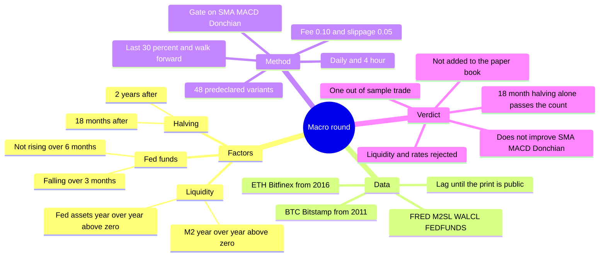

# Macro filters on BTC and ETH

Research only. The paper book, the dashboard, and the GitHub Action schedule were not changed.

Forty-eight pre-declared variants: six gates times eight slots (the gate alone on the daily and 4-hour clocks, plus the 200-day SMA, the 200-bar 4-hour SMA, MACD 12/26/9, and Donchian 20/10, each on both clocks). Fee 0.10% and slippage 0.05% per fill. A variant is kept only when it beats buy-and-hold on the last 30% and on a fixed-parameter walk-forward for both coins.

Two variants pass that count: hold only during the first 18 months after a halving, on the daily clock and on the 4-hour clock, with no technical rule underneath. Each out-of-sample result is a single trade. Walk-forward is four BTC trades and two ETH trades. The same gate on top of the 200-day SMA, MACD, or Donchian does not pass. M2 growth, Fed balance-sheet growth, and both Fed-funds regimes do not pass.

The daily 200-day SMA with no macro gate still beats buy-and-hold on this same sample (BTC out-of-sample +194.0% versus +58.4%, ETH +62.0% versus +8.6%). It was not replaced.

Prices: Bitstamp BTC 2011-08-18 to 2026-11-18, Bitfinex ETH 2016-03-09 to 2026-11-18, 4-hour bars through 2026-11-19 12:00 UTC. Macro: FRED M2SL, WALCL, and FEDFUNDS, usable only after a publication lag. Full tables and the Thai write-up are in [JOURNAL.md](../../JOURNAL.md). Numbers are in `results/macro_factors.csv`.

